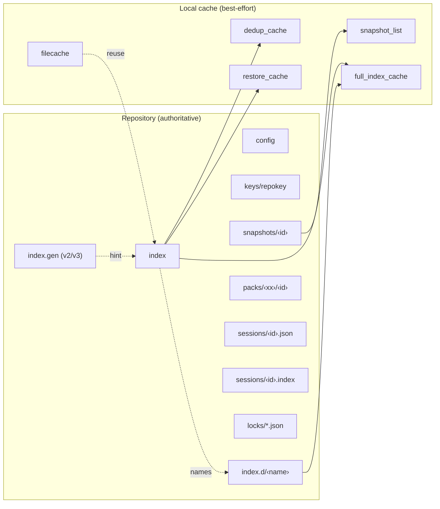
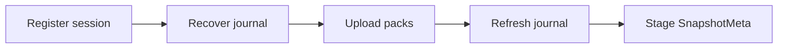
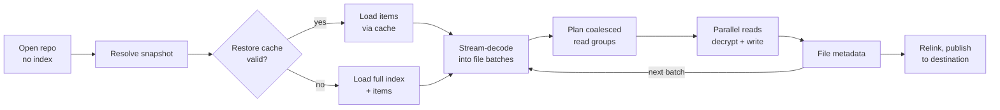
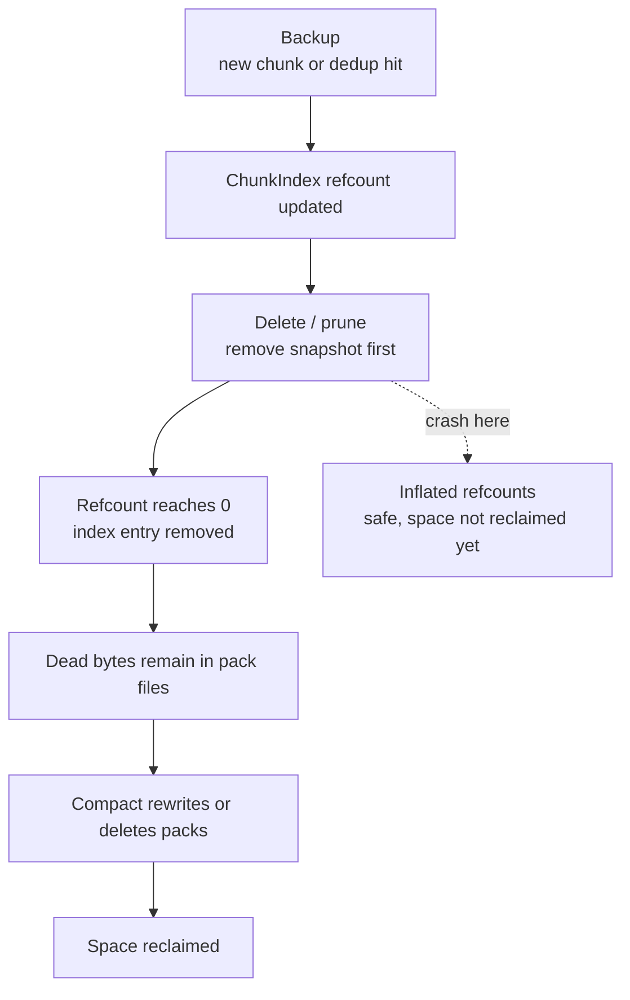
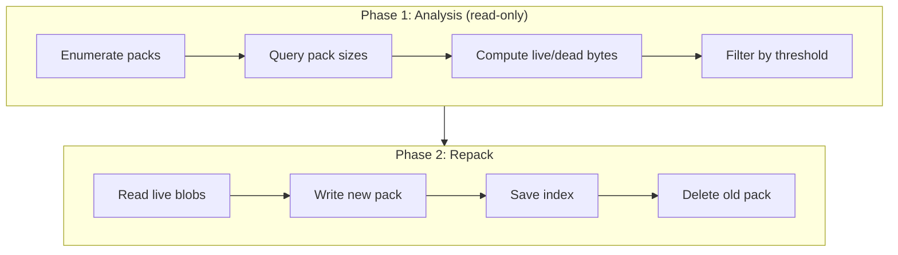
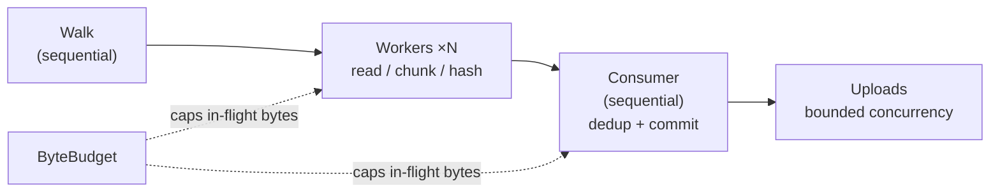

Technical reference for vykar's cryptographic, chunking, compression, concurrency, and repository-layout design decisions. The test strategy is described in [Testing](/testing).

---

## Cryptography

### Encryption

AEAD with 12-byte random nonces (`AES-256-GCM` or `ChaCha20-Poly1305`).

Rationale:
- Authenticated encryption with modern, audited constructions
- `auto` mode benchmarks `AES-256-GCM` vs `ChaCha20-Poly1305` at init and stores one concrete mode per repo
- Strong performance across mixed CPU capabilities (AES acceleration and non-AES acceleration)
- 32-byte symmetric keys (simpler key management than split-key schemes)
- AEAD AAD always includes the 1-byte type tag; for identity-bound objects it also includes a domain-separated object context (for example: `index`, snapshot ID, chunk ID, `filecache`, or `snapshot_cache`)

**Key usage model:** The master `encryption_key` is used directly as the AEAD symmetric key for all encryption operations throughout the lifetime of the repository. There is no per-session or per-snapshot key derivation. Cryptographic isolation between objects relies on random 12-byte nonces (unique per encryption call) and domain-separated AAD (binding ciphertext to object type and identity). With 96-bit random nonces, the birthday-bound collision threshold is approximately 2^48 encryptions under a single key — well beyond realistic backup workloads.

### Plaintext Mode (`none`)

When `encryption` is set to `none`, vykar uses a `PlaintextEngine` — an identity transform where `encrypt()` and `decrypt()` return data unchanged. AAD is ignored (there is no AEAD construction to bind it to). The format layer detects plaintext mode via `is_encrypting() == false` and uses the shorter wire format: `[1-byte type_tag][plaintext]` (1-byte overhead instead of 29 bytes).

This mode does **not** provide authentication or tamper protection — it is designed for trusted storage where confidentiality is unnecessary. Chunk data (file contents and item streams) is still protected against accidental corruption: its keyed chunk ID is recomputed and compared on every read (see [Hashing / Chunk IDs](#hashing--chunk-ids) below). The `index`, snapshot blobs and session journals carry no checksum in this mode.

### Key Derivation

The master key (64 bytes: 32-byte encryption key + 32-byte chunk ID key) is generated from OS entropy (`OsRng`) at repository init. It is never derived from the passphrase. Instead, the passphrase is used to derive a Key Encryption Key (KEK) via Argon2id, and the KEK wraps the master key with AES-256-GCM. The encrypted master key blob is stored at `keys/repokey` alongside the KDF parameters (algorithm, memory/time/parallelism costs, salt) and the wrapping nonce. Because the master key is random rather than derived, the passphrase and the key blob are **both** required and neither recovers the other — see [Key Redundancy](#key-redundancy).

Rationale:
- Two-layer scheme (random data key, passphrase-derived wrapping key) separates key strength from passphrase quality
- Argon2id is a modern memory-hard KDF recommended by OWASP and IETF
- Resists both GPU and ASIC brute-force attacks

In `none` mode no passphrase or key file is needed. The `chunk_id_key` is deterministically derived from `repo_id`, and *how* depends on the repository format:

| Format | Derivation |
|---|---|
| v2, v4 | `BLAKE2b-256(repo_id)` |
| v3, v5 | `blake3::derive_key("vykar 2026-01-01 plaintext repository chunk-id key v1", repo_id)` |

`derive_key` rather than a plain `blake3::hash` for domain separation: it is a distinct BLAKE3 mode with its own flag bits, so this key lives in a different domain from chunk digests (keyed mode) and pack digests (unkeyed mode).

Since `repo_id` is stored unencrypted in the repo `config`, this key is not secret in either format — it exists only so that the same keyed hashing path is used in all modes. No `keys/repokey` file is created.

This is the **one** auxiliary hash that follows the repository format, because it *is* the chunk-ID key: a v2 repository must reproduce it byte-identically or lose its entire dedup index.

### Key Redundancy

The wrapped key is stored **twice**: at `keys/repokey` and `keys/repokey.2`. Both hold the *same serialized bytes*, not two independent wraps — a second wrap would pick a fresh salt and nonce, and being able to compare the two copies byte-for-byte is the point. Repositories created before this existed carry one copy; opening them backfills the second, best-effort (a read-only mount or read-only credentials simply leave it alone).

The redundancy buys two things:

- **Recovery.** If one copy rots, vykar opens off the other. `vykar check` re-reads both copies on every run and reports them as their own line; `vykar check --repair` rewrites a damaged copy from the good one without the `type 'repair'` prompt, since restoring a key copy cannot lose data.
- **A better error message.** A GCM authentication failure genuinely cannot distinguish "wrong key" from "damaged ciphertext" — they are the same event — so something outside the blob has to corroborate it. Damage that is unambiguous on its own (truncation, mangled msgpack framing, out-of-range Argon2id parameters) is reported as corruption rather than blamed on the operator's typing, and needs no second copy. When the two copies are byte-identical and still fail to unwrap, the message says *likely* incorrect passphrase. Deliberately hedged: on a copy-on-write or deduplicating filesystem, or after `cp --reflink`, the two objects can share physical extents, so a single bad block would corrupt both identically.

When the copies **disagree**, no candidate is accepted without positive proof. vykar weighs each one against evidence outside the key blob. The local identity pin is decisive in both directions: a contradiction is a hard disproof, and a matching pin is accepted without consulting repository data at all. Only without a pin is repository-authored ciphertext tried, starting with the `index` object that `init` writes even for an empty repository. Exactly one candidate established means that one wins; nothing established, or both, means the open fails, naming the two conflicting copies. A pin that contradicts *both* candidates is reported as an identity mismatch with the usual `--trust-repo` remedy, not as an unresolvable repository.

That applies even when only one of the two divergent copies unwraps at all. "It was the only one that unwrapped" is not evidence: an attacker who can write to the repository can plant a copy wrapped under a passphrase of their choosing, and accepting it would let `check --repair` rewrite the genuine copy from it — which cannot be undone. Absence of evidence is only tolerable where there is no rival candidate: a single copy, two identical ones, or two independent wraps of the same key.

Every degraded state — a missing copy, a copy that disagrees, a backfill that could not land — is logged as a warning at open, so an ordinary command surfaces it on stderr rather than only `vykar check`.

An **unreadable** copy is distinguished from a missing one. An I/O or permission failure on one object must not defeat the redundancy the other exists to provide, so the open proceeds off the survivor — and the unreadable object is left strictly alone, never backfilled over, since it may well be intact.

Redundancy inside the repository covers bit rot, not loss of the storage. `vykar key export` and `vykar key import` (see [Commands](/commands)) move the passphrase-protected blob in and out of a password manager. Both work on raw storage rather than through `Repository::open`: `import` because it runs on a repository that can no longer be opened, `export` because a recovery tool for the key must not fail on an unreadable `index.gen` sidecar, scale with the snapshot count, or write anything. Export uses the same copy selection as `open`, so it can never hand out a copy `open` would have rejected. A key belongs to exactly one repository, so both commands require `-R` when several are configured.

### Hashing / Chunk IDs

A **keyed** 256-bit hash of the chunk plaintext, using a `chunk_id_key` derived from the master key. The algorithm is fixed by the repository format:

| Format | Chunk ID | Pack ID |
|---|---|---|
| v2, v4 | keyed BLAKE2b-256 | unkeyed BLAKE2b-256 |
| v3, v5 | keyed BLAKE3 | unkeyed BLAKE3 |

Chunk IDs are **always keyed**, in both algorithms. `index/hasher.rs` takes the first eight bytes of the digest as a hash-map bucket key, which is only safe because an attacker who controls chunk content cannot predict the digest; an unkeyed hash here would be a hash-flooding hole. Pack IDs are **always unkeyed**, in both algorithms: a pack ID is a storage key the server must be able to recompute from the bytes alone, without any repository key.

Why a keyed hash at all:

- Prevents content confirmation attacks (an adversary cannot check whether known plaintext exists in the backup without the key)
- Trade-off: keyed IDs prevent dedup across different encryption keys (acceptable for vykar's single-key-per-repo model)

Why not SHA-256:

- Both BLAKE2b and BLAKE3 are faster than SHA-256 in pure software. On CPUs with hardware SHA-256 acceleration (SHA-NI on x86, SHA extensions on ARM) hardware SHA-256 can beat BLAKE2b, but the BLAKE family gives consistent performance across all architectures without depending on hardware-specific instruction sets.

Why BLAKE3 for new repositories (formats v3 and v5):

- Hashing is a first-order CPU cost on two paths where dedup skips everything downstream. On a **file-cache miss with mostly-unchanged content** (VM images, databases, mail files) the file is fully re-read, chunked and hashed; chunks that dedup out skip compression, encryption and upload entirely, so per-byte cost there is read + chunk + hash. In `check --verify-data` under `encryption: none`, hashing dominates outright, and under `none` every chunk read (restore, list, diff, mount) is hashed too.
- Within a file (or a 64 MiB segment of a large file) hashing is single-threaded, so per-core hash throughput is the per-segment ceiling. BLAKE3's internal tree mode gives it a large per-core advantage even without multi-threading: measurements in [issue #177](https://github.com/borgbase/vykar/issues/177) show `blake3::keyed_hash` at ~2.15 GB/s against ~1.4 GB/s for keyed BLAKE2b-256 on Apple Silicon, with a wider gap on x86-64.
- BLAKE3 is used single-threaded (`hash` / `keyed_hash`); vykar never calls `update_rayon`, and parallelism comes from the existing per-file/per-segment workers instead.

In `none` mode the same keyed construction is used, but the key is derived from the public `repo_id` rather than a secret master key. The MAC therefore acts as a **checksum for corruption detection**, not as authentication against tampering. Because there is no AEAD tag, every chunk read in `none` mode (restore, list, diff, mount) recomputes the chunk ID and fails on a mismatch. `vykar check --verify-data` recomputes chunk IDs and compares them to detect bit-rot or storage corruption — this works identically across all encryption modes and both formats. The exception is a REST repository whose server supports pack verification: packs the server verifies (structure and pack hash, without any key) are skipped by the client, so their chunk IDs are not recomputed unless `--distrust-server` is added.

---

## Content Processing

### Chunking

FastCDC (content-defined chunking) via the `fastcdc` v3 crate.

Default parameters: 512 KiB min, 2 MiB average, 8 MiB max (configurable in YAML).
`chunker.max_size` is hard-capped at 16 MiB during config validation.

Rationale:
- Newer algorithm, benchmarks faster than Rabin fingerprinting
- Good deduplication ratio with configurable chunk boundaries

### Compression

Per-chunk compression with a 1-byte tag prefix. Supported algorithms: LZ4, ZSTD, and None. The tag identifies the codec only, not the compression level — the ZSTD level is a repo-wide configuration setting. Recompression at a different level requires decompressing and recompressing every chunk.

Rationale:
- Per-chunk tags allow mixing algorithms within a single repository
- LZ4 for speed-sensitive workloads, ZSTD for better compression ratios. LZ4 is recommended over None for most workloads — even on incompressible data the overhead is negligible, and the reduced I/O and transfer size typically more than compensate
- No repository-wide format version lock-in for compression choice
- ZSTD compression reuses a thread-local compressor context per level, reducing allocation churn in parallel backup paths
- Decompression enforces a hard output cap (32 MiB) to bound memory usage and mitigate decompression-bomb inputs

### Deduplication

Content-addressed deduplication uses keyed `ChunkId` values (keyed BLAKE2b-256 in format v2, keyed BLAKE3 in v3). Identical plaintext produces the same `ChunkId`, so the second copy is not stored; only refcounts are incremented. Because the algorithm is part of the chunk's identity, **dedup never spans chunk hashes** — which is also why the hash cannot be changed in place (the index layout can, see [Repository Versions](#repository-versions)).

vykar supports three index modes for dedup lookups:

1. **Full index mode** — in-memory `ChunkIndex` (`HashMap<ChunkId, ChunkIndexEntry>`)
2. **Dedup-only mode** — lightweight `DedupIndex` (`ChunkId -> stored_size`) plus `IndexDelta` for mutations
3. **Tiered dedup mode** — `TieredDedupIndex`:
   - session-local HashMap for new chunks in the current backup
   - Xor filter (`xorf::Xor8`) as probabilistic negative check
   - mmap-backed on-disk dedup cache for exact lookup

During backup, `enable_tiered_dedup_mode()` is used by default. If the mmap cache is missing/stale/corrupt, vykar safely falls back to dedup-only HashMap mode.

**Two-level dedup check** (in `Repository::bump_ref_if_exists`):
1. **Persistent dedup tier** — full index, dedup-only index, or tiered dedup index (depending on mode)
2. **Pending pack writers** — blobs buffered in data/tree `PackWriter`s that have not yet been flushed

This prevents duplicates both across backups and within a single backup run.

---

## Serialization

All persistent data structures use **msgpack** via `rmp_serde`. Structs serialize as **positional arrays** (not named-field maps) for compactness. This means field order matters — adding or removing fields requires careful versioning, and `#[serde(skip_serializing_if)]` must not be used on `Item` fields (it would break positional deserialization of existing data).

### RepoObj Envelope

Every repo object and local encrypted cache blob uses the same `RepoObj` envelope (`repo/format.rs`). The wire format depends on the encryption mode:

```text
Encrypted:  [1-byte type_tag][12-byte nonce][ciphertext + 16-byte AEAD tag]
Plaintext:  [1-byte type_tag][plaintext]
```

The type tag identifies the object kind via the `ObjectType` enum:

| Tag | ObjectType | Used for |
|-----|------------|----------|
| 0 | Config | Repository configuration (stored unencrypted) |
| 1 | Manifest | Legacy manifest object tag (unused in v2 repositories) |
| 2 | SnapshotMeta | Per-snapshot metadata |
| 3 | ChunkData | Compressed file/item-stream chunks |
| 4 | ChunkIndex | Encrypted `IndexBlob` stored at `index` |
| 5 | PackHeader | Reserved legacy tag (current pack files have no trailing header object) |
| 6 | FileCache | Local file-level cache (inode/mtime skip) |
| 7 | PendingIndex | Transient crash-recovery journal |
| 8 | SnapshotCache | Local snapshot-list cache |
| 9 | IndexHead | Segmented index head stored at `index` (v4/v5) |
| 10 | IndexBase | Segmented index base under `index.d/` |
| 11 | IndexSegment | Segmented index segment under `index.d/` |

The type tag byte is always included in AAD (authenticated additional data). For identity-bound objects, AAD also includes a domain-separated object context, binding ciphertext to both object type and identity (for example, `ChunkData` to its `ChunkId`, `SnapshotMeta` to snapshot ID, `ChunkIndex` and `IndexHead` to `b"index"`, `IndexBase` and `IndexSegment` to the static `b"index.d/base"` and `b"index.d/segment"`, `FileCache` to `b"filecache"`, and `SnapshotCache` to `b"snapshot_cache"`).

### Format Evolution

The **item stream** evolves by an *expand → contract* rule. The rule does not apply to the two frozen structures: `RepoConfig` stays at exactly seven fields (see [Repository Versions](#repository-versions)), and the `SnapshotMeta` envelope has been frozen since 0.17 (below) — new snapshot-level metadata goes into its `ext` blob instead.

- **Expand:** append a field with `#[serde(default)]`. New binaries still read old snapshots; older binaries cannot read the new ones (see below), so an expansion is still a one-way step for a shared repository. Already done for `Item.link_target`, `Item.xattrs`, `Item.raw_names`, `Item.hardlink`, and `SnapshotMeta.{comment, source_paths, label, ext, format_version}`. `Item.hardlink` ships under format **v1** (no bump), alongside the `format_version` envelope field itself — both landed together in **0.17.0**, so there is a single "0.17 introduces format v1" story rather than two versions in the wild. That release took the `SnapshotMeta` envelope from 12 fields to 14, which is why a pre-0.17 binary reports `array had incorrect length, expected 12` against a 0.17+ snapshot.
- **Contract (breaking, batched):** remove or retype a field — only when a larger forced break (crypto, chunking) already requires one; cleanups ride that train rather than justifying a break alone.

Compatibility is **backward-readable, not forward-compatible**: a new binary reads old snapshots, but older binaries are **not** guaranteed to read newer item streams (rmp-serde rejects a longer-than-expected positional array, so an old reader hits a length mismatch on the first extended record). `SnapshotMeta.format_version` (absent/`0` = legacy) is the discriminator; current writers stamp the latest (`CURRENT_FORMAT_VERSION`) and readers reject anything newer than they support. `check` treats a newer snapshot as **unsupported, never corrupt**, and `check --repair` refuses to run while one is present (rebuilding refcounts requires decoding every surviving snapshot).

Two distinct signals mean "newer writer", and both are classified as unsupported rather than corrupt:

1. **A decodable envelope with a higher `format_version`** — caught by `SnapshotMeta::supported()`.
2. **An envelope whose field count differs**, so `format_version` cannot be read at all. This is sound because of what precedes it: the AEAD decrypt has already succeeded, proving the bytes are intact and the key is right, and a *shorter* array still decodes via `#[serde(default)]` — so a length mismatch can only mean a *longer* array, i.e. a newer writer. Never corruption.

Case 2 is the one the `format_version` discriminator structurally cannot cover, and it must be classified separately: left as `CorruptSnapshot`, `check --repair` would emit `RemoveCorruptSnapshot` and **delete another host's snapshot**.

A snapshot this binary cannot read is **hidden, never damaged**. It is excluded from the manifest, but the exclusion is reported — `vykar list` prints `N snapshots hidden: written by a newer vykar` rather than silently returning a short list, and the warning is emitted once per process rather than once per repository open.

`SnapshotMeta`'s envelope (the fields up to `format_version`) is **frozen** — its field count never changes and existing fields are never removed or retyped, so `format_version` is always decodable and a future snapshot is recognized rather than mistaken for corruption. All breaking cleanups therefore live in the **item stream**, gated by `format_version`:

- **Paths → bytes.** `Item.path` / `Item.link_target` are UTF-8 `String`; non-UTF8 names are preserved out-of-band in the additive `Item.raw_names` byte field (`path` / `link_target` remain the lossy display strings, the raw bytes are authoritative at restore time on Unix). At the next item-stream version, collapse into one canonical byte field and drop the lossy String shadow.
- **Xattr names → bytes.** `Item.xattrs` keys are `String`; non-UTF8 xattr names are dropped with a warning today. Retype keys to bytes (niche — names are usually ASCII).

**Hard links** use a *content-on-every-node* representation (restic-style): a regular file with `nlink > 1` keeps its full chunk list and additionally records its source `(dev, ino)` in the optional `Item.hardlink` field. Restore regroups members by `(dev, ino)`, materializes the first member of each group from its chunks (the representative), and relinks the rest to it; a member is linked only when its **content** matches the representative — identity is a BLAKE2b-256 fingerprint over the ordered chunk-id list, which is authoritative because chunk ids are content-addressed. A mismatch (inode-number reuse handing the same `(dev, ino)` to different content) declines to link and materializes that member from its own chunks instead, so a member's own bytes are never silently replaced by the representative's. The relink stays inside the restore temp root (one filesystem, so links survive the final inode-preserving rename) and validates the link target's parent against the root unconditionally; a planted symlinked parent that escapes the root, or any failure to place a link's content (after a copy fallback), is fatal — restore never reports success with a requested path missing. Two properties fall out of this design: per-item chunk refcounts stay **symmetric** automatically (`+N` on backup, `-N` on delete) with no special-casing in `commit.rs`/`snapshot_ops.rs`, and restore is robust to partial views — *we never assume we see all N links*, so a single in-set member (filtered group, link outside the source) is just a normal file. The accepted cost is redundant chunk-lists in the item stream for extreme fan-out, which dedup makes free in storage.

Future snapshot-level metadata goes inside the reserved opaque `ext` blob (parsed per `format_version`) rather than as new outer fields, so the frozen envelope and its discriminator stay intact without a tolerant-envelope rework.

#### Repository Versions

`RepoConfig.version` is the *repository layout* version, distinct from `SnapshotMeta.format_version` above. It answers "what must a reader understand to read this repository?" — the chunk/pack hash and the index layout:

| `version` | Chunk ID | Pack ID | Index | Written by |
|---|---|---|---|---|
| 2 | keyed BLAKE2b-256 | unkeyed BLAKE2b-256 | monolithic | `init` up to 0.19 |
| 3 | keyed BLAKE3 | unkeyed BLAKE3 | monolithic | `init` 0.20 to 0.24 |
| 4 | keyed BLAKE2b-256 | unkeyed BLAKE2b-256 | segmented | `vykar upgrade` of a v2 repository |
| 5 | keyed BLAKE3 | unkeyed BLAKE3 | segmented | `init` 0.25 and later, `vykar upgrade` of v3 |

`RepoFormat::from_version` is the single gate; `chunk_hash()` and `index_layout()` derive both properties from it. The **hash never changes** for a repository: it is the dedup identity of every chunk and part of every pack's storage key, so a v2 repository stays BLAKE2b for life and remains fully readable *and writable*. The **index layout can change**, once and one way: `vykar upgrade` moves v2 to v4 and v3 to v5 in place (see [In-Place Upgrade](#in-place-upgrade)). It is never automatic, because it locks out older binaries on every other machine. `vykar info` reports the format, the hash, and for a segmented index the base and segment sizes.

There is deliberately **no user-facing choice** at `init`: no `--hash` flag, no YAML key. `init` always creates the current format (v5). Two accepted consequences: older binaries cannot open a repository created by a newer release (`unsupported repository version: 5`), so a fleet sharing a new repository must upgrade together; and a self-hosted `vykar-server` must be upgraded before a new repository can be created against it (a pre-flight `/health` probe at `init` checks both BLAKE3 support and the `segmented_index` capability, so that fails cleanly rather than at the first backup).

**Why there is no stored `hash` field.** `RepoConfig` is serialized as a *positional* msgpack array, and appending a field is not backward-safe in the way `#[serde(default)]` suggests: `#[serde(default)]` rescues *shorter* arrays, but rmp-serde **errors on longer ones** (`array had incorrect length, expected N`) — the same failure mode described for `SnapshotMeta` above. An old binary reading an 8-field config would therefore fail *before* reaching the version gate, turning a clear `unsupported repository version: 3` into a parse error that looks like corruption. So `RepoConfig` stays at exactly seven fields, and the version implies the algorithm. A unit test asserts the msgpack array length so this cannot be undone by accident. The segmented index followed the same rule: it is a version bump (4/5), not a field.

**Auxiliary hashes.** Only chunk IDs and pack IDs follow the format. Every other digest vykar computes is BLAKE3 for every version (BLAKE2b up to 0.23):

| Digest | Persisted in | Effect of the switch from BLAKE2b |
|---|---|---|
| TOFU identity fingerprint (`derive_key` over `repo_id ‖ chunk_id_key`) | `pin3.<BLAKE3(url)>` | Old `pin.*` files are ignored: the first open per client per repository re-pins without verification |
| Check-state file name | `check3.<BLAKE3(url)>` | Old state orphaned; the next `check` is a full one |
| `PathHash` in the file cache (first 16 bytes of BLAKE3) | `filecache` | Old caches rejected; the next backup re-reads every file once |
| Full-index cache checksum trailer | `full_index_cache` | Rebuilt once |
| Index blob digest (conditional-GET validator) | `index_blob` | Rebuilt once |
| Segmented index object names and state hashes | `index.d/`, head | none (BLAKE3 from the start) |
| Hard-link `chunks_fingerprint` | runtime only | none |

Non-pack REST uploads carry `X-Content-BLAKE3` when the server advertises `blake3` (or the repository is v3, whose packs already require it), and `X-Content-BLAKE2b` only for a pre-0.20 server. BLAKE2b remains for the v2 chunk/pack format and that fallback.

The single exception is the plaintext-mode `chunk_id_key` derivation, which *is* the chunk-ID key and therefore must follow the format — see [Key Derivation](#key-derivation).

---

## Repository Format

### On-Disk Layout

`RepoConfig.version = 5` is what `vykar init` writes; versions 2 to 4 remain fully readable and writable. See [Repository Versions](#repository-versions).

```text
<repo>/
|- config                    # Repository metadata (unencrypted msgpack)
|- keys/repokey              # Encrypted master key (Argon2id-wrapped; absent in `none` mode)
|- keys/repokey.2            # Byte-identical redundant copy (see Key Redundancy)
|- index                     # v4/v5: encrypted IndexHead (small); v2/v3: encrypted IndexBlob { generation, chunks }
|- index.d/<64 hex>          # v4/v5: write-once index base and segments, named by the BLAKE3 of their bytes
|- index.gen                 # v2/v3 only: unencrypted advisory u64 generation hint
|- snapshots/<id>            # Encrypted snapshot metadata; source of truth for snapshot listing
|- sessions/<id>.json        # Session presence markers (concurrent backups)
|- sessions/<id>.index       # Per-session crash-recovery journals (absent after clean backup)
|- packs/<xx>/<pack-id>      # Pack files containing compressed+encrypted chunks (256 shard dirs)
`- locks/                    # Advisory lock files
```

### Local Optimization Caches (Client Machine)

These files live under a per-repo local cache root. By default this is the platform cache directory + `vykar` (for example, `~/.cache/vykar/<repo_id_hex>/...` on Linux, `~/Library/Caches/vykar/<repo_id_hex>/...` on macOS). If `cache_dir` is set in config, that path becomes the cache root. These are optimization artifacts, not repository source of truth.

```text
<cache>/<repo_id_hex>/
|- filecache                 # File metadata -> cached ChunkRefs
|- snapshot_list             # Snapshot ID -> SnapshotEntry cache
|- dedup_cache               # Sorted ChunkId -> stored_size (mmap + xor filter)
|- restore_cache             # Sorted ChunkId -> pack_id, pack_offset, stored_size (mmap)
|- full_index_cache          # Sorted full index rows for local rehydration/cache rebuilds
`- index_blob                # Raw index blob as last written by this machine, with its BLAKE3
                             #   (validator for the conditional GET and the commit fast path)
```

The index caches are validated against the current index generation. In v4/v5 the generation is derived from the head's `state_hash` (its first eight bytes, 0 mapped to 1), and `full_index_cache` is matched by its whole 32-byte trailer, which is that state hash; `index_blob` is not written. The rest of this section describes v2/v3.

In v2/v3, the authenticated source of truth is `IndexBlob.generation` inside `index`; `index.gen` is only an advisory hint used to avoid unnecessary remote index downloads on read paths. A stale or missing sidecar causes cache misses or full-index fallback, not correctness issues.

On a REST repository, opening with the index and the backup commit ask the server whether `index` still matches `index_blob` (`If-None-Match`). On a `304` the client uses its local copy, verified against the recorded digest, instead of downloading the index.

When the index is provably the blob this machine last wrote (a `304`, or downloaded bytes on any backend that hash to the digest recorded in `index_blob`) and `full_index_cache` is checksum-valid at that blob's generation, the in-memory index is built from `full_index_cache` instead of decrypting and decoding the blob. The backup fast path already trusts the full cache on the same evidence. In every other case the blob is decoded as before.

The `snapshot_list` cache is separate: on open/refresh, the client lists `snapshots/`, removes stale local entries, loads only new snapshot blobs, and persists the resulting snapshot list locally. This avoids O(n) snapshot metadata GETs on every open.

The same per-repo cache root is also used as the preferred temp location for intermediate files (e.g. cache rebuilds).

#### Repository And Cache Topology



### Key Data Structures

**IndexBlob** — v2/v3: the encrypted object stored at the `index` key. It combines the current cache-validity token with the chunk index. v4/v5 store the same `ChunkIndex` as a [segmented index](#segmented-index-v4v5).

| Field | Type | Description |
|-------|------|-------------|
| generation | u64 | Authenticated cache-validity token rotated when the index changes |
| chunks | ChunkIndex | Full chunk-to-pack mapping |

**ChunkIndex** — `HashMap<ChunkId, ChunkIndexEntry>`, persisted inside `IndexBlob` (v2/v3) or as a base plus segments (v4/v5). The central lookup table for deduplication, restore, and compaction.

| Field | Type | Description |
|-------|------|-------------|
| refcount | u32 | Number of references to this chunk across all snapshots. Every occurrence counts, including repeats within one snapshot |
| stored_size | u32 | Size in bytes as stored (compressed + encrypted) |
| pack_id | PackId | Which pack file contains this chunk |
| pack_offset | u64 | Byte offset within the pack file |

**Manifest** — runtime-only in-memory snapshot list derived from `snapshots/` and the local `snapshot_list` cache. It is not persisted to repository storage.

| Field | Type | Description |
|-------|------|-------------|
| version | u32 | Format version (currently 1) |
| timestamp | DateTime | Last modification time |
| snapshots | Vec\<SnapshotEntry\> | One entry per snapshot |

**SnapshotListCache** — local encrypted map from snapshot ID hex to `SnapshotEntry`. It is refreshed incrementally from `snapshots/` and exists only to avoid repeatedly downloading every snapshot blob on open.

Each `SnapshotEntry` contains: `name`, `id` (32-byte random), `time`, `source_label`, `label`, `source_paths`, `hostname`.

**SnapshotMeta** — per-snapshot metadata stored at `snapshots/<id>`.

| Field | Type | Description |
|-------|------|-------------|
| name | String | User-provided snapshot name |
| hostname | String | Machine that created the backup |
| username | String | User that ran the backup |
| time / time_end | DateTime | Backup start and end timestamps |
| chunker_params | ChunkerConfig | CDC parameters used for this snapshot |
| comment | String | Optional snapshot comment field; currently written as `""` by backup flows |
| item_ptrs | Vec\<ChunkId\> | Chunk IDs containing the serialized item stream |
| stats | SnapshotStats | File count, original/compressed/deduplicated sizes |
| source_label | String | Config label for the source |
| source_paths | Vec\<String\> | Directories that were backed up |
| label | String | Legacy compatibility field; new snapshots currently write `""` |
| ext | Option\<Vec\<u8\>\> | Reserved opaque extension blob for future snapshot-level metadata; currently always `None` |
| format_version | u32 | Format discriminator (frozen last field; absent/`0` = legacy, current writers stamp `CURRENT_FORMAT_VERSION`) |

**SnapshotStats** — per-snapshot counters stored inside `SnapshotMeta.stats`.

| Field | Type | Description |
|-------|------|-------------|
| nfiles | u64 | Number of backed-up regular files plus command-dump virtual files |
| original_size | u64 | Total plaintext bytes before compression/dedup |
| compressed_size | u64 | Total bytes after compression |
| deduplicated_size | u64 | Bytes newly stored after deduplication |
| errors | u64 | Number of soft file-read errors skipped during backup |

`deduplicated_size` records the bytes newly stored at the time the snapshot was created. It depends on the global repository state at that moment and becomes stale if other snapshots are later deleted — a snapshot that originally shared all its chunks (showing `deduplicated_size ≈ 0`) may become the sole owner of those chunks after the other snapshot is removed. Treat this field as a creation-time accounting metric, not a durable measure of a snapshot's unique storage footprint.

**Item** — a single filesystem entry within a snapshot's item stream.

| Field | Type | Description |
|-------|------|-------------|
| path | String | Relative path within the backup |
| entry_type | ItemType | `RegularFile`, `Directory`, or `Symlink` |
| mode | u32 | Unix permission bits |
| uid / gid | u32 | Owner and group IDs |
| user / group | Option\<String\> | Owner and group names |
| mtime | i64 | Modification time (nanoseconds since epoch) |
| atime / ctime | Option\<i64\> | Access and change times |
| size | u64 | Original file size |
| chunks | Vec\<ChunkRef\> | Content chunks (regular files only) |
| link_target | Option\<String\> | Symlink target |
| xattrs | Option\<HashMap\> | Extended attributes |
| raw_names | Option\<ItemRawNames\> | Byte-faithful `path` / `link_target` for non-UTF8 names (Unix); `None` for the common UTF-8 case |

**ChunkRef** — reference to a stored chunk, used in `Item.chunks`:

| Field | Type | Description |
|-------|------|-------------|
| id | ChunkId | Content-addressed chunk identifier |
| size | u32 | Uncompressed (original) size |
| csize | u32 | Stored size (compressed + encrypted) |

The uncompressed `size` is stored per-reference so the restore path can size its output buffers up front, pass it as a size hint to the ZSTD one-shot decompressor, and then validate the decoded length against it. The chunk index holds only the stored size; readers without this field (e.g. `check --verify-data`) use the same decompressor and take the size from the ZSTD frame header instead, so both paths accept and reject the same frames.

### Segmented Index (v4/v5)

A monolithic index (v2/v3) is rewritten whole on every change: on a repository with millions of chunks that is hundreds of megabytes per backup, prune and compact. v4/v5 store the same `ChunkIndex` as a base plus a chain of segments, so a write uploads what it changed (`repo/index_store.rs`, `repo/index_write.rs`, `index/{head,base,segment}.rs`).

```text
index                # mutable, small: IndexHead
index.d/<64 hex>     # write-once: base or segment, name = BLAKE3 of the stored bytes
```

- **State identity.** An index state is identified by `state_hash`, BLAKE3 over its canonical sorted 80-byte records — the checksum trailer of `full_index_cache`. A local cache is therefore matched to a state by content, and identical content keeps caches valid across a fold.
- **Head** (`IndexHead`, positional msgpack, frozen; `layout` = 1): `state_hash`, `entries`, `base: Option<{name, size, state_hash, entries}>` (`None` = the empty index, which `init` writes), `segments: [{name, size, state_hash_after, entries_after}]` in order, and `retired`: the objects of the last head before the most recent fold.
- **Base**: a pack-ID table, then the sorted records referencing packs by table index; zstd; AEAD.
- **Segment**: the change from its predecessor state, by *position* in the predecessor's sorted order — refcount deltas (position gaps and zigzag deltas as separate columns; a result of 0 removes the entry, a result outside `u32` is a decode error), relocations (position, pack, offset, size) for compact, and new entries as full sorted records. Nearly every backup bumps the refcount of most chunks; by position a bump costs a fraction of a bit, by chunk ID 33 bytes. All counts are bounded against the input length before allocating.
- **Every read of `index.d/<name>` checks `BLAKE3(bytes) == name` and the recorded size first.** The AEAD contexts are static because the name is the hash of the ciphertext; the binding to the head is this check. On a plaintext repository it is the only corruption check before decompression.

**Write** (any writer, under the repository lock): GET the head; bring the local full cache to it; produce the next state and its segment in one sorted pass; PUT the segment, check the lock fence, PUT the head. The backup commit's reconcile is a merge-walk over the caught-up cache, the session's positional bumps, its keyed bumps and its new entries: a new entry already present becomes a bump, a bump on a chunk in neither is `StaleChunksDuringCommit`. Maintenance writes (prune, delete, compact, repair) diff the in-memory index against the local full cache at the loaded head, caught up through the chain when it holds an earlier state; with no local cache in the head's chain, or when the catch-up fails, they write a base. A write refuses when the head changed after the index was loaded.

**Read**: open lists snapshots first, then GETs the head once (a writer PUTs the head before its snapshot, so this head covers every listed snapshot). A local full cache at the head's state needs nothing; one at a state in the chain gets the missing segments applied in one streaming pass; otherwise the segments are downloaded (in parallel), then the base, and applied. Readers take no lock. A 404 on a named object makes the reader re-read the head: if the new head still names the object it is lost, and the read fails naming it (`vykar check --repair`); otherwise a fold moved the head and the reader retries on it (bounded retries). Without a cache directory the full cache lives in a temp file kept on the `Repository`, so the base is downloaded once per run.

**Fold** (writing a base instead of a segment), under the lock: delete every `index.d/` object the current head names neither as live nor as retired, and the retired ones; PUT the base (none for the empty index, which is `base: None` as `init` writes it); PUT the head with no segments and the previous live set as `retired`. A fold without a valid previous head (`check --repair`, `upgrade`) deletes the unreferenced objects only after the head PUT, since until then they may be the only copy of the index. A reader on the previous head finishes; one on the head before it gets a 404 and re-reads. Peak storage is two bases. Every writer folds at the hard limit (64 segments, or segments ≥ 20 % of the base and ≥ 4 MiB); compact folds at the soft limit (16, or 5 % and ≥ 1 MiB) and otherwise deletes unreferenced `index.d/` objects (debris of interrupted writes) — in one batch request where the backend has one (vykar-server), else one by one. No local cache in the head's chain, or a plaintext segment whose name the head already holds, also folds.

**Order against pack deletes**: no pack is deleted while the head on storage names a state that references it. Client-side compact saves once per batch of source packs (64 packs or 4 GiB), then deletes that batch's sources, empty packs included.

**Damage**: a `ChunkIndex` blob at `index` (an older binary overwrote the head) or a chain with missing or damaged objects is refused by every command except `check --repair`, which rebuilds from the blob, from this machine's cache of the latest state, or from the readable part of the chain, and writes a fresh base. Only an absent object or one that fails verification or decoding is salvaged around; a storage error aborts the repair unless this machine's cache holds the latest state. A chain read only in part loses the entries of the unreadable objects: snapshots that need them are removed by the plan (which says how much of the chain was read), and an interactive repair refuses to apply a plan rebuilt under the lock that has data loss where the shown plan had none, or that read the index differently. A head that cannot be read is rebuilt from this machine's full index cache when there is one, whatever state it holds (the plan says it may be older than the latest), else from the objects in `index.d/`: each segment records the state it follows, so the chains from every base and from the empty index are followed. A single end state is used; it cannot be confirmed to be the latest: a segment of a failed write that follows the latest state is applied too, and when a fold returned to a state inside the retired chain, the walk follows the retired segments past it. Two segments following one state, a cycle, or several end states are refused, with the objects listed. After a fold that changed the state, the previous generation is a second end state until a fold that leaves the state unchanged (the one at the end of `compact`; a fold on a write path changes the state and leaves a new second end), so only a machine with a current local cache can repair an unreadable head then. A head of an unknown layout, or an `index` of an unknown type, is refused.

### In-Place Upgrade

`vykar upgrade` (`repo/upgrade.rs`) moves v2 to v4 and v3 to v5 under the maintenance lock, on a repository opened without its index:

1. Probe the server's `segmented_index` capability, and PUT the stored `config` bytes back unchanged. A server that refuses overwrites (append-only) fails here, with the repository untouched.
2. Load the legacy index (from the local full cache when the stored blob is the one this machine last wrote) and write it as a base (none for an empty index). Anything an earlier attempt left in `index.d/` is deleted after step 3, or by the next compact if the upgrade is interrupted there.
3. Overwrite `index` with the head. From here every older binary fails on its next index read (`UnknownObjectType`), rather than reading an empty index — compact deletes packs with no index entries, so an empty index would be dangerous, not just wrong.
4. Rewrite `config` with the new version; delete `index.gen` and the local `index_blob`. The local full cache is installed at the new state and the dedup and restore caches are rebuilt.

A v2/v3 `config` with a head at `index` is an upgrade interrupted after step 3: monolithic index reads fail and name `vykar upgrade`, which verifies the head and every object of its chain and completes step 4. `prove_key` accepts either object at `index`, so key-copy disagreement can be resolved in every state. Remaining hole: a pre-0.25 prune or delete that loaded the index before the upgrade and gets the lock after it can overwrite the head with a legacy blob; that is the damage case above, repaired by `check --repair`. Stop all other clients before upgrading. With a damaged chain or head, `vykar upgrade` names `check --repair`, which repairs the segmented index the upgrade wrote (leaving `config` at v2/v3); `vykar upgrade` then completes.

### Pack Files

Chunks are grouped into **pack files** (~32 MiB) instead of being stored as individual files. This reduces file count by 1000x+, critical for cloud storage costs (fewer PUT/GET ops) and filesystem performance (fewer inodes).

#### Pack File Format

```text
[8B magic "VGERPACK"][1B version=1]
[4B blob_0_len LE][blob_0_data]
[4B blob_1_len LE][blob_1_data]
...
[4B blob_N_len LE][blob_N_data]
```

- **Per-blob length prefix** (4 bytes): enables forward scanning of all blobs from byte 9 to EOF
- Each blob is a complete RepoObj envelope: `[1B type_tag][12B nonce][ciphertext+16B AEAD tag]`
- Each blob is independently encrypted (can read one chunk without decrypting the whole pack)
- No trailing per-pack header object — the chunk index already records which blobs reside in which pack at which offset, making a per-pack blob manifest redundant. Pack analysis for compaction enumerates blobs by forward-scanning length prefixes. Trade-off: if the index is lost, rebuilding requires a full sequential scan of all pack data (reading every byte); a trailing header would allow reading just the last N bytes per pack. In practice index loss is rare (single encrypted blob, written atomically) and `check --verify-data` already performs a full pack scan
- Pack ID = unkeyed hash of the entire pack contents (BLAKE2b-256 in format v2, BLAKE3 in v3), stored at `packs/<shard>/<hex_pack_id>`

#### Data Packs vs Tree Packs

Two separate `PackWriter` instances:
- **Data packs** — file content chunks. Dynamic target size. Assembled in heap `Vec<u8>` buffers.
- **Tree packs** — item-stream metadata. Fixed at `min(min_pack_size, 4 MiB)` and assembled in heap `Vec<u8>` buffers.

#### Dynamic Pack Sizing

Pack sizes grow with repository size. Config exposes floor and ceiling:

```yaml
repositories:
  - url: /backups/repo
    min_pack_size: 33554432     # 32 MiB (floor, default)
    max_pack_size: 201326592    # 192 MiB (default)
```

Data pack sizing formula:
```text
target = clamp(min_pack_size * sqrt(num_data_packs / 50), min_pack_size, max_pack_size)
```

`max_pack_size` has a hard ceiling of **512 MiB**. Values above that are rejected at repository init/open.

| Data packs in repo | Target pack size |
|--------------------|------------------|
| < 50               | 32 MiB (floor)   |
| 200                | 64 MiB           |
| 800                | 128 MiB          |
| 1,800+             | 192 MiB (default cap) |

If you raise `max_pack_size`, target size can grow further, up to the 512 MiB hard ceiling.

`num_data_packs` is computed at `open()` by counting distinct `pack_id` values in the ChunkIndex (zero extra I/O). During a backup session, the target is recalculated after each data-pack flush, so the first large backup benefits from scaling immediately.

---

## Data Flow

### Backup Pipeline

The backup runs in two phases so multiple clients can upload concurrently (see [Concurrent Multi-Client Backups](#concurrent-multi-client-backups)).

#### Phase 1: Upload (no exclusive lock)



```text
generate session_id (128-bit random hex)
register_session() → write sessions/<session_id>.json, probe for active lock
open repo (full index loaded once)
begin_write_session(session_id) → journal key = sessions/<session_id>.index
  → prune stale local file-cache entries
  → recover own sessions/<session_id>.index if present (batch-verify packs, promote into dedup structures)
  → enable tiered dedup mode (mmap cache + xor filter, fallback to dedup HashMap)
  → derive upload/pipeline limits from `limits.connections` + `limits.threads`
  → execute `command_dumps` first:
    → stream each command's stdout directly into chunk storage
    → add virtual items under `vykar-dumps/` to the item stream
    → abort backup on non-zero exit or timeout
  → walk sources with excludes + one_file_system + exclude_if_present
    → cache-hit path: reuse cached ChunkRefs and bump refs
    → cache-miss path:
      → pipeline path (if effective worker threads > 1):
        → walk emits regular files and segmented large files
          (segmentation applies when file_size > 64 MiB;
           segment size is min(64 MiB, pipeline_buffer_bytes))
        → worker threads read/chunk/hash and classify each chunk:
          - xor prefilter says "maybe present" → hash-only chunk
          - xor prefilter miss (or no filter) → compress + encrypt prepacked chunk
        → sequential consumer validates segment order, performs dedup checks
          (persistent dedup tier + pending pack writers), commits new chunks,
          and handles xor false positives via inline transform
        → ByteBudget enforces pipeline_buffer_bytes as a hard in-flight memory cap
          (64 MiB × effective threads, clamped to 64 MiB..1 GiB)
      → sequential fallback path (effective worker threads == 1)
  → serialize items incrementally into item-stream chunks (tree packs)
  → throughout: packs are sealed and uploaded in the background when a writer
    reaches its target size, 10,000 blobs, or 300s age
  → final flush (unconditional): seal partial pack writers, join all in-flight
    uploads, write sessions/<id>.index
  → pack SnapshotMeta in memory (do not write snapshots/<id> yet)
```

#### Phase 2: Commit (exclusive lock, brief)


```text
acquire_lock_with_deadline(COMMIT_LOCK_MAX_WAIT = 10 min, 500ms base, exponential backoff + jitter,
                           interruptible by Ctrl-C)
commit_concurrent_session_with_progress():
  → flush packs (no-op safety net: Phase 1 already drained uploads)
  → refresh snapshot list from snapshots/ (via local snapshot cache diff)
  → check snapshot name uniqueness against fresh list
  → v4/v5 (segmented index):
      → GET head, bring the local full cache to it
      → merge-walk cache + positional bumps + keyed bumps + new entries:
        new entries already present → bumps; bump targets in neither → Err(StaleChunksDuringCommit)
      → verify packs alongside
      → PUT index.d/<segment> (or a base at the fold limit), fence check, PUT index (head)
  → v2/v3 (monolithic index), if delta is non-empty:
      → reload full index from storage
      → delta.reconcile(fresh_index): new_entries already present → refcount bumps;
        missing bump targets → Err(StaleChunksDuringCommit)
      → verify_delta_packs on reconciled delta
      → apply reconciled delta to fresh index
      → persist IndexBlob + advisory index.gen
  → v2/v3, if delta is empty but local dedup caches need rebuilding:
      → reload full index from storage for cache rebuild
  → write snapshots/<id> (commit point)
  → rebuild local dedup/restore/full-index caches as needed
  → update in-memory manifest
  → persist local file cache
deregister_session() → delete sessions/<session_id>.json (while holding lock)
release_lock()
clear sessions/<session_id>.index
```

#### Error Paths

```text
  → on VykarError::Interrupted (Ctrl-C):
    → flush_on_abort(): seal partial packs, join upload threads, write final sessions/<id>.index
    → deregister_session(), release advisory lock, exit code 130
  → on soft file error (PermissionDenied / NotFound before commit):
    → skip file, increment snapshot.stats.errors, continue
    → exit code 3 (partial success) if any files were skipped
```

Snapshot refresh uses two modes:
- `open()` uses resilient refresh: listed-but-missing snapshots and GET failures are warned and skipped
- commit-time refresh uses strict I/O: listed-but-missing snapshots and GET failures abort the commit so a transient error cannot hide an existing snapshot name

Decrypt and deserialize failures are warned and skipped in both modes. Snapshot names are only available after successful decrypt + deserialize, so the implementation chooses availability over letting one garbage blob brick all future opens or commits in append-only mode.

### Restore Pipeline



```text
open repository without index (`open_without_index`)
  → resolve snapshot
  → try mmap restore cache (validated by index_generation)
  → load item stream:
    → preferred: lookup tree-pack chunk locations via restore cache
    → fallback: load full index and read item stream normally
  → create a hidden staging directory inside the destination (`.vykar-restore-<hex>`)
  → stream-decode items once:
    → directories and symlinks are created in staging as they are decoded
    → regular files accumulate into bounded batches (100,000 files)
  → for each batch:
    → build coalesced pack read groups via the full index
    → create the batch's files exclusively
    → parallel coalesced range reads by pack/offset
      (merge when gap <= 256 KiB and merged range <= 16 MiB)
      → `limits.connections` reader workers fetch groups, decrypt + decompress-with-size-hint chunks
      → validate plaintext size and write to all targets (max 16 open files per worker)
    → apply file metadata (mode, mtime, optional xattrs), then drop the batch
  → apply symlink metadata and relink hard-link groups, still in staging
  → rename the staged tree into the destination
  → apply directory metadata, deepest first
```

Everything is written inside the staging directory, so a failed restore leaves the destination empty. Batching bounds plan memory by batch size rather than by snapshot size; the cost is that a chunk shared by files in different batches is downloaded once per batch.

### Item Stream

Snapshot metadata (the list of files, directories, and symlinks) is **not** stored as a single monolithic blob. Instead:

1. Items are serialized one-by-one as msgpack and appended to an in-memory buffer
2. After each entry, the buffer is stored as a **tree pack** chunk if it holds at least 8 KiB and a keyed BLAKE3 hash of the entry's path falls under a threshold proportional to the entry's encoded size (about 32 KiB per chunk on average), or once it reaches 128 KiB. Chunks always hold whole entries
3. The resulting `ChunkId` values are collected into `item_ptrs` in the `SnapshotMeta`

Because the entry, not its offset, decides where a chunk ends, an inserted or removed entry changes only the chunk(s) around it, and the unchanged parts of the listing deduplicate across snapshots. `check --repair` rewrites listings with the same rule.

Command dumps participate in this same item stream. A source with `command_dumps` produces a synthetic `vykar-dumps/` directory entry plus one regular-file `Item` per dump, so restores treat dump output like ordinary files.

Restore now also consumes item streams incrementally (streaming deserialization) instead of materializing full `Vec<Item>` state up front.
When the mmap restore cache is valid, item-stream chunk lookups can avoid loading the full chunk index. File-data read-group planning still uses the full index after planning, avoiding unrecoverable stale-location failures.

Commands that load a whole item stream (delete, prune, check, list, diff, find, mount, and backup's parent-snapshot load) fetch its coalesced range reads in parallel at the backend's request width, derived from `limits.connections` (remote: `min(connections*3, 24)`, local: `min(connections, 8)`), and reassemble them in stream order; restore reads the stream lazily, one window at a time.

---

## Operations

### Locking

vykar uses a two-tier locking model to allow concurrent backup uploads while serializing commits and maintenance.

#### Session Markers (shared, non-exclusive)

During the upload phase of a backup, a lightweight JSON marker is written to `sessions/<session_id>.json`. Multiple backup clients can coexist in this tier simultaneously — session markers do not block each other.

Each marker contains: hostname, PID, `registered_at`, and `last_refresh`. On registration, the client writes its marker, then checks for an active advisory lock by listing `locks/` (3 retries, 2 s base delay, exponential backoff + 25 % jitter). The probe is read-only and writes no lock key. If the lock is held (maintenance in progress), the session marker is deleted and the backup aborts with `Locked`. This is safe against maintenance without taking the lock: the session writes its marker before listing locks, maintenance writes its lock before listing sessions, so at least one sees the other.

Each client owns a dedicated heartbeat thread (`SessionGuard` with a 15-minute timer) that refreshes the marker independently of the upload pipeline — so a host that happens to have very long-running uploads still keeps its marker fresh. Markers whose `last_refresh` is strictly older than 45 minutes (three missed heartbeats) are treated as stale.

#### Advisory Lock (exclusive)

- Lock files at `locks/<timestamp>-<uuid>.json`
- Each lock contains: hostname, PID, and acquisition timestamp
- **Only key wins**: a client first lists `locks/` and gives up without writing if any non-stale lock is present. Otherwise it writes its key and lists again; it holds the lock only if its key is the only one. Any other key, older or newer, means it deletes its own and returns `Locked`. No ordering is involved, so a client with a skewed clock cannot jump an established holder. Two contenders that write in the same window both back off and retry.
- **Storage requirement**: a LIST must reflect every PUT that completed before it started, including other clients' PUTs. S3 guarantees this; S3-compatible services must too. Local and SFTP repositories are only as consistent as the filesystem underneath: NFS/SMB with directory or attribute caching can serve a stale listing and break mutual exclusion.
- **Stale cleanup**: locks older than 6 hours are automatically removed before each acquisition attempt
- **Recovery**: `vykar break-lock` forcibly removes stale lock objects when interrupted processes leave lock conflicts

**Clock dependence.** Clocks no longer pick the lock winner, but they still decide expiry, which compares the reaper's clock with the owner's:
- Session markers (45 min threshold, 15 min heartbeat): a maintenance host roughly 30 minutes ahead of a backup host can reap a live session and then compact against an uploading backup. This is the tighter bound.
- Locks (6 h threshold, 3 h refresh): roughly 3 hours of skew are needed to reap a live foreign lock.

The lock fence detects a lost lock at its next check; it cannot stop a write already in flight when the key is removed (`break-lock`, stale reaping). An older vykar binary still uses oldest-key-wins, so one with a slow clock can still jump a newer binary's lock; upgrading all clients closes this.

The advisory lock is used for:
- **Backup commit phase**: acquired with `acquire_lock_with_deadline`, which retries (500 ms base delay, exponential backoff + 25 % jitter) for up to `COMMIT_LOCK_MAX_WAIT` (10 minutes) and is interruptible by Ctrl-C. Waiters do not queue, so the bound is soft when several commits contend. The lock is held only for the brief commit — typically seconds, since all packs are uploaded before it is taken.
- **Maintenance commands** (`delete`, `prune`, `compact`): acquired via `with_maintenance_lock()`, which additionally cleans stale session markers (>45 min since `last_refresh`) while preserving their companion `.index` journals so the next backup can recover uploaded-but-uncommitted chunks. Orphaned `.index` files from a *prior* cleanup run (marker already gone) are removed. Then maintenance checks for remaining active sessions — if any non-stale sessions exist (including malformed markers that cannot be proven stale), the lock is released and `VykarError::ActiveSessions` is returned, preventing compaction from deleting packs that upload-phase backups depend on. Maintenance commands open without the chunk index and load it only after the lock is held and the session check has passed, so they act on the index as storage holds it while no other writer can change it. `prune` loads it only when it removes at least one snapshot (never for `--dry-run`). When the operation persisted the index, the machine's existing local index caches (`full_index_cache`, `dedup_cache`, `restore_cache`) are rebuilt at the new generation before the lock is released, so the next backup can use tiered dedup and the commit fast path. A machine without a `full_index_cache` gets none created.

#### Command Summary

| Command | Upload phase | Commit/mutate phase |
|---------|-------------|-------------------|
| `backup` | Session marker only (shared) | Advisory lock (exclusive, brief) |
| `delete`, `prune`, `compact`, `upgrade` | — | Maintenance lock (exclusive + session check) |
| `list`, `restore`, `check`, `info` | — | No lock (read-only) |

When using `vykar-server`, the same lock and session objects are stored through the REST backend under `locks/*` and `sessions/*`; there is no separate lock-specific server API.

### Signal Handling

Two-stage signal handling applies to all commands:

1. First SIGINT/SIGTERM sets a global shutdown flag; iterative loops (`backup`, `prune`, `compact`) check it and return `VykarError::Interrupted`
2. Second signal restores the default handler (immediate kill)
3. SIGHUP (daemon only): sets a reload flag; the daemon re-reads the config file between backup cycles. Invalid config is logged and ignored — the daemon continues with the previous config.
4. SIGUSR1 (daemon only): sets a trigger flag; the daemon runs an immediate backup cycle between scheduled runs. The existing schedule is preserved unless the ad-hoc cycle overruns the scheduled slot.
5. On backup abort: `flush_on_abort()` seals partial packs, joins upload threads, writes final `sessions/<id>.index` journal for recovery
6. Advisory lock is released before exit; CLI exits with code 130

### Refcount Lifecycle

Chunk refcounts track how many snapshots reference each chunk, driving the dedup → delete → compact lifecycle:



1. **Backup** — `store_chunk()` adds a new entry with refcount=1, or increments an existing entry's refcount on dedup hit
2. **Delete / Prune** — delete `snapshots/<id>` first, then decrement chunk refs in the index and save it
3. **Crash window** — if the process dies after snapshot deletion but before index save, refcounts stay inflated; this is safe and only keeps chunks live longer than necessary
4. **Orphaned blobs** — after delete/prune commits, the encrypted blob data remains in pack files (the index no longer points to it, but the bytes are still on disk)
5. **Compact** — rewrites packs to reclaim space from orphaned blobs

This design means `delete` is fast (just index updates), while space reclamation is deferred to `compact`.

### Crash Recovery

If a backup is interrupted after packs have been flushed but before commit, those packs would be orphaned. The **pending index journal** prevents re-uploading their data on the next run:

1. During backup, every 8 data-pack flushes, vykar writes a `sessions/<session_id>.index` blob to storage containing pack→chunk mappings for all flushed packs in this session
2. The next backup — under its own, new session ID — scans `sessions/` for journals left by other sessions. A journal is recovered when its `.json` marker is missing (orphaned) or stale; journals of active sessions, and the backup's own, are skipped. Recovered packs are batch-verified by listing shard directories (avoiding per-pack HEAD requests on REST/S3 backends)
3. Verified chunks are promoted into the dedup structures so subsequent dedup checks find them
4. After a successful commit, the `sessions/<session_id>.index` blob is deleted
5. `flush_on_abort()` writes a final journal before exiting, maximizing recovery coverage

If a backup process crashes or is killed without clean shutdown, its session marker (`sessions/<id>.json`) remains on storage. Maintenance commands (`compact`, `delete`, `prune`) will see it via `list_session_entries()` and refuse to run until the marker ages out. `cleanup_stale_sessions()` removes markers whose `last_refresh` is strictly older than 45 minutes (three missed 15-minute heartbeats). Companion `.index` journals are **preserved** across this cleanup so the next backup can recover any uploaded-but-uncommitted chunks; only `.index` files whose `.json` marker was already absent (orphaned from a prior run) are deleted. Malformed `.json` markers (unparseable JSON or bad timestamps) are left in place and reported as blocking sessions — they require operator intervention (`break-lock --sessions`).

### Concurrent Multi-Client Backups

Multiple machines or scheduled jobs can back up to the same repository concurrently. The expensive work (walking files, compressing, encrypting, uploading packs) runs in parallel across all clients without coordination. Only the brief index+snapshot commit requires mutual exclusion.

#### Session Lifecycle

Each backup client registers a session marker at `sessions/<session_id>.json` before opening the repository. After the repository is open, a dedicated `SessionGuard` heartbeat thread refreshes the marker every 15 minutes, independent of the upload pipeline. At commit time, the client acquires the exclusive advisory lock, commits its changes, deregisters the session (while still holding the lock — the guard's `Drop` stops and joins the heartbeat thread before deleting the marker, so no refresh can race with the delete), then releases the lock.

Each session's crash-recovery journal is co-located at `sessions/<session_id>.index`, keeping all per-session state in a single directory.

#### Why Sessions Block Maintenance but Not Each Other

Two concurrent backups do not block each other during upload — each operates on a private `IndexDelta` and private `sessions/<id>.index` journal. Maintenance commands (`compact`, `delete`, `prune`) must block on active sessions because compaction can delete packs that upload-phase clients are still referencing. `with_maintenance_lock()` acquires the advisory lock, cleans stale sessions, then fails with `ActiveSessions` if any remain.

#### IndexDelta Reconciliation

Each backup session accumulates index mutations in an `IndexDelta`: `new_entries` (newly uploaded chunks) and `refcount_bumps` (dedup hits on existing chunks). At commit time, the delta is reconciled against the current on-storage index. In v4/v5 this is the merge-walk described under [Segmented Index](#segmented-index-v4v5), with the same two rules; the steps below are v2/v3:

- If the delta is non-empty, the full index is reloaded from storage and the delta is reconciled against it:
  - `new_entries` for chunks already present in the fresh index (another client uploaded the same chunk) are converted to `refcount_bumps`
  - `refcount_bumps` referencing chunks no longer in the index (deleted by a concurrent maintenance operation) cause `StaleChunksDuringCommit` — the backup must be retried
- Pack verification (`verify_delta_packs`) runs after reconciliation to avoid false negatives when chunks were absorbed as refcount bumps.
- If the delta is empty, no remote index write is needed. The client only reloads the full index when local dedup caches need rebuilding.

#### Index Then Snapshot Commit Point

The index is always written before `snapshots/<id>`. A crash between these two writes leaves orphan entries in the index (no snapshot references them) — a bounded, never-data-loss space leak. `compact` alone does **not** reclaim these: it treats any in-index chunk as live, so an orphan still in the index counts toward `live_bytes`. They are reclaimed by `vykar check --repair`, whose always-on refcount rebuild recomputes refcounts from the surviving snapshots and drops index entries no snapshot references; a subsequent `vykar compact` then frees the orphaned pack bytes. Once `snapshots/<id>` is written, the backup is committed. Delete/prune intentionally invert this ordering: snapshot object first, then index save, so crashes leave inflated refcounts instead of visible snapshots whose chunks were already removed from the index.

### Compact

After `delete` or `prune`, chunk refcounts are decremented and entries with refcount 0 are removed from the `ChunkIndex` — but the encrypted blob data remains in pack files. The `compact` command rewrites packs to reclaim this wasted space.

#### Algorithm



**Phase 1 — Analysis (read-only, no pack downloads):**
1. Enumerate all pack files: one sized listing of `packs/` on a vykar-server, otherwise one sized listing per shard dir (`packs/00/` through `packs/ff/`), parallelized from `limits.connections` (remote: `min(connections*3, 24)`, local: `min(connections, 8)`)
2. Sizes come from the listing; `HEAD`/stat only for packs it lists without one (servers before v0.22), parallelized the same way
3. Compute live bytes per pack from the `ChunkIndex`: `live_bytes = Σ(4 + stored_size)` for each indexed blob in that pack
4. Derive `dead_bytes = (pack_size - PACK_HEADER_SIZE) - live_bytes`; packs where `live_bytes > pack_payload` are marked corrupt
5. Compute `unused_ratio = dead_bytes / pack_size` per pack
6. Track pack health counters (`packs_corrupt`, `packs_orphan`) in addition to live/dead bytes
7. Filter packs where `unused_ratio >= threshold`

**Phase 2 — Repack:**
For each candidate pack (most wasteful first, respecting `--max-repack-size` cap):
1. If backend supports `server_repack`, send a repack plan and apply returned pack remaps
2. Otherwise run client-side repack:
   - If all blobs are dead → delete the pack file directly
   - Else validate pack header (magic + version) via `get_range(0..9)` and cross-check each on-disk blob length prefix against the index's `stored_size`
   - Read live blobs as encrypted passthrough (no decrypt/re-encrypt cycle), write a new pack, update index mappings
3. Persist index updates before old pack deletion (`save_state()`); client-side repack saves once per batch of 64 source packs or 4 GiB
4. Delete old pack(s)
5. v4/v5: fold the index at the soft limit, otherwise delete unreferenced `index.d/` objects — also when nothing was repacked

#### Crash Safety

The crash-safety invariant is visible in the Phase 2 ordering above: the index never points to a deleted pack. Sequence: write new pack → save index → delete old pack. A crash between steps leaves an orphan old pack (harmless, cleaned up on next compact).

#### CLI

```text
vykar compact [--threshold N] [--max-repack-size 2G] [-n/--dry-run]
```

---

## Parallel Pipeline

Backup uses a bounded pipeline:



1. Sequential walk stage emits file work
2. Parallel workers in a crossbeam-channel pipeline read/chunk/hash files and classify chunks (hash-only vs prepacked)
3. A `ByteBudget` enforces a hard cap on in-flight pipeline bytes (derived from `limits.threads`)
4. Consumer stage commits chunks and updates dedup/index state sequentially (including segment-order validation for large files)
5. Pack uploads run in background with bounded in-flight upload concurrency

Large files are split into fixed 64 MiB segments and processed through the same worker pool. Segmentation applies when `file_size > 64 MiB`; segment *i* covers `[i × 64 MiB, min((i+1) × 64 MiB, file_size))`. The pipeline byte budget is never below 64 MiB, so the segment size is always 64 MiB. Each segment is chunked on its own, which makes every multiple of 64 MiB a forced chunk boundary.

What this means for deduplication:

- Chunk boundaries, and so chunk IDs, of a file > 64 MiB depend on its content and size, not on how many workers run. The exception is a backup with one effective thread (`limits.threads: 1`, or auto mode on a single-core host): it takes the sequential path, which chunks the whole file without segments. Moving between one thread and more uploads the changed chunks of such files once; unchanged files hit the file cache and are not re-read.
- Overwrites in place and appends (VM images, databases, logs) do not move data against the fixed grid and deduplicate as without segments.
- An insertion or deletion shifts everything after it against the grid. The chunks on both sides of each later seam change until FastCDC finds its old cut points again; the rest of each segment still deduplicates. The cost is a few chunks per 64 MiB, not the segment (an estimate, not measured).
- Command dumps are chunked as one stream and are not segmented.

**Configuration:**

```yaml
limits:
  threads: 4                       # backup transform workers (0 = auto: local ceil(cores/2)∈[2,4] (1 on one core), remote min(cores,4))
  connections: 2                   # backend/upload/restore concurrency (1-16)
  nice: 10                         # Unix nice value
  upload_mib_per_sec: 100          # upload bandwidth cap (MiB/s, 0 = unlimited)
  download_mib_per_sec: 0          # download bandwidth cap (MiB/s, 0 = unlimited)
```

Internal backup pipeline knobs are derived automatically:
- `threads_effective = threads == 0 ? (local ? (cores == 1 ? 1 : ceil(cores/2)∈[2,4]) : min(cores, 4)) : threads`
- `pipeline_depth = max(connections, 2)`
- `pipeline_buffer_bytes = clamp(threads_effective * 64 MiB, 64 MiB..1 GiB)`
- `segment_size = 64 MiB`, `transform_batch = 32 MiB`, `max_pending_actions = 8192`

### Allocator tuning

On Linux builds linked against glibc, the CLI adjusts two process-wide allocator settings at startup to reduce retained memory: the arena limit (`MALLOC_ARENA_MAX`, set to 2) and the mmap threshold (`MALLOC_MMAP_THRESHOLD_`, pinned to 1 MiB).

Pinning the mmap threshold is the larger of the two. Allocations at or above it
are served by `mmap` and released to the kernel when freed, rather than retained
in an arena the backup never reuses. glibc's default is to raise this threshold
as a program runs — up to 32 MiB — so partway through a backup the multi-MiB
chunk, blob, and pack buffers stop being released. On a 49 GiB local backup,
pinning it cut mean peak resident memory by 34%, for about 5% more CPU time and
3-5% more wall time, and made peak memory far more repeatable run to run. Combined
with the arena limit, peak resident memory is about 41% below untuned glibc.

Setting either variable in the environment before starting vykar overrides that
knob: `MALLOC_ARENA_MAX=0 vykar backup` restores glibc's automatic arena limit,
and `MALLOC_MMAP_THRESHOLD_=<bytes>` pins the threshold at a value of your choice.
Raising it trades memory back for CPU time. No setting restores glibc's *dynamic*
threshold: any explicit value, whether vykar's or one from the environment,
switches the adjustment off. See
[Configuration → Limits](/configuration#limits) for the user-facing summary.
