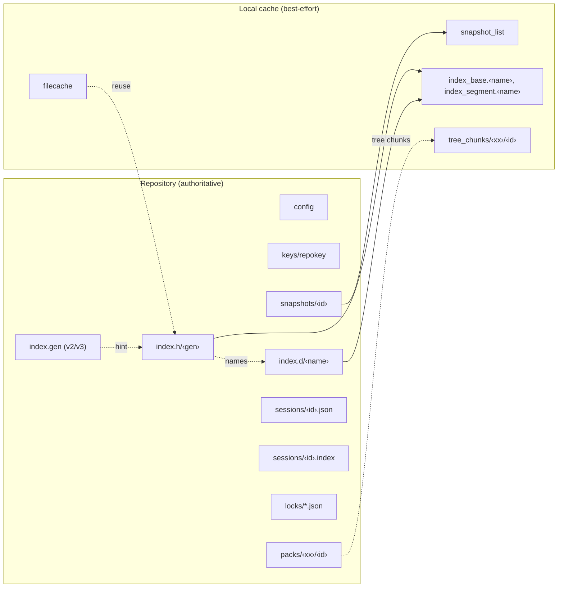
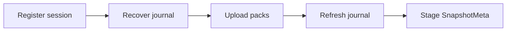
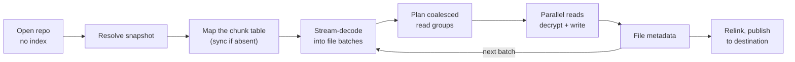
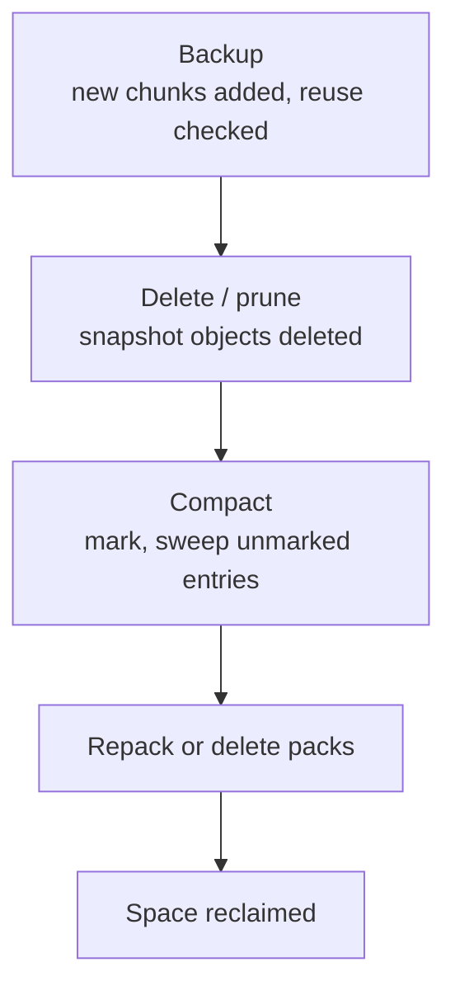
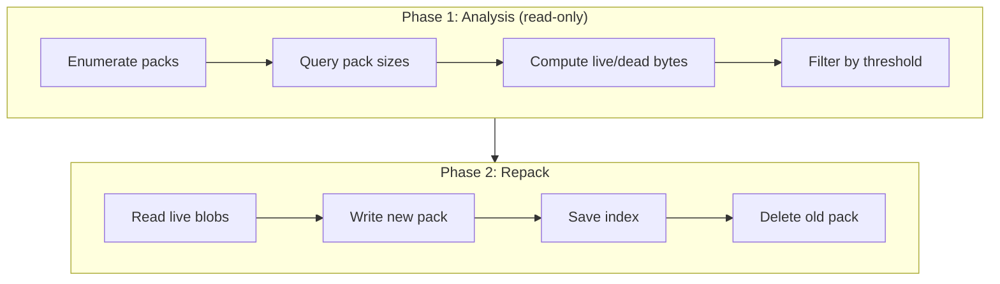
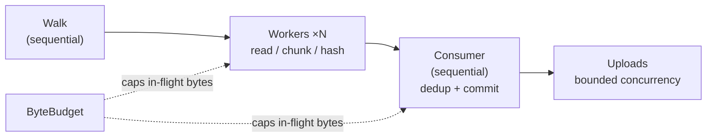

Technical reference for vykar's cryptographic, chunking, compression, concurrency, and repository-layout design decisions. The test strategy is described in [Testing](/testing).

---

## Cryptography

### Encryption

AEAD with 12-byte random nonces (`AES-256-GCM` or `ChaCha20-Poly1305`).

Rationale:
- Authenticated encryption with modern, audited constructions
- `auto` mode benchmarks `AES-256-GCM` vs `ChaCha20-Poly1305` at init and stores one concrete mode per repo
- Strong performance across mixed CPU capabilities (AES acceleration and non-AES acceleration)
- 32-byte symmetric keys (simpler key management than split-key schemes)
- AEAD AAD always includes the 1-byte type tag; for identity-bound objects it also includes a domain-separated object context (for example: `index`, snapshot ID, chunk ID, `filecache`, or `snapshot_cache`)

**Key usage model:** The master `encryption_key` is used directly as the AEAD symmetric key for all encryption operations throughout the lifetime of the repository. There is no per-session or per-snapshot key derivation. Cryptographic isolation between objects relies on random 12-byte nonces (unique per encryption call) and domain-separated AAD (binding ciphertext to object type and identity). With 96-bit random nonces, the birthday-bound collision threshold is approximately 2^48 encryptions under a single key — well beyond realistic backup workloads.

### Plaintext Mode (`none`)

When `encryption` is set to `none`, vykar uses a `PlaintextEngine` — an identity transform where `encrypt()` and `decrypt()` return data unchanged. AAD is ignored (there is no AEAD construction to bind it to). The format layer detects plaintext mode via `is_encrypting() == false` and uses the shorter wire format: `[1-byte type_tag][plaintext]` (1-byte overhead instead of 29 bytes).

This mode does **not** provide authentication or tamper protection — it is designed for trusted storage where confidentiality is unnecessary. Chunk data (file contents and item streams) is still protected against accidental corruption: its keyed chunk ID is recomputed and compared on every read (see [Hashing / Chunk IDs](#hashing--chunk-ids) below). The `index`, snapshot blobs and session journals carry no checksum in this mode.

### Key Derivation

The master key (64 bytes: 32-byte encryption key + 32-byte chunk ID key) is generated from OS entropy (`OsRng`) at repository init. It is never derived from the passphrase. Instead, the passphrase is used to derive a Key Encryption Key (KEK) via Argon2id, and the KEK wraps the master key with AES-256-GCM. The encrypted master key blob is stored at `keys/repokey` alongside the KDF parameters (algorithm, memory/time/parallelism costs, salt) and the wrapping nonce. Because the master key is random rather than derived, the passphrase and the key blob are **both** required and neither recovers the other — see [Key Redundancy](#key-redundancy).

Rationale:
- Two-layer scheme (random data key, passphrase-derived wrapping key) separates key strength from passphrase quality
- Argon2id is a modern memory-hard KDF recommended by OWASP and IETF
- Resists both GPU and ASIC brute-force attacks

In `none` mode no passphrase or key file is needed. The `chunk_id_key` is deterministically derived from `repo_id`, and *how* depends on the repository format:

| Format | Derivation |
|---|---|
| v2, v6 with `chunk_hash` blake2b | `BLAKE2b-256(repo_id)` |
| v3, v6 | `blake3::derive_key("vykar 2026-01-01 plaintext repository chunk-id key v1", repo_id)` |

`derive_key` rather than a plain `blake3::hash` for domain separation: it is a distinct BLAKE3 mode with its own flag bits, so this key lives in a different domain from chunk digests (keyed mode) and pack digests (unkeyed mode).

Since `repo_id` is stored unencrypted in the repo `config`, this key is not secret in either format — it exists only so that the same keyed hashing path is used in all modes. No `keys/repokey` file is created.

This is the **one** auxiliary hash that follows the repository format, because it *is* the chunk-ID key: a v2 repository must reproduce it byte-identically or lose its entire dedup index.

### Key Redundancy

The wrapped key is stored **twice**: at `keys/repokey` and `keys/repokey.2`. Both hold the *same serialized bytes*, not two independent wraps — a second wrap would pick a fresh salt and nonce, and being able to compare the two copies byte-for-byte is the point. Repositories created before this existed carry one copy; opening them backfills the second, best-effort (a read-only mount or read-only credentials simply leave it alone).

The redundancy buys two things:

- **Recovery.** If one copy rots, vykar opens off the other. `vykar check` re-reads both copies on every run and reports them as their own line; `vykar check --repair` rewrites a damaged copy from the good one without the `type 'repair'` prompt, since restoring a key copy cannot lose data.
- **A better error message.** A GCM authentication failure genuinely cannot distinguish "wrong key" from "damaged ciphertext" — they are the same event — so something outside the blob has to corroborate it. Damage that is unambiguous on its own (truncation, mangled msgpack framing, out-of-range Argon2id parameters) is reported as corruption rather than blamed on the operator's typing, and needs no second copy. When the two copies are byte-identical and still fail to unwrap, the message says *likely* incorrect passphrase. Deliberately hedged: on a copy-on-write or deduplicating filesystem, or after `cp --reflink`, the two objects can share physical extents, so a single bad block would corrupt both identically.

When the copies **disagree**, no candidate is accepted without positive proof. vykar weighs each one against evidence outside the key blob. The local identity pin is decisive in both directions: a contradiction is a hard disproof, and a matching pin is accepted without consulting repository data at all. Only without a pin is repository-authored ciphertext tried, starting with the `index` object that `init` writes even for an empty repository. Exactly one candidate established means that one wins; nothing established, or both, means the open fails, naming the two conflicting copies. A pin that contradicts *both* candidates is reported as an identity mismatch with the usual `--trust-repo` remedy, not as an unresolvable repository.

That applies even when only one of the two divergent copies unwraps at all. "It was the only one that unwrapped" is not evidence: an attacker who can write to the repository can plant a copy wrapped under a passphrase of their choosing, and accepting it would let `check --repair` rewrite the genuine copy from it — which cannot be undone. Absence of evidence is only tolerable where there is no rival candidate: a single copy, two identical ones, or two independent wraps of the same key.

Every degraded state — a missing copy, a copy that disagrees, a backfill that could not land — is logged as a warning at open, so an ordinary command surfaces it on stderr rather than only `vykar check`.

An **unreadable** copy is distinguished from a missing one. An I/O or permission failure on one object must not defeat the redundancy the other exists to provide, so the open proceeds off the survivor — and the unreadable object is left strictly alone, never backfilled over, since it may well be intact.

Redundancy inside the repository covers bit rot, not loss of the storage. `vykar key export` and `vykar key import` (see [Commands](/commands)) move the passphrase-protected blob in and out of a password manager. Both work on raw storage rather than through `Repository::open`: `import` because it runs on a repository that can no longer be opened, `export` because a recovery tool for the key must not fail on an unreadable index head, scale with the snapshot count, or write anything. Export uses the same copy selection as `open`, so it can never hand out a copy `open` would have rejected. A key belongs to exactly one repository, so both commands require `-R` when several are configured.

### Hashing / Chunk IDs

A **keyed** 256-bit hash of the chunk plaintext, using a `chunk_id_key` derived from the master key. The algorithm is fixed by the repository format:

| Format | Chunk ID | Pack ID |
|---|---|---|
| v2, v6 with `chunk_hash` blake2b | keyed BLAKE2b-256 | unkeyed BLAKE2b-256 |
| v3, v6 | keyed BLAKE3 | unkeyed BLAKE3 |

Chunk IDs are **always keyed**, in both algorithms. `index/hasher.rs` takes the first eight bytes of the digest as a hash-map bucket key, which is only safe because an attacker who controls chunk content cannot predict the digest; an unkeyed hash here would be a hash-flooding hole. Pack IDs are **always unkeyed**, in both algorithms: a pack ID is a storage key the server must be able to recompute from the bytes alone, without any repository key.

Why a keyed hash at all:

- Prevents content confirmation attacks (an adversary cannot check whether known plaintext exists in the backup without the key)
- Trade-off: keyed IDs prevent dedup across different encryption keys (acceptable for vykar's single-key-per-repo model)

Why not SHA-256:

- Both BLAKE2b and BLAKE3 are faster than SHA-256 in pure software. On CPUs with hardware SHA-256 acceleration (SHA-NI on x86, SHA extensions on ARM) hardware SHA-256 can beat BLAKE2b, but the BLAKE family gives consistent performance across all architectures without depending on hardware-specific instruction sets.

Why BLAKE3 for new repositories (formats v3 and v6):

- Hashing is a first-order CPU cost on two paths where dedup skips everything downstream. On a **file-cache miss with mostly-unchanged content** (VM images, databases, mail files) the file is fully re-read, chunked and hashed; chunks that dedup out skip compression, encryption and upload entirely, so per-byte cost there is read + chunk + hash. In `check --verify-data` under `encryption: none`, hashing dominates outright, and under `none` every chunk read (restore, list, diff, mount) is hashed too.
- Within a file (or a 64 MiB segment of a large file) hashing is single-threaded, so per-core hash throughput is the per-segment ceiling. BLAKE3's internal tree mode gives it a large per-core advantage even without multi-threading: measurements in [issue #177](https://github.com/borgbase/vykar/issues/177) show `blake3::keyed_hash` at ~2.15 GB/s against ~1.4 GB/s for keyed BLAKE2b-256 on Apple Silicon, with a wider gap on x86-64.
- BLAKE3 is used single-threaded (`hash` / `keyed_hash`); vykar never calls `update_rayon`, and parallelism comes from the existing per-file/per-segment workers instead.

In `none` mode the same keyed construction is used, but the key is derived from the public `repo_id` rather than a secret master key. The MAC therefore acts as a **checksum for corruption detection**, not as authentication against tampering. Because there is no AEAD tag, every chunk read in `none` mode (restore, list, diff, mount) recomputes the chunk ID and fails on a mismatch. `vykar check --verify-data` recomputes chunk IDs and compares them to detect bit-rot or storage corruption — this works identically across all encryption modes and both formats. The exception is a REST repository whose server supports pack verification: packs the server verifies (structure and pack hash, without any key) are skipped by the client, so their chunk IDs are not recomputed unless `--distrust-server` is added.

---

## Content Processing

### Chunking

FastCDC (content-defined chunking) via the `fastcdc` v3 crate.

Default parameters: 512 KiB min, 2 MiB average, 8 MiB max (configurable in YAML).
`chunker.max_size` is hard-capped at 16 MiB during config validation.

Rationale:
- Newer algorithm, benchmarks faster than Rabin fingerprinting
- Good deduplication ratio with configurable chunk boundaries

### Compression

Per-chunk compression with a 1-byte tag prefix. Supported algorithms: LZ4, ZSTD, and None. The tag identifies the codec only, not the compression level — the ZSTD level is a repo-wide configuration setting. Recompression at a different level requires decompressing and recompressing every chunk.

Rationale:
- Per-chunk tags allow mixing algorithms within a single repository
- LZ4 for speed-sensitive workloads, ZSTD for better compression ratios. LZ4 is recommended over None for most workloads — even on incompressible data the overhead is negligible, and the reduced I/O and transfer size typically more than compensate
- No repository-wide format version lock-in for compression choice
- ZSTD compression reuses a thread-local compressor context per level, reducing allocation churn in parallel backup paths
- Decompression enforces a hard output cap (32 MiB) to bound memory usage and mitigate decompression-bomb inputs

### Deduplication

Content-addressed deduplication uses keyed `ChunkId` values (keyed BLAKE2b-256 in format v2 and in v6 repositories upgraded from it, keyed BLAKE3 in v3 and v6 otherwise). Identical plaintext produces the same `ChunkId`, so the second copy is not stored; the reference is only recorded as reused. Because the algorithm is part of the chunk's identity, **dedup never spans chunk hashes** — which is also why the hash cannot be changed in place (the index layout can, see [Repository Versions](#repository-versions)).

The repository's chunk index is one memory-mapped **chunk table** per base, the head's segments applied over it in memory, and this process's edits (`LiveIndex`, see [Local Optimization Caches](#local-optimization-caches-client-machine)). There is one lookup path for backup, restore, compact and check; no dedup mode is chosen.

**Dedup check during a write session** (`Repository::bump_ref_if_exists` and the backup consumer):
1. **Chunks stored earlier in this session** — a small `session_new` map
2. **The session's view of the index** — first the additions of the head's segments applied over the table (found by key, and recorded as reused by key), then an xor filter (`xorf::Xor8`, built once per table) as probabilistic negative check and a binary search of the mapped table. A table hit is recorded as reused by *table position* (`ReusedChunks`: one bit per table entry, and a key set for everything outside the table); no count is kept. The commit checks the reused chunks again only when the head changed in a way that can have removed entries (see [Commit Check](#commit-check)). Backup workers run this check themselves (`DedupPrefilter`) and send a confirmed hit without its data. Over an index with unsaved edits (repair) the lookup goes through the live index by key instead, with no prefilter.
3. **Chunks recovered** from an interrupted session's journal
4. **Pending pack writers** — blobs buffered in data/tree `PackWriter`s that have not yet been flushed

This prevents duplicates both across backups and within a single backup run.

---

## Serialization

All persistent data structures use **msgpack** via `rmp_serde`. Structs serialize as **positional arrays** (not named-field maps) for compactness. This means field order matters — adding or removing fields requires careful versioning, and `#[serde(skip_serializing_if)]` must not be used on `Item` fields (it would break positional deserialization of existing data).

### RepoObj Envelope

Every repo object and local encrypted cache blob uses the same `RepoObj` envelope (`repo/format.rs`). The wire format depends on the encryption mode:

```text
Encrypted:  [1-byte type_tag][12-byte nonce][ciphertext + 16-byte AEAD tag]
Plaintext:  [1-byte type_tag][plaintext]
```

The type tag identifies the object kind via the `ObjectType` enum:

| Tag | ObjectType | Used for |
|-----|------------|----------|
| 0 | Config | Repository configuration (stored unencrypted) |
| 1 | Manifest | Legacy manifest object tag (unused in v2 repositories) |
| 2 | SnapshotMeta | Per-snapshot metadata |
| 3 | ChunkData | Compressed file/item-stream chunks |
| 4 | ChunkIndex | Encrypted `IndexBlob` stored at `index` |
| 5 | PackHeader | Reserved legacy tag; not used for trailers |
| 6 | FileCache | Local file-level cache (inode/mtime skip) |
| 7 | PendingIndex | Transient crash-recovery journal |
| 8 | SnapshotCache | Local snapshot-list cache |
| 9 | IndexHead | Index head stored at `index.h/<gen>` (v6; v4/v5 kept it at `index`) |
| 10 | IndexBase | Segmented index base under `index.d/` |
| 11 | IndexSegment | Segmented index segment under `index.d/` |
| 12 | PackTrailer | Last framed blob of a pack: its blob list |
| 13 | PackMap | Blob lists of packs without a trailer, under `packmaps/` |
| 14 | SweepRecord | What one mark-and-sweep found, under `index.d/` (v6) |

The type tag byte is always included in AAD (authenticated additional data). For identity-bound objects, AAD also includes a domain-separated object context, binding ciphertext to both object type and identity (for example, `ChunkData` to its `ChunkId`, `SnapshotMeta` to snapshot ID, `ChunkIndex` to `b"index"`, `IndexHead` to `b"index.h"`, `IndexBase`, `IndexSegment` and `SweepRecord` to the static `b"index.d/base"`, `b"index.d/segment"` and `b"index.d/sweep"`, `FileCache` to `b"filecache"`, `SnapshotCache` to `b"snapshot_cache"`, `PackTrailer` to the static `b"pack-trailer"`, and `PackMap` to the static `b"packmap"`; as for `index.d/`, a pack map's name is the BLAKE3 of its stored bytes and is checked first).

### Format Evolution

The **item stream** evolves by an *expand → contract* rule. The rule does not apply to the two frozen structures: `config` keeps the seven fields of 0.19-0.24 under their old names and types for good, in a map from v6 on (see [Repository Versions](#repository-versions)), and the `SnapshotMeta` envelope has been frozen since 0.17 (below) — new snapshot-level metadata goes into its `ext` blob instead.

- **Expand:** append a field with `#[serde(default)]`. New binaries still read old snapshots; older binaries cannot read the new ones (see below), so an expansion is still a one-way step for a shared repository. Already done for `Item.link_target`, `Item.xattrs`, `Item.raw_names`, `Item.hardlink`, and `SnapshotMeta.{comment, source_paths, label, ext, format_version}`. `Item.hardlink` ships under format **v1** (no bump), alongside the `format_version` envelope field itself — both landed together in **0.17.0**, so there is a single "0.17 introduces format v1" story rather than two versions in the wild. That release took the `SnapshotMeta` envelope from 12 fields to 14, which is why a pre-0.17 binary reports `array had incorrect length, expected 12` against a 0.17+ snapshot.
- **Contract (breaking, batched):** remove or retype a field — only when a larger forced break (crypto, chunking) already requires one; cleanups ride that train rather than justifying a break alone.

**Format 2** changes only how chunk IDs are encoded in `Item.chunks` and `SnapshotMeta.item_ptrs`: each is a msgpack bin of 32 bytes (34 bytes on the wire) instead of `ChunkId`'s derived array of 32 integers (about 51 bytes). Writers stamp 2. Readers use one decoder (`snapshot::bin_id`) for every snapshot, whatever its `format_version`: it accepts the format-2 bin and format 1's integer array, exactly 32 bytes or elements, so format-1 and legacy-0 snapshots read as before. The `check --repair` rewriter re-encodes every kept item, so a rewritten format-1 snapshot comes out as format 2. `ChunkId`'s own encoding, used by the index, pack maps, file cache, journal and protocol, is unchanged.

Compatibility is **backward-readable, not forward-compatible**: a new binary reads old snapshots, but older binaries are **not** guaranteed to read newer item streams (rmp-serde rejects a longer-than-expected positional array, so an old reader hits a length mismatch on the first extended record). `SnapshotMeta.format_version` (absent/`0` = legacy) is the discriminator; current writers stamp the latest (`CURRENT_FORMAT_VERSION`) and readers reject anything newer than they support. `check` treats a newer snapshot as **unsupported, never corrupt**, and `check --repair` refuses to run while one is present (its sweep requires decoding every surviving snapshot).

Two distinct signals mean "newer writer", and both are classified as unsupported rather than corrupt:

1. **A decodable envelope with a higher `format_version`** — caught by `SnapshotMeta::supported()`.
2. **An envelope whose field count differs**, so `format_version` cannot be read at all. This is sound because of what precedes it: the AEAD decrypt has already succeeded, proving the bytes are intact and the key is right, and a *shorter* array still decodes via `#[serde(default)]` — so a length mismatch can only mean a *longer* array, i.e. a newer writer. Never corruption.

Case 2 is the one the `format_version` discriminator structurally cannot cover, and it must be classified separately: left as `CorruptSnapshot`, `check --repair` would emit `RemoveCorruptSnapshot` and **delete another host's snapshot**.

A snapshot this binary cannot read is **hidden, never damaged**. It is excluded from the manifest, but the exclusion is reported — `vykar list` prints `N snapshots hidden: written by a newer vykar` rather than silently returning a short list, and the warning is emitted once per process rather than once per repository open.

`SnapshotMeta`'s envelope (the fields up to `format_version`) is **frozen** — its field count never changes and existing fields are never removed, so `format_version` is always decodable and a future snapshot is recognized rather than mistaken for corruption. One element type changed once: format 2 writes `item_ptrs` as 32-byte bins. That keeps the envelope decodable by format-1 binaries, because rmp-serde reads a 32-byte bin into a derived `[u8; 32]` (pinned by `format_1_reader_refuses_format_2_by_version`), so those binaries refuse a format-2 snapshot by version. Any future retype needs the same proof: a test that decodes the new bytes with the old types. All breaking cleanups therefore live in the **item stream**, gated by `format_version`:

- **Paths → bytes.** `Item.path` / `Item.link_target` are UTF-8 `String`; non-UTF8 names are preserved out-of-band in the additive `Item.raw_names` byte field (`path` / `link_target` remain the lossy display strings, the raw bytes are authoritative at restore time on Unix). At the next item-stream version, collapse into one canonical byte field and drop the lossy String shadow.
- **Xattr names → bytes.** `Item.xattrs` keys are `String`; non-UTF8 xattr names are dropped with a warning today. Retype keys to bytes (niche — names are usually ASCII).

**Hard links** use a *content-on-every-node* representation (restic-style): a regular file with `nlink > 1` keeps its full chunk list and additionally records its source `(dev, ino)` in the optional `Item.hardlink` field. Restore regroups members by `(dev, ino)`, materializes the first member of each group from its chunks (the representative), and relinks the rest to it; a member is linked only when its **content** matches the representative — identity is a BLAKE2b-256 fingerprint over the ordered chunk-id list, which is authoritative because chunk ids are content-addressed. A mismatch (inode-number reuse handing the same `(dev, ino)` to different content) declines to link and materializes that member from its own chunks instead, so a member's own bytes are never silently replaced by the representative's. The relink stays inside the restore temp root (one filesystem, so links survive the final inode-preserving rename) and validates the link target's parent against the root unconditionally; a planted symlinked parent that escapes the root, or any failure to place a link's content (after a copy fallback), is fatal — restore never reports success with a requested path missing. Two properties fall out of this design: every member lists its own chunks, so the [mark](#mark) reaches them from any member and deleting some members needs no special-casing, and restore is robust to partial views — *we never assume we see all N links*, so a single in-set member (filtered group, link outside the source) is just a normal file. The accepted cost is redundant chunk-lists in the item stream for extreme fan-out, which dedup makes free in storage.

Future snapshot-level metadata goes inside the reserved opaque `ext` blob (parsed per `format_version`) rather than as new outer fields, so the frozen envelope and its discriminator stay intact without a tolerant-envelope rework.

#### Repository Versions

`config`'s `version` is the *repository layout* version, distinct from `SnapshotMeta.format_version` above. It answers "what must a reader understand to read this repository?":

| `version` | `config` | Chunk ID | Pack ID | Index | Written by |
|---|---|---|---|---|---|
| 2 | positional, 7 fields | keyed BLAKE2b-256 | unkeyed BLAKE2b-256 | monolithic | `init` up to 0.19 |
| 3 | positional, 7 fields | keyed BLAKE3 | unkeyed BLAKE3 | monolithic | `init` 0.20 to 0.24 |
| 4, 5 | positional | as 2, 3 | as 2, 3 | segmented, mutable head at `index` | development builds only; refused by version |
| 6, 7 (positional) | positional | | | numbered heads, v1 objects | development builds of 05 step 8 only; refused ("created by a development build ... Create a new repository") |
| 6 | map: the seven old fields, `chunk_hash`, `features` | keyed, `chunk_hash` (`blake3`, or `blake2b` when upgraded from v2) | unkeyed, `chunk_hash` | numbered heads at `index.h/<gen>`, base and keyed segments (v2 bodies), mark-and-sweep | `init`, `vykar upgrade` of v2 and v3 |

`RepoConfig::decode` tells a map from an array by its first byte; `DecodedConfig::validate` is the single gate and returns a `RepoFormat` (`V2`, `V3` or `V6(hash)`): a map must say version 6 (a higher version is `UnsupportedVersion`), name a known `chunk_hash` and only known `features` (else "written by a newer vykar"); a positional config is accepted only at 2 and 3. The **hash never changes** for a repository: it is the dedup identity of every chunk and part of every pack's storage key, so a v2 repository is upgraded to v6 with `chunk_hash` `blake2b` and stays BLAKE2b for life. v2 and v3 are **upgrade-only** (`is_upgrade_only()`): every open except the one `vykar upgrade` makes refuses them, right after reading `config` and before the key is loaded, with an error that names `vykar upgrade`; `init` can no longer create them. `key export`/`key import`, `delete-repo` and `break-lock` work on raw storage and keep working on them. The **index layout can change**, once and one way: `vykar upgrade` moves v2 and v3 to v6 in place (see [In-Place Upgrade](#in-place-upgrade)). It is never automatic, because it locks out older binaries on every other machine. `vykar info` reports the format, the hash, the base and segment sizes, and the last sweep.

There is deliberately **no user-facing choice** at `init`: no `--hash` flag, no YAML key. `init` always creates v6 with BLAKE3. Two accepted consequences: older binaries cannot open a repository created by a newer release (`unsupported repository version: 6`), so a fleet sharing a new repository must upgrade together; and a self-hosted `vykar-server` must be upgraded before a new repository can be created against it (a pre-flight `/health` probe at `init` checks BLAKE3 support, the `segmented_index` capability and that `key_dirs` lists `index.h` and `packmaps`, so that fails cleanly rather than at the first backup).

**Why the v6 `config` is a map.** The positional config of v2/v3 cannot grow: `#[serde(default)]` rescues *shorter* arrays, but rmp-serde **errors on longer ones** (`array had incorrect length, expected N`) — an old binary reading an 8-field array would fail *before* its version gate, with a parse error that looks like corruption. A msgpack map decodes into the old seven-field struct (rmp-serde reads a struct from a map by name and ignores unknown keys), so 0.19.x and 0.20-0.24 reach their gate and say `unsupported repository version: 6` (`tests/legacy_config_refusal.rs` runs the releases' vendored types on the real encoder's bytes, on upgraded fixtures and on a fresh repository; `scripts/check-old-release-refusal.sh` runs the release binaries). The seven old fields therefore stay under their old names and msgpack types for good; `id` stays an array of integers. New fields are additive: a reader ignores unknown keys, and one it must understand is named in `features`. `RepoConfig::encode` writes only version 6, so a v2/v3 value is never written as a map (old releases would read it at their own version).

**Auxiliary hashes.** Only chunk IDs and pack IDs follow the format. Every other digest vykar computes is BLAKE3 for every version (BLAKE2b up to 0.23):

| Digest | Persisted in | Effect of the switch from BLAKE2b |
|---|---|---|
| TOFU identity fingerprint (`derive_key` over `repo_id ‖ chunk_id_key`) | `pin3.<BLAKE3(url)>` | Old `pin.*` files are ignored: the first open per client per repository re-pins without verification |
| Check-state file name | `check3.<BLAKE3(url)>` | Old state orphaned; the next `check` is a full one |
| `PathHash` in the file cache (first 16 bytes of BLAKE3) | `filecache` | Old caches rejected; the next backup re-reads every file once |
| Local table checksum trailer | `full_index_cache`, then `chunk_table.<state>`, now `index_base.<name>` | Rebuilt once (the earlier files are deleted by age) |
| Index blob digest (conditional-GET validator of 0.24 and earlier) | `index_blob` | No longer written; `vykar upgrade` deletes it |
| Index object names | `index.d/`, head | none (BLAKE3 from the start) |
| Hard-link `chunks_fingerprint` | runtime only | none |

Non-pack REST uploads carry `X-Content-BLAKE3` when the server advertises `blake3` (or the repository is v3, whose packs already require it), and `X-Content-BLAKE2b` only for a pre-0.20 server. BLAKE2b remains for the v2 chunk/pack format and that fallback.

The single exception is the plaintext-mode `chunk_id_key` derivation, which *is* the chunk-ID key and therefore must follow the format — see [Key Derivation](#key-derivation).

---

## Repository Format

### On-Disk Layout

`version = 6` (a map config) is what `vykar init` and `vykar upgrade` write; versions 2 and 3 (positional) are opened only by `vykar upgrade`, and every other version is refused. See [Repository Versions](#repository-versions).

```text
<repo>/
|- config                    # Repository metadata (unencrypted msgpack; a map from v6 on)
|- keys/repokey              # Encrypted master key (Argon2id-wrapped; absent in `none` mode)
|- keys/repokey.2            # Byte-identical redundant copy (see Key Redundancy)
|- index                     # v2/v3 only: encrypted IndexBlob { generation, chunks }; absent in v6
|- index.h/<gen>             # v6: write-once encrypted IndexHead (msgpack map, layout 3) per generation; the highest wins
|- index.d/<64 hex>          # v6: write-once index bases and keyed segments (body version 2) and sweep records, named by the BLAKE3 of their bytes
|- packmaps/<64 hex>         # Write-once pack maps (blob lists of packs without a trailer, e.g. every pre-upgrade pack), named by the BLAKE3 of their bytes
|- index.gen                 # v2/v3 only (written by 0.24 and earlier): unencrypted advisory u64 generation hint
|- snapshots/<id>            # Encrypted snapshot metadata; source of truth for snapshot listing
|- sessions/<id>.json        # Session presence markers (concurrent backups)
|- sessions/<id>.index       # Per-session crash-recovery journals (absent after clean backup)
|- packs/<xx>/<pack-id>      # Pack files containing compressed+encrypted chunks (256 shard dirs)
`- locks/                    # Advisory lock files
```

### Local Optimization Caches (Client Machine)

These files live under a per-repo local cache root. By default this is the platform cache directory + `vykar` (for example, `~/.cache/vykar/<repo_id_hex>/...` on Linux, `~/Library/Caches/vykar/<repo_id_hex>/...` on macOS). If `cache_dir` is set in config, that path becomes the cache root. These are optimization artifacts, not repository source of truth.

```text
<cache>/<repo_id_hex>/
|- filecache                 # File metadata -> cached ChunkRefs
|- snapshot_list             # Snapshot ID -> SnapshotEntry cache
|- index_base.<name hex>    # One base: its decoded body (fixed-width records) + BLAKE3 trailer (mmap)
|- index_segment.<name hex> # One segment object of the head, as stored (encrypted)
|- tree_chunks/<xx>/<id>     # Tree (item-stream) chunks: stored blob bytes, one file each
`- index_blob                # 0.24 and earlier only: the v2/v3 index blob this machine last wrote;
                             #   no longer read or written, deleted by `vykar upgrade`
```

A chunk table is the decoded body of one base object (base v2: a pack table, then sorted 44-byte records), `magic "VYKTBL02" | body_len u64 | body | BLAKE3(body)`, named after the base object and verified on every open (checksum and canonical body); a file that fails is ignored. The head's segments are kept beside it as `index_segment.<name>`, exactly as `GET` returned them, and read back only after the name check (BLAKE3 and size) every `index.d/` read makes; a file that fails is deleted and fetched again. Rules, so that any number of processes can share one cache dir:

- A file is written once, through a uniquely named temp file published with a no-clobber link; it is never modified, renamed over or replaced. A base name that is already taken is adopted when its content verifies, and replaced only when it does not.
- A file is deleted (after a sync or a write that used the cache dir) only if the current head does not name it, no table of this process maps it, and its mtime is more than an hour old. The 80-byte `chunk_table.<state>` files of earlier development builds are deleted by the same rule. On Unix a deleted table stays readable through every mapping; a process that later looks for it finds it gone and downloads the base again.
- A sync starts from the repository's own index (its table and applied segments) when the head extends it, else from `index_base.<name>` of the head's base, and applies the missing segments in memory; a write needs no local file. Between folds nothing local is rewritten: a write adds one small segment file.

The **tree-chunk cache** (`tree_chunks/<first id byte hex>/<chunk id hex>`) holds one file per tree chunk with the chunk's stored blob bytes, exactly as in its pack: compressed and, for an encrypted repository, encrypted with the chunk ID as AAD. Backup writes every new tree chunk it stores, and readers write what they download. List, diff, find, mount, restore, compact's mark and backup's parent-snapshot load read it first, decode an entry like a pack blob and download only the misses; the item pointers are still resolved through the index first, so a chunk the index lacks fails even when it is cached. `check`, `check --repair` and the simulator's checker never read it and their reads do not fill it, so they verify what storage holds (the listing chunks a repair rewrites are cached like any stored tree chunk); the other readers no longer notice a corrupt or missing tree blob in storage while the chunk is cached. After a compact's sweep is written, entries of tree chunks the mark did not reach are deleted; prune, delete and backup drop nothing, so cached tree chunks of deleted snapshots stay until the next compact. Entries are content-addressed and every failure is a miss: an entry that does not decode is deleted and the chunk downloaded, a failed write disables writing for the handle, and nothing is fsynced. Entries are written through unique `.tc-*` temp files renamed into place (temps older than an hour are deleted by the drop), so processes sharing the cache dir need no coordination; a drop in one process can delete entries a backup running in another has just written, which costs that backup's next reader a download. The cache has no size cap.

The fixed-name caches of earlier binaries (`dedup_cache`, `restore_cache`, `full_index_cache`) are deleted at open. Without a cache dir, or for `check`'s verifying load (which reads and writes no local file), the table lives in a temp file kept by the repository handle.

In v2/v3 the authenticated generation is `IndexBlob.generation` inside `index`, and `index.gen` is an advisory hint that only pre-0.25 binaries write and read. This vykar reads neither outside `vykar upgrade`, which GETs and decodes the `IndexBlob` once. The client no longer sends `If-None-Match`; vykar-server still answers it (`304`) for 0.24 clients.

The `snapshot_list` cache is separate: on open/refresh, the client lists `snapshots/`, removes stale local entries, loads only new snapshot blobs, and persists the resulting snapshot list locally. This avoids O(n) snapshot metadata GETs on every open.

The same per-repo cache root is also used as the preferred temp location for intermediate files (e.g. cache rebuilds).

#### Repository And Cache Topology



### Key Data Structures

**IndexBlob** — v2/v3 only: the encrypted object stored at the `index` key, as vykar 0.19 to 0.24 wrote it (`index::legacy`). Read only by `vykar upgrade`; encoded only by tests and fuzz seeds. Its types (`IndexBlob`, `LegacyChunkIndex`, `LegacyIndexEntry`) are a frozen wire format.

| Field | Type | Description |
|-------|------|-------------|
| generation | u64 | Authenticated cache-validity token rotated when the index changes |
| chunks | LegacyChunkIndex | `HashMap<ChunkId, LegacyIndexEntry>`: `refcount` (u32), `stored_size`, `pack_id`, `pack_offset` |

The legacy `refcount` is the only count left: the upgrade drops entries at 0 (garbage the old release had not removed yet) and discards the others.

**ChunkIndexEntry** — where a chunk is stored; in memory only, never serialized. v6 stores the entries as a base plus segments ([segmented index](#segmented-index-v6)) and holds them in a `LiveIndex` (mapped base table, the head's segments applied in memory, and edits), the central lookup table for deduplication, restore, and compaction. `ChunkIndex`, a plain map of the same entries, serves the rebuild, oracles and tests.

| Field | Type | Description |
|-------|------|-------------|
| stored_size | u32 | Size in bytes as stored (compressed + encrypted) |
| pack_id | PackId | Which pack file contains this chunk |
| pack_offset | u64 | Byte offset within the pack file |

**Manifest** — runtime-only in-memory snapshot list derived from `snapshots/` and the local `snapshot_list` cache. It is not persisted to repository storage.

| Field | Type | Description |
|-------|------|-------------|
| version | u32 | Format version (currently 1) |
| timestamp | DateTime | Last modification time |
| snapshots | Vec\<SnapshotEntry\> | One entry per snapshot |

**SnapshotListCache** — local encrypted map from snapshot ID hex to `SnapshotEntry`. It is refreshed incrementally from `snapshots/` and exists only to avoid repeatedly downloading every snapshot blob on open.

Each `SnapshotEntry` contains: `name`, `id` (32-byte random), `time`, `source_label`, `label`, `source_paths`, `hostname`.

**SnapshotMeta** — per-snapshot metadata stored at `snapshots/<id>`.

| Field | Type | Description |
|-------|------|-------------|
| name | String | User-provided snapshot name |
| hostname | String | Machine that created the backup |
| username | String | User that ran the backup |
| time / time_end | DateTime | Backup start and end timestamps |
| chunker_params | ChunkerParams | CDC parameters used for this snapshot |
| comment | String | Optional snapshot comment field; currently written as `""` by backup flows |
| item_ptrs | Vec\<ChunkId\> | Chunk IDs containing the serialized item stream; one 32-byte bin per pointer from format 2 (arrays of 32 integers in format 1) |
| stats | SnapshotStats | File count, original/compressed/deduplicated sizes |
| source_label | String | Config label for the source |
| source_paths | Vec\<String\> | Directories that were backed up |
| label | String | Legacy compatibility field; new snapshots currently write `""` |
| ext | Option\<Vec\<u8\>\> | Reserved opaque extension blob for future snapshot-level metadata; currently always `None` |
| format_version | u32 | Format discriminator (frozen last field; absent/`0` = legacy, current writers stamp `CURRENT_FORMAT_VERSION`) |

**SnapshotStats** — per-snapshot counters stored inside `SnapshotMeta.stats`.

| Field | Type | Description |
|-------|------|-------------|
| nfiles | u64 | Number of backed-up regular files plus command-dump virtual files |
| original_size | u64 | Total plaintext bytes before compression/dedup |
| compressed_size | u64 | Total bytes after compression |
| deduplicated_size | u64 | Bytes newly stored after deduplication |
| errors | u64 | Number of soft file-read errors skipped during backup |

`deduplicated_size` records the bytes newly stored at the time the snapshot was created. It depends on the global repository state at that moment and becomes stale if other snapshots are later deleted — a snapshot that originally shared all its chunks (showing `deduplicated_size ≈ 0`) may become the sole owner of those chunks after the other snapshot is removed. Treat this field as a creation-time accounting metric, not a durable measure of a snapshot's unique storage footprint.

**Item** — a single filesystem entry within a snapshot's item stream.

| Field | Type | Description |
|-------|------|-------------|
| path | String | Relative path within the backup |
| entry_type | ItemType | `RegularFile`, `Directory`, or `Symlink` |
| mode | u32 | Unix permission bits |
| uid / gid | u32 | Owner and group IDs |
| user / group | Option\<String\> | Owner and group names |
| mtime | i64 | Modification time (nanoseconds since epoch) |
| atime / ctime | Option\<i64\> | Access and change times |
| size | u64 | Original file size |
| chunks | Vec\<ChunkRef\> | Content chunks (regular files only) |
| link_target | Option\<String\> | Symlink target |
| xattrs | Option\<HashMap\> | Extended attributes |
| raw_names | Option\<ItemRawNames\> | Byte-faithful `path` / `link_target` for non-UTF8 names (Unix); `None` for the common UTF-8 case |

**ChunkRef** — reference to a stored chunk, used in `Item.chunks`:

| Field | Type | Description |
|-------|------|-------------|
| id | ChunkId, 32-byte bin from format 2 | Content-addressed chunk identifier (an array of 32 integers in format 1) |
| size | u32 | Uncompressed (original) size |
| csize | u32 | Stored size (compressed + encrypted) |

The uncompressed `size` is stored per-reference so the restore path can size its output buffers up front, pass it as a size hint to the ZSTD one-shot decompressor, and then validate the decoded length against it. The chunk index holds only the stored size; readers without this field (e.g. `check --verify-data`) use the same decompressor and take the size from the ZSTD frame header instead, so both paths accept and reject the same frames. Every chunk read (restore, `read_chunk`, coalesced reads, the item stream and `check --verify-data`) decodes through `repo::format::decode_chunk_into`, which takes the size hint as an optional argument.

### Segmented Index (v6)

A monolithic index (v2/v3) is rewritten whole on every change: on a repository with millions of chunks that is hundreds of megabytes per backup, prune and compact. v6 stores the same entries as a base plus segments, so a write uploads what it changed (`repo/index_store.rs`, `repo/index_write.rs`, `index/{head,base_v2,segment_v2,sweep_record}.rs`).

```text
index.h/<gen>        # write-once, small: IndexHead of generation <gen>; the highest generation is the state
index.d/<64 hex>     # write-once: base, segment or sweep record, name = BLAKE3 of the stored bytes
```

- **The state is the head.** An index state is the head's base with its segments applied in the head's order; no state hash exists. Local files are matched by object name.
- **Head** (`IndexHead`, a msgpack **map** with named keys, `layout` = 3, AEAD context `index.h`): `gen` (equal to its key's generation, checked), `features` (written empty; a head naming a feature this binary does not know is refused as written by a newer vykar; readers ignore unknown keys, so a later field is additive), `base: Option<{name, size, entries}>` (`None` = the empty table, which `init` writes at `index.h/1`), `segments: [{name, size, kind, entries}]` in order (`kind`: 0 = backup, which may only add entries, 1 = maintenance; `entries` bounds the decode), `retired`: the objects of the last head before the most recent fold, and `sweep: {gen, record}`: the generation of the last head a sweep or `check --repair` wrote, and the sweep record of the last sweep (an informational map of what the mark found; `info` reads it). A layout-2 head (05 step 8's development builds, with v1 chain fields) or layout 1 (v4/v5) is refused by layout.
- **Base** (body version 2, then zstd, AEAD): `version u8 = 2 | reserved [3] | pack_count u32 | entry_count u32 | packs × {pack_id [32], trailer_len u32} | records × {chunk_id [32], pack_slot u32, pack_offset u32, stored_size u32}`, little-endian, fixed width, so the decoded body is the local table file. Canonical: packs and records strictly increasing, every pack referenced, length exact. No reference count is stored. `trailer_len` is the length of the pack's trailer frame (4 + its blob), 0 for a pack without one.
- **Segment** (body version 2, keyed): `version u8 = 2 | kind u8 | reserved [2] | counts u32 × 4 | packs × {pack_id, trailer_len} | additions × {chunk_id, slot, offset, size} | removals × {chunk_id} | relocations × {chunk_id, slot, offset, size}`. Each section is sorted, a chunk is in at most one, every pack is referenced, a backup segment only adds, and an empty segment is invalid. A segment names no predecessor. The header counts are checked against the head's `entries` before anything is allocated. A version other than 2 (a v1 base or segment included) is refused by version.
- **Applying**, in the head's order: a removal or relocation of an absent chunk is damage; an addition of an absent chunk adds it; an addition of a present chunk keeps the lower (pack ID, offset), so additions are order-independent across segments; a pack named with two trailer lengths takes the larger.
- **Every read of `index.d/<name>` checks `BLAKE3(bytes) == name` and the recorded size first.** The AEAD contexts are static because the name is the hash of the ciphertext; the binding to the head is this check. On a plaintext repository it is the only corruption check before decompression.

**In memory** (`LiveIndex`): the mapped base table, an `applied` layer (what the head's segments did to it: removed and relocated table positions, entries added outside the table, trailer lengths), shared with write sessions and never edited in place, and the copy-on-write `edits` of this process.

**Write** (any writer, under the repository lock): read the latest head and check it is the one the index was loaded from; express the edits as one maintenance segment by comparing `edits` with `applied` (a walk over the overlay structures, never the table); PUT the segment (and a pending sweep record), check the lock fence, PUT the head of the next generation with a plain put (04 step 8 makes it create-if-absent); the edits become the applied layer and the segment's bytes are cached locally. Edits that change nothing (such as an add of a chunk the index holds) write nothing. A write refuses when the head changed after the index was loaded.

**Backup commit, by additions**: GET the latest head and bring the index to it (normally already there; another session's backup segments are applied). Reused chunks (the session's reuse record, see [Commit Check](#commit-check)) are checked again only when the head moved in a way that can have removed entries: another `sweep.gen`, another base, a segment list that does not extend the session's, or a non-backup segment since the session began; then every reused chunk must be in the index or among the session's new entries, else `StaleChunksDuringCommit` and nothing is written. The segment holds the session's new chunks the index does not hold yet (another session may have committed some first; its copies are dead bytes compact reclaims), with the trailer length of each of their packs. A session that adds nothing writes no segment and no head. Workers dedup against the session's view: its applied additions first, then the table's xor filter and the table.

**Read**: open lists snapshots first, then lists `index.h/` and GETs the highest generation once (a writer PUTs the head before its snapshot, so this head covers every listed snapshot; a 404 on that GET re-lists, bounded). The repository's own index needs only the segments it lacks; otherwise the head's base comes from `index_base.<name>` or is downloaded once, and its segments from the segment cache or are downloaded (in parallel, before the base), and applied. Readers take no lock. A 404 on a named object makes the reader re-read the head: if the new head still names the object it is lost, and the read fails naming it (`vykar check --repair`); otherwise a fold moved the head and the reader retries on it (bounded retries).

**Fold** (writing a base instead of a segment), under the lock: PUT the base (none for the empty index); PUT the head with no segments and the previous live set as `retired`; the base's body becomes this machine's `index_base.<name>`. A fold without a valid previous head (`check --repair`, `upgrade`) writes at the highest listed generation + 1. Nothing is deleted before a head PUT. Every writer folds at the hard limit (64 segments, or segments ≥ 20 % of the base and ≥ 4 MiB); compact folds at the soft limit (16, or 5 % and ≥ 1 MiB). A plaintext segment whose name the head already holds (including a retired one) also folds.

**Garbage collection, by age** (after every fold, and at the end of every compact): with "now" the newest mtime in the listings of `index.h/` and `index.d/` (the storage's clock, not the client's), heads below latest − 16 that are older than an hour are deleted, and so are `index.d/` objects that no kept head names and that are older than an hour — in one batch request where the backend has one, else one by one; best-effort. Entries without an mtime are never deleted. A kept head that cannot be read stops the object part. A concurrent writer's fresh segment is therefore not deleted, and a reader on a recent head finishes; one whose objects aged out gets a 404 and re-reads. A listed entry with an mtime in the future (a skewed storage clock) moves "now" forward and over-estimates every other age, so an object no kept head names can go early, a concurrent writer's segment not yet named by its head among them. The damage is bounded: the latest head and the 16 below it are kept whatever their age, and so is every object a kept head names. On an append-only server old heads cannot be deleted (`WriteOnce`) and accumulate, one per index write.

**Order against pack deletes**: no pack is deleted while the head on storage names a state that references it. Client-side compact saves once per batch of source packs (64 packs or 4 GiB), then deletes that batch's sources, empty packs included.

**Damage**: a chain with missing or damaged objects, and a missing or unreadable latest head, are refused by every command except `check --repair`, which writes a fresh base. When an object of the chain is absent or fails verification or decoding, the head's state is loaded from this machine's copies of its objects (its base table and cached segments, each verified) when they cover it, and the repair writes that state as a fresh base under a new head, so storage again holds every object its head names. Without such copies, and when the head is missing or cannot be read, the index is **rebuilt from the packs** (`repo::index_rebuild`): every listed pack is described by a pack map naming it (no request to the pack), else by its trailer, else by this machine's verified base tables (`index_base.*`; only entries that lie inside the listed pack; a pack ID names the pack's bytes, so an entry that was ever true for it still is). A chunk stored in several packs resolves to the lowest (pack ID, offset). Packs that nothing describes are listed in the plan with the reason, and the snapshots that need them are removed by it; packs the rebuild took only from a local table get a `WritePackMaps` action, so the next rebuild does not need this machine. A storage error (a failed GET of a chain object, even when this machine's copies cover it, or a failed listing, map GET or trailer read), a pack map or trailer of a newer body version or codec, or an object of an unknown type under `packmaps/` aborts the repair with nothing changed, and the error names the object's key. A trailer of an unknown version counts as newer only when the pack still hashes to its ID (the pack ID covers the trailer): in a plaintext repository one flipped byte also produces an unknown version, and a pack that no longer matches its ID is damaged, so it is uncovered and the repair goes on. The rebuilt base records each trailer-described pack's trailer length (0 for packs a map or a local table described without one). The repair then removes the entries no surviving snapshot references. The rebuild trusts what the packs say: chunks whose bytes rotted inside a described pack are found only by `check --verify-data`, so run it after a rebuild. An interactive repair refuses to apply a plan rebuilt under the lock that has data loss where the shown plan had none, or that read the index differently (including other rebuild counts). A head of an unknown layout or with unknown features, or of an unknown object type, is refused.

### In-Place Upgrade

`vykar upgrade` (`repo/upgrade.rs`) moves v2 and v3 to v6 (keeping the hash: `chunk_hash` `blake2b` for v2, `blake3` for v3) under the maintenance lock, on a repository opened without its index:

1. Probe the server's `segmented_index` capability and its `index.h`/`packmaps` key directories, and PUT the stored `config` bytes back unchanged. A server that refuses overwrites (append-only) fails here, with the repository untouched: turn append-only off for the upgrade (see maintenance). The server-side repack's `repack_trailer` capability is not required; compact falls back to client-side repack without it.
2. GET `index` and decode the legacy index. While `config` is positional this blob is the repository's index; heads and bases already under `index.h/` and `index.d/` are debris of an earlier attempt, and pack maps under `packmaps/` are reused. An index that cannot be decoded, or an `index` holding a segmented head (a development build's interrupted upgrade), fails the upgrade before anything is written.
3. Write its live entries as a base body in a local temp file (an entry at legacy refcount 0 was garbage the old release had not removed yet and is left out; the other refcounts are discarded; every pack at `trailer_len` 0: the releases that wrote v2/v3 wrote no trailers; an offset beyond u32 aborts) and drop the legacy index.
4. Write a pack map for every pack the index names that no readable map covers. A pack with more entries than a map may hold is skipped and reported (the index alone describes it); a pack the index describes inconsistently stops the upgrade here, before the switch.
5. Write the base and a head at `index.h/<highest listed + 1>`. `index` is not touched.
6. Rewrite `config` as the v6 map. From here every older binary refuses the repository by version.
7. Delete `index`, `index.gen` and the local `index_blob`, best-effort. The base's table is installed in the local cache dir.

Until the switch in step 6 an older binary keeps working on the repository, because the legacy index is untouched; a resume always rebuilds from the current legacy index, so writes an old client made in between are kept. Maps come before the switch, so a v6 repository never has a pre-upgrade pack a map could describe but does not: `check --repair` on a machine without local files can rebuild its index. Debris of an interrupted attempt is collected by age. An upgrade interrupted after the switch finds a current format: `vykar upgrade` reports it current and retries the deletions of step 7. `prove_key` reads `index` for v2/v3 and the latest head for v6. Stop all other clients before upgrading. Every pre-upgrade pack's map costs compact a read of every map, until those packs are repacked or deleted.

### Pack Files

Chunks are grouped into **pack files** (~32 MiB) instead of being stored as individual files. This reduces file count by 1000x+, critical for cloud storage costs (fewer PUT/GET ops) and filesystem performance (fewer inodes).

#### Pack File Format

```text
[8B magic "VGERPACK"][1B version=1]
[4B blob_0_len LE][blob_0_data]
[4B blob_1_len LE][blob_1_data]
...
[4B blob_N_len LE][blob_N_data]
[4B L LE][trailer blob, L bytes]
```

The trailer blob (written by every client since pack trailers were introduced; packs from before have none):

```text
trailer blob = object ++ footer                                     (L bytes)
object       = [0x0C][nonce 12][AEAD(tagged_body)][tag 16]          (encrypting engines)
             = [0x0C][tagged_body]                                  (plaintext repositories)
               AAD: type tag 12 and the static context b"pack-trailer"
tagged_body  = [codec tag u8][body]   written uncompressed (0x00); readers accept any codec
body         = [version u8 = 1][pack_type u8][count u32 LE] then count x entry
entry        = [chunk_id 32][offset u32 LE][stored_size u32 LE][kind u8]   (41 bytes)
footer       = [L u32 LE][b"VYKTRLR1"]                                     (12 bytes)
pack_type    = 0 data, 1 tree, 2 repacked (compact output: source types unknown)
kind         = 0 chunk
```

- **Per-blob length prefix** (4 bytes): enables forward scanning of all blobs from byte 9 to EOF
- Each blob is a complete RepoObj envelope: `[1B type_tag][12B nonce][ciphertext+16B AEAD tag]`
- Each blob is independently encrypted (can read one chunk without decrypting the whole pack)
- **Pack trailer**: the last frame lists every blob of the pack (chunk ID, offset, stored size, kind), so a pack describes itself from its last bytes. It is an ordinary length-framed blob, so every reader of indexed ranges, the forward scan and the server's `verify-packs` ignore it, and the pack version stays 1. Its length is exact: `L = 1 + 28 (encrypting only) + 1 + 6 + 41 × count + 12`, so a pack grows by 52 bytes (24 in a plaintext repository) plus 41 per blob. A decoder refuses a body version or codec tag it does not know by version (`UnsupportedVersion`), and anything else malformed as damage. The pack ID covers the trailer. Binaries from before trailers read such packs normally; their journal recovery does not adopt a trailer pack (its length differs from the end of its last chunk) and uploads those chunks again, and their compact counts the trailer as dead bytes and writes output without one. The index records each pack's trailer frame length (`trailer_len` in the base's and segments' pack tables); compact counts it as overhead without reading the pack. `check --repair` rebuilds the index from trailers when the index cannot be read (see Segmented Index, Damage), and `check --verify-data` checks the trailer of every pack the client reads: a trailer that cannot be read, or that does not list an indexed chunk at its indexed location, is reported (`CorruptPackTrailer`) and repaired by writing a pack map for the pack, never by removing data; a pack a map describes in full is not reported. Damage to the 12-byte footer itself reads as "no trailer" and cannot be told from a pack written before trailers. Readers: `repo::pack_trailer`
- Pack ID = unkeyed hash of the entire pack contents (BLAKE2b-256 in format v2, BLAKE3 in v3), stored at `packs/<shard>/<hex_pack_id>`

#### Pack Maps

Packs written before trailers (every pack of a repository upgraded from v2/v3, and of a development repository made before trailers) describe themselves only through the index. A **pack map** lists their blobs, so the index can be rebuilt without them:

```text
key    = packmaps/<hex(BLAKE3(stored))>                    (write-once)
stored = [0x0D][nonce 12][AEAD(zstd(body))][tag 16]         (encrypting engines)
       = [0x0D][zstd(body)]                                  (plaintext repositories)
         AAD: type tag 13 and the static context b"packmap"
body   = [version u8 = 1][pack_count u32 LE] then pack_count x pack
pack   = [pack_id 32][entry_count u32 LE] then entry_count x entry
entry  = [chunk_id 32][offset u32 LE][stored_size u32 LE]   (40 bytes)
```

Packs are in increasing pack-ID order, every pack has at least one entry, entries are in increasing offset order from offset 13 without overlap, and a map holds at most 400 000 entries; the encoding is canonical. A body version or codec this binary does not know is refused by version. Writers group whole packs, in pack-ID order, into maps of up to 65 536 entries. Maps are written by `check --repair` (`WritePackMaps`, for packs whose trailer is damaged, packs that lose chunks, and packs a rebuild took from a local table); `vykar upgrade` does not write them yet. Repair skips a named pack only when the maps together list every index entry of it, and otherwise writes a new map with all of its index entries. A map is never modified, and a pack named by several maps gets the union of their entries. A map takes precedence over the pack's trailer. Compact does not delete maps yet; entries for packs that no longer exist are ignored. A vykar-server that does not list `packmaps` in its `/health` `key_dirs` gets no maps: repair leaves the action out of the plan with a warning; a failed `/health` fails the plan. Readers: `repo::pack_map`

#### Data Packs vs Tree Packs

Two separate `PackWriter` instances:
- **Data packs** — file content chunks. Dynamic target size. Assembled in heap `Vec<u8>` buffers.
- **Tree packs** — item-stream metadata. Fixed at `min(min_pack_size, 4 MiB)` and assembled in heap `Vec<u8>` buffers.

#### Dynamic Pack Sizing

Pack sizes grow with repository size. Config exposes floor and ceiling:

```yaml
repositories:
  - url: /backups/repo
    min_pack_size: 33554432     # 32 MiB (floor, default)
    max_pack_size: 201326592    # 192 MiB (default)
```

Data pack sizing formula:
```text
target = clamp(min_pack_size * sqrt(num_data_packs / 50), min_pack_size, max_pack_size)
```

`max_pack_size` has a hard ceiling of **512 MiB**. Values above that are rejected at repository init/open.

| Data packs in repo | Target pack size |
|--------------------|------------------|
| < 50               | 32 MiB (floor)   |
| 200                | 64 MiB           |
| 800                | 128 MiB          |
| 1,800+             | 192 MiB (default cap) |

If you raise `max_pack_size`, target size can grow further, up to the 512 MiB hard ceiling.

`num_data_packs` is computed at `open()` by counting distinct `pack_id` values in the ChunkIndex (zero extra I/O). During a backup session, the target is recalculated after each data-pack flush, so the first large backup benefits from scaling immediately.

---

## Data Flow

### Backup Pipeline

The backup runs in two phases so multiple clients can upload concurrently (see [Concurrent Multi-Client Backups](#concurrent-multi-client-backups)).

#### Phase 1: Upload (no exclusive lock)



```text
generate session_id (128-bit random hex)
register_session() → write sessions/<session_id>.json, probe for active lock
open repo (full index loaded once)
begin_write_session(session_id) → journal key = sessions/<session_id>.index
  → prune stale local file-cache entries
  → recover own sessions/<session_id>.index if present (batch-verify packs, promote into dedup structures)
  → dedup against the session's view of the index: the head's applied additions (reuse recorded by key), then the table (xor filter + mmap, reuse recorded by table position)
  → derive upload/pipeline limits from `limits.connections` + `limits.threads`
  → execute `command_dumps` first:
    → stream each command's stdout directly into chunk storage
    → add virtual items under `vykar-dumps/` to the item stream
    → abort backup on non-zero exit or timeout
  → walk sources with excludes + one_file_system + exclude_if_present
    → cache-hit path: reuse cached ChunkRefs and record their reuse
    → cache-miss path:
      → pipeline (N = effective worker threads, N ≥ 1):
        → walk emits regular files and segmented large files
          (segmentation applies when file_size > 64 MiB;
           segment size is min(64 MiB, pipeline_buffer_bytes))
        → worker threads read/chunk/hash and classify each chunk:
          - xor filter hit confirmed in the table → data-less hit (table position)
          - filter miss or false positive (or no filter) → compress + encrypt prepacked chunk
        → sequential consumer validates segment order, performs dedup checks
          (session-new chunks, recovered chunks, pending pack writers) and
          commits new chunks
        → ByteBudget enforces pipeline_buffer_bytes as a hard in-flight memory cap
          (64 MiB × effective threads, clamped to 64 MiB..1 GiB)
  → serialize items incrementally into item-stream chunks (tree packs)
  → throughout: packs are sealed and uploaded in the background when a writer
    reaches its target size, 10,000 blobs, or 300s age
  → final flush (unconditional): seal partial pack writers, join all in-flight
    uploads, write sessions/<id>.index
  → pack SnapshotMeta in memory (do not write snapshots/<id> yet)
```

#### Phase 2: Commit (exclusive lock, brief)


```text
acquire_lock_with_deadline(COMMIT_LOCK_MAX_WAIT = 10 min, 500ms base, exponential backoff + jitter,
                           interruptible by Ctrl-C)
commit_concurrent_session_with_progress():
  → flush packs (no-op safety net: Phase 1 already drained uploads)
  → refresh snapshot list from snapshots/ (via local snapshot cache diff)
  → check snapshot name uniqueness against fresh list
  → if delta is non-empty (additions or reuse):
      → GET head, bring the index to it (normally the loaded one; another session's backup segments are applied)
      → when the head moved by a sweep, a fold or a maintenance segment (needs_recheck), check every reused chunk:
        one in neither the index nor the session's new entries → Err(StaleChunksDuringCommit), nothing written
      → the additions: the first location of each new chunk the index does not hold yet
      → verify their packs
      → no additions: nothing is written
      → else PUT one backup segment of the additions (a base at the fold limit), fence check,
        PUT index.h/<gen+1>; apply it to the index in memory
  → write snapshots/<id> (commit point)
  → update in-memory manifest
  → persist local file cache
deregister_session() → delete sessions/<session_id>.json (while holding lock)
release_lock()
clear sessions/<session_id>.index
```

#### Error Paths

```text
  → on VykarError::Interrupted (Ctrl-C):
    → flush_on_abort(): seal partial packs, join upload threads, write final sessions/<id>.index
    → deregister_session(), release advisory lock, exit code 130
  → on soft file error (PermissionDenied / NotFound before commit):
    → skip file, increment snapshot.stats.errors, continue
    → exit code 3 (partial success) if any files were skipped
```

Snapshot refresh uses two modes:
- `open()` uses resilient refresh: listed-but-missing snapshots and GET failures are warned and skipped
- commit-time refresh uses strict I/O: listed-but-missing snapshots and GET failures abort the commit so a transient error cannot hide an existing snapshot name

Decrypt and deserialize failures are warned and skipped in both modes. Snapshot names are only available after successful decrypt + deserialize, so the implementation chooses availability over letting one garbage blob brick all future opens or commits in append-only mode.

### Restore Pipeline



```text
open repository without index (`open_without_index`)
  → resolve snapshot
  → load the index of the open head: the local chunk table at that state
    maps with no download; otherwise sync it (segments, or the base)
  → read the item stream lazily through it
  → create a hidden staging directory inside the destination (`.vykar-restore-<hex>`)
  → stream-decode items once:
    → directories and symlinks are created in staging as they are decoded
    → regular files accumulate into bounded batches (100,000 files)
  → for each batch:
    → build coalesced pack read groups via the chunk index
    → create the batch's files exclusively
    → parallel coalesced range reads by pack/offset
      (merge when gap <= 256 KiB and merged range <= 16 MiB)
      → `limits.connections` reader workers fetch groups, decrypt + decompress-with-size-hint chunks
      → validate plaintext size and write to all targets (max 16 open files per worker)
    → apply file metadata (mode, mtime, optional xattrs), then drop the batch
  → apply symlink metadata and relink hard-link groups, still in staging
  → rename the staged tree into the destination
  → apply directory metadata, deepest first
```

Everything is written inside the staging directory, so a failed restore leaves the destination empty. Batching bounds plan memory by batch size rather than by snapshot size; the cost is that a chunk shared by files in different batches is downloaded once per batch.

### Item Stream

Snapshot metadata (the list of files, directories, and symlinks) is **not** stored as a single monolithic blob. Instead:

1. Items are serialized one-by-one as msgpack and appended to an in-memory buffer
2. After each entry, the buffer is stored as a **tree pack** chunk if it holds at least 8 KiB and a keyed BLAKE3 hash of the entry's path falls under a threshold proportional to the entry's encoded size (about 32 KiB per chunk on average), or once it reaches 128 KiB. Chunks always hold whole entries
3. The resulting `ChunkId` values are collected into `item_ptrs` in the `SnapshotMeta`

Because the entry, not its offset, decides where a chunk ends, an inserted or removed entry changes only the chunk(s) around it, and the unchanged parts of the listing deduplicate across snapshots. `check --repair` rewrites listings with the same rule. One writer produces every listing (backup, command dumps and the `check --repair` rewriter). The readers that decode each tree chunk on its own, the [mark](#mark) and `check`, treat a chunk that ends inside an entry as an error; the readers that load a whole stream decode across chunk boundaries.

**Order.** Each source root is walked depth first: all entries of a directory, sorted by the bytes of their snapshot path (the raw name for non-UTF8 names, compared case-sensitively and without normalization), then each subdirectory in the same order. On ext2/3/4, xfs and reiserfs the walker stats a directory's entries in inode order first and re-sorts them before emission, so the order is the same on every filesystem. Within a root an entry `p` therefore sorts by (components of its parent, its name), component lists compared element by element as bytes with a list before its extensions; this is not the byte order of the joined path (`a.b` comes before `a/x`). Command dumps come first, in name order under `vykar-dumps/`, then the roots in config order.

Command dumps participate in this same item stream. A source with `command_dumps` produces a synthetic `vykar-dumps/` directory entry plus one regular-file `Item` per dump, so restores treat dump output like ordinary files.

Restore now also consumes item streams incrementally (streaming deserialization) instead of materializing full `Vec<Item>` state up front.
Item-stream and file-data chunks are resolved through the chunk table of the open head. A lazily read item stream whose chunk cannot be read at its location (a compaction moved it after the index was loaded) re-resolves the rest once against the index at a freshly read head.

Commands that load a whole item stream (delete, prune, check, list, diff, find, mount, and backup's parent-snapshot load) fetch its coalesced range reads in parallel at the backend's request width, derived from `limits.connections` (remote: `min(connections*3, 24)`, local: `min(connections, 8)`), and reassemble them in stream order; restore reads the stream lazily, one window at a time. All of them except check take tree chunks from the local [tree-chunk cache](#local-optimization-caches-client-machine) first and read only the misses from storage. `check` and the sweep of `check --repair` instead read and decode each distinct tree chunk once across all checked snapshots, from storage (see [Mark](#mark)), and attribute the results to every snapshot that names it. These loads and restore's file-data reads go through one fetch/decode loop (`repo::blob_read`): one range request per coalesced group, each blob decoded in place as it is read.

---

## Operations

### Locking

vykar uses a two-tier locking model to allow concurrent backup uploads while serializing commits and maintenance.

#### Session Markers (shared, non-exclusive)

During the upload phase of a backup, a lightweight JSON marker is written to `sessions/<session_id>.json`. Multiple backup clients can coexist in this tier simultaneously — session markers do not block each other.

Each marker contains: hostname, PID, `registered_at`, and `last_refresh`. On registration, the client writes its marker, then checks for an active advisory lock by listing `locks/` (3 retries, 2 s base delay, exponential backoff + 25 % jitter). The probe is read-only and writes no lock key. If the lock is held (maintenance in progress), the session marker is deleted and the backup aborts with `Locked`. This is safe against maintenance without taking the lock: the session writes its marker before listing locks, maintenance writes its lock before listing sessions, so at least one sees the other.

Each client owns a dedicated heartbeat thread (`SessionGuard` with a 15-minute timer) that refreshes the marker independently of the upload pipeline — so a host that happens to have very long-running uploads still keeps its marker fresh. Markers whose `last_refresh` is strictly older than 45 minutes (three missed heartbeats) are treated as stale.

#### Advisory Lock (exclusive)

- Lock files at `locks/<timestamp>-<uuid>.json`
- Each lock contains: hostname, PID, and acquisition timestamp
- **Only key wins**: a client first lists `locks/` and gives up without writing if any non-stale lock is present. Otherwise it writes its key and lists again; it holds the lock only if its key is the only one. Any other key, older or newer, means it deletes its own and returns `Locked`. No ordering is involved, so a client with a skewed clock cannot jump an established holder. Two contenders that write in the same window both back off and retry.
- **Storage requirement**: a LIST must reflect every PUT that completed before it started, including other clients' PUTs. S3 guarantees this; S3-compatible services must too. Local and SFTP repositories are only as consistent as the filesystem underneath: NFS/SMB with directory or attribute caching can serve a stale listing and break mutual exclusion.
- **Stale cleanup**: locks older than 6 hours are automatically removed before each acquisition attempt
- **Recovery**: `vykar break-lock` forcibly removes stale lock objects when interrupted processes leave lock conflicts

**Clock dependence.** Clocks no longer pick the lock winner, but they still decide expiry, which compares the reaper's clock with the owner's:
- Session markers (45 min threshold, 15 min heartbeat): a maintenance host roughly 30 minutes ahead of a backup host can reap a live session and then compact against an uploading backup. This is the tighter bound.
- Locks (6 h threshold, 3 h refresh): roughly 3 hours of skew are needed to reap a live foreign lock.

The lock fence detects a lost lock at its next check; it cannot stop a write already in flight when the key is removed (`break-lock`, stale reaping). An older vykar binary still uses oldest-key-wins, so one with a slow clock can still jump a newer binary's lock; upgrading all clients closes this.

Lock, session and maintenance code read time and host identity only through `repo::host_env::HostEnv`; the protocol simulator (`crates/vykar-core/src/sim`) runs several clients on virtual time and distinct identities in one process.

The advisory lock is used for:
- **Backup commit phase**: acquired with `acquire_lock_with_deadline`, which retries (500 ms base delay, exponential backoff + 25 % jitter) for up to `COMMIT_LOCK_MAX_WAIT` (10 minutes) and is interruptible by Ctrl-C. Waiters do not queue, so the bound is soft when several commits contend. The lock is held only for the brief commit — typically seconds, since all packs are uploaded before it is taken.
- **Maintenance commands** (`delete`, `prune`, `compact`): acquired via `with_maintenance_lock()`, which additionally cleans stale session markers (>45 min since `last_refresh`) while preserving their companion `.index` journals so the next backup can recover uploaded-but-uncommitted chunks. Orphaned `.index` files from a *prior* cleanup run (marker already gone) are removed. Then maintenance checks for remaining active sessions — if any non-stale sessions exist (including malformed markers that cannot be proven stale), the lock is released and `VykarError::ActiveSessions` is returned, preventing compaction from deleting packs that upload-phase backups depend on. Maintenance commands open without the chunk index and load it only after the lock is held and the session check has passed, so they act on the index as storage holds it while no other writer can change it. `prune` loads it only when it removes at least one snapshot (never for `--dry-run`). An index write caches its segment (or, for a fold, the base's table) locally, so the next backup needs no index download.

#### Command Summary

| Command | Upload phase | Commit/mutate phase |
|---------|-------------|-------------------|
| `backup` | Session marker only (shared) | Advisory lock (exclusive, brief) |
| `delete`, `prune`, `compact`, `upgrade` | — | Maintenance lock (exclusive + session check) |
| `list`, `restore`, `check`, `info` | — | No lock (read-only) |

When using `vykar-server`, the same lock and session objects are stored through the REST backend under `locks/*` and `sessions/*`; there is no separate lock-specific server API.

### Signal Handling

Two-stage signal handling applies to all commands:

1. First SIGINT/SIGTERM sets a global shutdown flag; iterative loops (`backup`, `prune`, `compact`) check it and return `VykarError::Interrupted`
2. Second signal restores the default handler (immediate kill)
3. SIGHUP (daemon only): sets a reload flag; the daemon re-reads the config file between backup cycles. Invalid config is logged and ignored — the daemon continues with the previous config.
4. SIGUSR1 (daemon only): sets a trigger flag; the daemon runs an immediate backup cycle between scheduled runs. The existing schedule is preserved unless the ad-hoc cycle overruns the scheduled slot.
5. On backup abort: `flush_on_abort()` seals partial packs, joins upload threads, writes final `sessions/<id>.index` journal for recovery
6. Advisory lock is released before exit; CLI exits with code 130

### Liveness

No reference counts exist: an index entry is live when a live snapshot references it, and the mark that every compact runs decides that (see [Mark](#mark)). New chunks are added, reuse is checked at commit, prune and delete only delete `snapshots/<id>` objects, and compact marks and sweeps:



1. **Backup** — a new chunk gets an entry; a reused chunk is only checked at commit (`StaleChunksDuringCommit` if the head no longer has it, see [Commit Check](#commit-check))
2. **Delete / Prune** — delete `snapshots/<id>` (fenced by the maintenance lock); no index read or write. The space stays used until the next compact
3. **Compact** — mark every live snapshot, remove the unmarked entries in one maintenance segment with a sweep record, then repack and delete packs over the swept index
4. **Repair** — `check --repair` sweeps too: it marks every surviving snapshot from storage (a data reference missing from the index is skipped, an unreadable snapshot or tree chunk aborts before the sweep: no entry is removed and no sweep head is written), removes the entries the mark does not reach, and writes a fold whose head records the repair as a sweep

`vykar compact --report-unreferenced` runs the same mark and reports what a sweep would remove; it changes nothing.

### Crash Recovery

If a backup is interrupted after packs have been flushed but before commit, those packs would be orphaned. The **pending index journal** prevents re-uploading their data on the next run:

1. During backup, every 8 data-pack flushes, vykar writes a `sessions/<session_id>.index` blob to storage containing pack→chunk mappings for all flushed packs in this session
2. The next backup — under its own, new session ID — scans `sessions/` for journals left by other sessions. A journal is recovered when its `.json` marker is missing (orphaned) or stale; journals of active sessions, and the backup's own, are skipped. Recovered packs are batch-verified by listing shard directories (avoiding per-pack HEAD requests on REST/S3 backends). A pack is adopted when its length is exactly the end of its last journaled chunk (a pack without a trailer) or that plus exactly the trailer frame for its chunk count; no pack content is read
3. Verified chunks are promoted into the dedup structures so subsequent dedup checks find them
4. After a successful commit, the `sessions/<session_id>.index` blob is deleted
5. `flush_on_abort()` writes a final journal before exiting, maximizing recovery coverage

If a backup process crashes or is killed without clean shutdown, its session marker (`sessions/<id>.json`) remains on storage. Maintenance commands (`compact`, `delete`, `prune`) will see it via `list_session_entries()` and refuse to run until the marker ages out. `cleanup_stale_sessions()` removes markers whose `last_refresh` is strictly older than 45 minutes (three missed 15-minute heartbeats). Companion `.index` journals are **preserved** across this cleanup so the next backup can recover any uploaded-but-uncommitted chunks; only `.index` files whose `.json` marker was already absent (orphaned from a prior run) are deleted. Malformed `.json` markers (unparseable JSON or bad timestamps) are left in place and reported as blocking sessions — they require operator intervention (`break-lock --sessions`).

### Concurrent Multi-Client Backups

Multiple machines or scheduled jobs can back up to the same repository concurrently. The expensive work (walking files, compressing, encrypting, uploading packs) runs in parallel across all clients without coordination. Only the brief index+snapshot commit requires mutual exclusion.

#### Session Lifecycle

Each backup client registers a session marker at `sessions/<session_id>.json` before opening the repository. After the repository is open, a dedicated `SessionGuard` heartbeat thread refreshes the marker every 15 minutes, independent of the upload pipeline. At commit time, the client acquires the exclusive advisory lock, commits its changes, deregisters the session (while still holding the lock — the guard's `Drop` stops and joins the heartbeat thread before deleting the marker, so no refresh can race with the delete), then releases the lock.

Each session's crash-recovery journal is co-located at `sessions/<session_id>.index`, keeping all per-session state in a single directory.

#### Why Sessions Block Maintenance but Not Each Other

Two concurrent backups do not block each other during upload — each operates on a private `IndexDelta` and private `sessions/<id>.index` journal. Maintenance commands (`compact`, `delete`, `prune`) must block on active sessions because compaction can delete packs that upload-phase clients are still referencing. `with_maintenance_lock()` acquires the advisory lock, cleans stale sessions, then fails with `ActiveSessions` if any remain.

#### Commit Check

Each backup session accumulates its index mutations in an `IndexDelta`: `new_entries` (newly uploaded chunks, with their locations) and `reused` (`ReusedChunks`: the existing chunks it referenced, presence only — a bit per position of the session's table, and a key set for chunks outside it). A rolled-back file or command dump (`checkpoint` / `rollback`) removes exactly what it recorded first, additions and reuse alike. At commit (see [Segmented Index](#segmented-index-v6)):

- A delta with neither additions nor reuse needs no head: nothing is fetched or written.
- Otherwise the latest head is fetched and the index brought to it. The reused chunks are checked again only when the head moved in a way that can have removed entries (`needs_recheck`: another `sweep.gen`, another base, a segment list that does not extend the session's, or a non-backup segment since the session began). Then every reused chunk must be in the index or among the session's new entries, else `StaleChunksDuringCommit` (the backup must be retried) and nothing is written.
- The additions are the session's new chunks the index does not hold yet (another client may have committed some first; its copies are dead bytes compact reclaims). Their packs are verified, then written as one backup segment; a session that adds nothing writes no segment and no head.

#### Index Then Snapshot Commit Point

The index is always written before `snapshots/<id>`. A crash between these two writes leaves orphan entries in the index (no snapshot references them) — a bounded, never-data-loss space leak that the next compact's sweep removes. Once `snapshots/<id>` is written, the backup is committed. Delete/prune only delete snapshot objects.

### Compact

`delete` and `prune` only delete snapshot objects. `compact` reclaims the space: on every run it first marks every live snapshot and sweeps the index entries none references, then rewrites and deletes packs.

**Mark and sweep first, on every run, fail closed.** Under the maintenance lock, against the index loaded under it: the strict listing of `snapshots/` and the mark (tree-chunk cache first) must succeed, or compact refuses with `compact refused: the live snapshots could not be marked, nothing was changed` — an unreadable, undecodable or newer snapshot object, a foreign key under `snapshots/`, a tree chunk missing from the index or unreadable, or a data reference missing from the index. It also refuses when no snapshot is listed while the index has entries (it does not sweep a repository to empty; `vykar delete` removes a repository), and when a snapshot the last sweep marked is missing from the listing but still exists (a stale listing). On such a repository every compact refuses until `check --repair` removes the object. Then the unmarked entries are removed in one maintenance segment, with a sweep record and a head whose `sweep.gen` is its own generation (a run that removes nothing writes the record and a head only), and the tree-chunk cache drops the tree chunks the mark did not reach. A dry run marks too and writes nothing. After the pack phase, pack maps none of whose packs is left are deleted (a damaged map is kept).

#### Algorithm



**Phase 1 — Analysis (read-only, no pack downloads):**
1. Enumerate all pack files: one sized listing of `packs/` on a vykar-server, otherwise one sized listing per shard dir (`packs/00/` through `packs/ff/`), parallelized from `limits.connections` (remote: `min(connections*3, 24)`, local: `min(connections, 8)`)
2. Sizes come from the listing; `HEAD`/stat only for packs it lists without one (servers before v0.22), parallelized the same way
3. Compute live bytes per pack from the swept index: `live_bytes = Σ(4 + stored_size)` for each indexed blob in that pack; a pack left without entries is an orphan and deleted whole (a pack this run wrote as a repack output is never deleted)
4. Derive `dead_bytes = (pack_size - PACK_HEADER_SIZE) - live_bytes - trailer_len`, `trailer_len` as the index records it for the pack (no read of the pack); packs where `live_bytes + trailer_len > pack_payload` are marked corrupt. The trailer counts as overhead, not as dead bytes, so a repack's own trailer never makes its output a candidate again. A pack recorded without a trailer (`trailer_len` 0, such as every pre-upgrade pack) whose bytes hold one counts it as dead and is repacked once; the repack records its output's exact length
5. Compute `unused_ratio = dead_bytes / pack_size` per pack
6. Track pack health counters (`packs_corrupt`, `packs_orphan`) in addition to live/dead bytes
7. Filter packs where `unused_ratio >= threshold`

**Phase 2 — Repack:**
For each candidate pack (most wasteful first, respecting `--max-repack-size` cap):
1. If the backend's `server_ops()` offers repack with trailers (a vykar-server that advertises both `repack` and `repack_trailer`), send repack plans and apply returned pack remaps. Each operation that keeps blobs carries the output pack's encrypted trailer (`pack_type` repacked), built by the client from the offsets the server will write (`9 + Σ(4 + len)`); a result whose offsets differ is refused before the index changes. Plans are batched within the server's output cap (2 GiB), its 10 000 operations per plan and a bound on the plan's JSON below the 64 MiB admin body limit; an operation over any per-operation cap (output, 16 MiB trailer, JSON, 200 000 kept blobs) sends the whole selection to client-side repack. A server without `repack_trailer` gets a client-side repack, which writes trailers itself
2. Otherwise run client-side repack:
   - If all blobs are dead → delete the pack file directly
   - Else validate pack header (magic + version) via `get_range(0..9)` and cross-check each on-disk blob length prefix against the index's `stored_size`
   - Read live blobs as encrypted passthrough (no decrypt/re-encrypt cycle), write a new pack, update index mappings
3. Persist index updates before old pack deletion (`save_state()`); client-side repack saves once per batch of 64 source packs or 4 GiB
4. Delete old pack(s)
5. Fold the index at the soft limit, then collect old heads and unreferenced `index.d/` objects by age — also when nothing was repacked
6. Delete the pack maps whose packs are all gone

#### Crash Safety

The crash-safety invariant is visible in the Phase 2 ordering above: the index never points to a deleted pack. Sequence: write new pack → save index → delete old pack. A crash between steps leaves an orphan old pack (harmless, cleaned up on next compact).

#### Mark

The mark (`commands::mark`) answers which index entries the snapshots reference, reading each tree chunk once:

1. **Strict listing.** Every object under `snapshots/` on storage is fetched at the backend's request width, authenticated and decoded; the local snapshot list is not used. It fails closed: a key that is not a snapshot ID, a listed object that is gone, an object that cannot be read, decrypted or decoded, a foreign envelope and a newer format version all fail the mark.
2. **One read per distinct tree chunk.** The union of the snapshots' `item_ptrs` is resolved through the index before any read (a pointer the index lacks fails the mark, even when the chunk is cached), sorted by pack and offset and read in batches of at most 2 000 chunks or 64 MiB stored, from the tree-chunk cache first.
3. **Parallel decode.** Each tree chunk is decoded on its own on up to `min(available_parallelism, 8)` threads; a chunk that does not decode alone, and a data reference the index lacks, fail the mark.
4. **A bit per index position.** Every chunk reference of every item, and every tree chunk, sets the bit of its index position. Compact's sweep also counts the references with snapshot multiplicity (a tree chunk named by three snapshots counts its references three times), for the sweep record's referenced bytes; the report and the repair only mark.

`vykar compact --report-unreferenced` runs the mark under the maintenance lock, so no backup can have committed index entries whose snapshot is not written yet, and refuses while backups run (`ActiveSessions`). It writes no index, pack or snapshot object; like every maintenance command, taking the lock cleans up stale session markers and orphaned session journals first. On success it deletes cached tree chunks no live snapshot uses. `check` and the sweep of `check --repair` use the same tree-chunk traversal, reading storage only.

#### CLI

```text
vykar compact [--threshold N] [--max-repack-size 2G] [-n/--dry-run]
vykar compact --report-unreferenced
```

---

## Parallel Pipeline

Backup uses a bounded pipeline:



1. Sequential walk stage emits file work
2. N workers (N = effective threads, at least 1) in a crossbeam-channel pipeline read/chunk/hash files and classify chunks (hash-only vs prepacked)
3. A `ByteBudget` enforces a hard cap on in-flight pipeline bytes (derived from `limits.threads`)
4. Consumer stage commits chunks and updates dedup/index state sequentially (including segment-order validation for large files)
5. Pack uploads run in background with bounded in-flight upload concurrency

With one thread the walk, the worker and the consumer still run on separate OS threads, but most of the CPU time is spent in the single worker. To lower the CPU impact of a backup, use `limits.nice`.

Large files are split into fixed 64 MiB segments and processed through the same worker pool. Segmentation applies when `file_size > 64 MiB`; segment *i* covers `[i × 64 MiB, min((i+1) × 64 MiB, file_size))`. The pipeline byte budget is never below 64 MiB, so the segment size is always 64 MiB. Each segment is chunked on its own, which makes every multiple of 64 MiB a forced chunk boundary.

What this means for deduplication:

- Chunk boundaries, and so chunk IDs, of a file > 64 MiB depend on its content and size, not on `limits.threads` or the host's core count.
- Overwrites in place and appends (VM images, databases, logs) do not move data against the fixed grid and deduplicate as without segments.
- An insertion or deletion shifts everything after it against the grid. The chunks on both sides of each later seam change until FastCDC finds its old cut points again; the rest of each segment still deduplicates. The cost is a few chunks per 64 MiB, not the segment (an estimate, not measured).
- Command dumps are chunked as one stream and are not segmented.

**Configuration:**

```yaml
limits:
  threads: 4                       # backup transform workers (0 = auto: local ceil(cores/2)∈[2,4] (1 on one core), remote min(cores,4))
  connections: 2                   # backend/upload/restore concurrency (1-16)
  nice: 10                         # Unix nice value
  upload_mib_per_sec: 100          # upload bandwidth cap (MiB/s, 0 = unlimited)
  download_mib_per_sec: 0          # download bandwidth cap (MiB/s, 0 = unlimited)
```

Internal backup pipeline knobs are derived automatically:
- `threads_effective = threads == 0 ? (local ? (cores == 1 ? 1 : ceil(cores/2)∈[2,4]) : min(cores, 4)) : threads`
- `pipeline_depth = max(connections, 2)`
- `pipeline_buffer_bytes = clamp(threads_effective * 64 MiB, 64 MiB..1 GiB)`
- `segment_size = 64 MiB`

### Allocator tuning

On Linux builds linked against glibc, the CLI adjusts two process-wide allocator settings at startup to reduce retained memory: the arena limit (`MALLOC_ARENA_MAX`, set to 2) and the mmap threshold (`MALLOC_MMAP_THRESHOLD_`, pinned to 1 MiB).

Pinning the mmap threshold is the larger of the two. Allocations at or above it
are served by `mmap` and released to the kernel when freed, rather than retained
in an arena the backup never reuses. glibc's default is to raise this threshold
as a program runs — up to 32 MiB — so partway through a backup the multi-MiB
chunk, blob, and pack buffers stop being released. On a 49 GiB local backup,
pinning it cut mean peak resident memory by 34%, for about 5% more CPU time and
3-5% more wall time, and made peak memory far more repeatable run to run. Combined
with the arena limit, peak resident memory is about 41% below untuned glibc.

Setting either variable in the environment before starting vykar overrides that
knob: `MALLOC_ARENA_MAX=0 vykar backup` restores glibc's automatic arena limit,
and `MALLOC_MMAP_THRESHOLD_=<bytes>` pins the threshold at a value of your choice.
Raising it trades memory back for CPU time. No setting restores glibc's *dynamic*
threshold: any explicit value, whether vykar's or one from the environment,
switches the adjustment off. See
[Configuration → Limits](/configuration#limits) for the user-facing summary.
