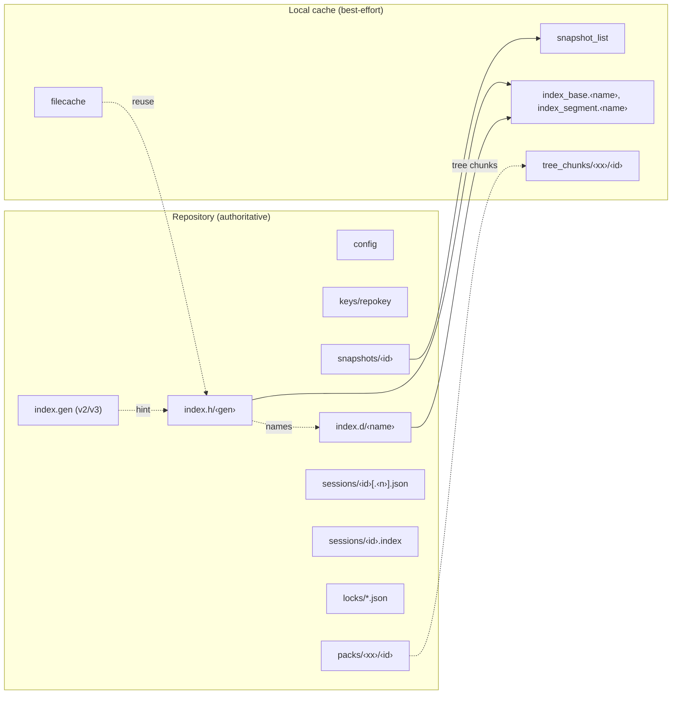
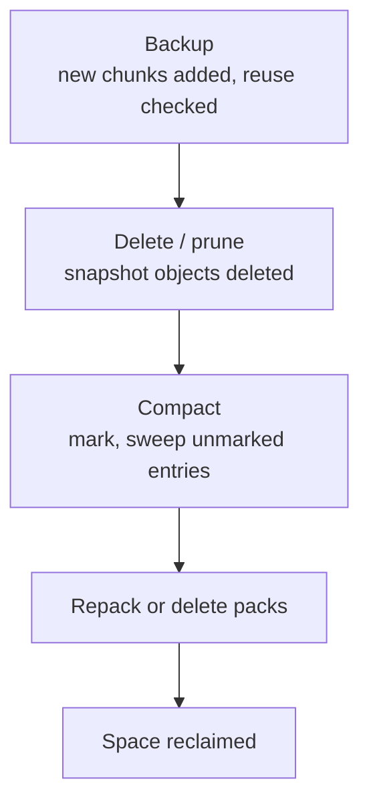
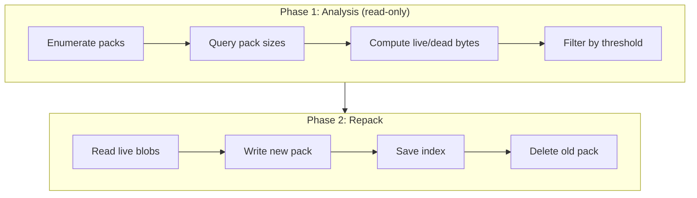
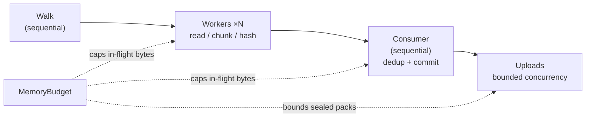

Technical reference for vykar's cryptographic, chunking, compression, concurrency, and repository-layout design decisions. The test strategy is described in [Testing](/testing).

---

## Cryptography

### Encryption

AEAD with 12-byte random nonces (`AES-256-GCM` or `ChaCha20-Poly1305`).

Rationale:
- Authenticated encryption with modern, audited constructions
- `auto` mode benchmarks `AES-256-GCM` vs `ChaCha20-Poly1305` at init and stores one concrete mode per repo
- Strong performance across mixed CPU capabilities (AES acceleration and non-AES acceleration)
- 32-byte symmetric keys (simpler key management than split-key schemes)
- AEAD AAD always includes the 1-byte type tag; for identity-bound objects it also includes a domain-separated object context (for example: `index`, snapshot ID, chunk ID, `filecache`, or `snapshot_cache`)

**Key usage model:** The master `encryption_key` is used directly as the AEAD symmetric key for all encryption operations throughout the lifetime of the repository. There is no per-session or per-snapshot key derivation. Cryptographic isolation between objects relies on random 12-byte nonces (unique per encryption call) and domain-separated AAD (binding ciphertext to object type and identity). With 96-bit random nonces, the birthday-bound collision threshold is approximately 2^48 encryptions under a single key — well beyond realistic backup workloads.

### Plaintext Mode (`none`)

When `encryption` is set to `none`, vykar uses a `PlaintextEngine` — an identity transform where `encrypt()` and `decrypt()` return data unchanged. AAD is ignored (there is no AEAD construction to bind it to). The format layer detects plaintext mode via `is_encrypting() == false` and uses the shorter wire format: `[1-byte type_tag][plaintext]` (1-byte overhead instead of 29 bytes).

This mode does **not** provide authentication or tamper protection — it is designed for trusted storage where confidentiality is unnecessary. Chunk data (file contents and item streams) is still protected against accidental corruption: its keyed chunk ID is recomputed and compared on every read (see [Hashing / Chunk IDs](#hashing--chunk-ids) below). The `index`, snapshot blobs and session journals carry no checksum in this mode.

### Key Derivation

The master key (64 bytes: 32-byte encryption key + 32-byte chunk ID key) is generated from OS entropy (`OsRng`) at repository init. It is never derived from the passphrase. Instead, the passphrase is used to derive a Key Encryption Key (KEK) via Argon2id, and the KEK wraps the master key with AES-256-GCM. The encrypted master key blob is stored at `keys/repokey` alongside the KDF parameters (algorithm, memory/time/parallelism costs, salt) and the wrapping nonce. Because the master key is random rather than derived, the passphrase and the key blob are **both** required and neither recovers the other — see [Key Redundancy](#key-redundancy).

Rationale:
- Two-layer scheme (random data key, passphrase-derived wrapping key) separates key strength from passphrase quality
- Argon2id is a modern memory-hard KDF recommended by OWASP and IETF
- Resists both GPU and ASIC brute-force attacks

In `none` mode no passphrase or key file is needed. The `chunk_id_key` is deterministically derived from `repo_id`, and *how* depends on the repository format:

| Format | Derivation |
|---|---|
| v2, v6 with `chunk_hash` blake2b | `BLAKE2b-256(repo_id)` |
| v3, v6 | `blake3::derive_key("vykar 2026-01-01 plaintext repository chunk-id key v1", repo_id)` |

`derive_key` rather than a plain `blake3::hash` for domain separation: it is a distinct BLAKE3 mode with its own flag bits, so this key lives in a different domain from chunk digests (keyed mode) and pack digests (unkeyed mode).

Since `repo_id` is stored unencrypted in the repo `config`, this key is not secret in either format — it exists only so that the same keyed hashing path is used in all modes. No `keys/repokey` file is created.

This is the **one** auxiliary hash that follows the repository format, because it *is* the chunk-ID key: a v2 repository must reproduce it byte-identically or lose its entire dedup index.

### Key Redundancy

The wrapped key is stored **twice**: at `keys/repokey` and `keys/repokey.2`. Both hold the *same serialized bytes*, not two independent wraps — a second wrap would pick a fresh salt and nonce, and being able to compare the two copies byte-for-byte is the point. Repositories created before this existed carry one copy; opening them backfills the second, best-effort (a read-only mount or read-only credentials simply leave it alone).

The redundancy buys two things:

- **Recovery.** If one copy rots, vykar opens off the other. `vykar check` re-reads both copies on every run and reports them as their own line; `vykar check --repair` rewrites a damaged copy from the good one without the `type 'repair'` prompt, since restoring a key copy cannot lose data.
- **A better error message.** A GCM authentication failure genuinely cannot distinguish "wrong key" from "damaged ciphertext" — they are the same event — so something outside the blob has to corroborate it. Damage that is unambiguous on its own (truncation, mangled msgpack framing, out-of-range Argon2id parameters) is reported as corruption rather than blamed on the operator's typing, and needs no second copy. When the two copies are byte-identical and still fail to unwrap, the message says *likely* incorrect passphrase. Deliberately hedged: on a copy-on-write or deduplicating filesystem, or after `cp --reflink`, the two objects can share physical extents, so a single bad block would corrupt both identically.

When the copies **disagree**, no candidate is accepted without positive proof. vykar weighs each one against evidence outside the key blob. The local identity pin is decisive in both directions: a contradiction is a hard disproof, and a matching pin is accepted without consulting repository data at all. Only without a pin is repository-authored ciphertext tried, starting with the `index` object that `init` writes even for an empty repository. Exactly one candidate established means that one wins; nothing established, or both, means the open fails, naming the two conflicting copies. A pin that contradicts *both* candidates is reported as an identity mismatch with the usual `--trust-repo` remedy, not as an unresolvable repository.

That applies even when only one of the two divergent copies unwraps at all. "It was the only one that unwrapped" is not evidence: an attacker who can write to the repository can plant a copy wrapped under a passphrase of their choosing, and accepting it would let `check --repair` rewrite the genuine copy from it — which cannot be undone. Absence of evidence is only tolerable where there is no rival candidate: a single copy, two identical ones, or two independent wraps of the same key.

Every degraded state — a missing copy, a copy that disagrees, a backfill that could not land — is logged as a warning at open, so an ordinary command surfaces it on stderr rather than only `vykar check`.

An **unreadable** copy is distinguished from a missing one. An I/O or permission failure on one object must not defeat the redundancy the other exists to provide, so the open proceeds off the survivor — and the unreadable object is left strictly alone, never backfilled over, since it may well be intact.

Redundancy inside the repository covers bit rot, not loss of the storage. `vykar key export` and `vykar key import` (see [Commands](/commands)) move the passphrase-protected blob in and out of a password manager. Both work on raw storage rather than through `Repo::open`: `import` because it runs on a repository that can no longer be opened, `export` because a recovery tool for the key must not fail on an unreadable index head, scale with the snapshot count, or write anything. Export uses the same copy selection as `open`, so it can never hand out a copy `open` would have rejected. A key belongs to exactly one repository, so both commands require `-R` when several are configured.

### Hashing / Chunk IDs

A **keyed** 256-bit hash of the chunk plaintext, using a `chunk_id_key` derived from the master key. The algorithm is fixed by the repository format:

| Format | Chunk ID | Pack ID |
|---|---|---|
| v2, v6 with `chunk_hash` blake2b | keyed BLAKE2b-256 | unkeyed BLAKE2b-256 |
| v3, v6 | keyed BLAKE3 | unkeyed BLAKE3 |

Chunk IDs are **always keyed**, in both algorithms. `index/hasher.rs` takes the first eight bytes of the digest as a hash-map bucket key, which is only safe because an attacker who controls chunk content cannot predict the digest; an unkeyed hash here would be a hash-flooding hole. Pack IDs are **always unkeyed**, in both algorithms: a pack ID is a storage key the server must be able to recompute from the bytes alone, without any repository key.

Why a keyed hash at all:

- Prevents content confirmation attacks (an adversary cannot check whether known plaintext exists in the backup without the key)
- Trade-off: keyed IDs prevent dedup across different encryption keys (acceptable for vykar's single-key-per-repo model)

Why not SHA-256:

- Both BLAKE2b and BLAKE3 are faster than SHA-256 in pure software. On CPUs with hardware SHA-256 acceleration (SHA-NI on x86, SHA extensions on ARM) hardware SHA-256 can beat BLAKE2b, but the BLAKE family gives consistent performance across all architectures without depending on hardware-specific instruction sets.

Why BLAKE3 for new repositories (formats v3 and v6):

- Hashing is a first-order CPU cost on two paths where dedup skips everything downstream. On a **file-cache miss with mostly-unchanged content** (VM images, databases, mail files) the file is fully re-read, chunked and hashed; chunks that dedup out skip compression, encryption and upload entirely, so per-byte cost there is read + chunk + hash. In `check --verify-data` under `encryption: none`, hashing dominates outright, and under `none` every chunk read (restore, list, diff, mount) is hashed too.
- Within a file (or a 64 MiB segment of a large file) hashing is single-threaded, so per-core hash throughput is the per-segment ceiling. BLAKE3's internal tree mode gives it a large per-core advantage even without multi-threading: measurements in [issue #177](https://github.com/borgbase/vykar/issues/177) show `blake3::keyed_hash` at ~2.15 GB/s against ~1.4 GB/s for keyed BLAKE2b-256 on Apple Silicon, with a wider gap on x86-64.
- BLAKE3 is used single-threaded (`hash` / `keyed_hash`); vykar never calls `update_rayon`, and parallelism comes from the existing per-file/per-segment workers instead.

In `none` mode the same keyed construction is used, but the key is derived from the public `repo_id` rather than a secret master key. The MAC therefore acts as a **checksum for corruption detection**, not as authentication against tampering. Because there is no AEAD tag, every chunk read in `none` mode (restore, list, diff, mount) recomputes the chunk ID and fails on a mismatch. `vykar check --verify-data` recomputes chunk IDs and compares them to detect bit-rot or storage corruption — this works identically across all encryption modes and both formats. The exception is a REST repository whose server supports pack verification: packs the server verifies (structure and pack hash, without any key) are skipped by the client, so their chunk IDs are not recomputed unless `--distrust-server` is added.

---

## Content Processing

### Chunking

FastCDC (content-defined chunking) via the `fastcdc` v3 crate.

Default parameters: 512 KiB min, 2 MiB average, 8 MiB max (configurable in YAML).
`chunker.max_size` is hard-capped at 16 MiB during config validation.

Rationale:
- Newer algorithm, benchmarks faster than Rabin fingerprinting
- Good deduplication ratio with configurable chunk boundaries

### Compression

Per-chunk compression with a 1-byte tag prefix. Supported algorithms: LZ4, ZSTD, and None. The tag identifies the codec only, not the compression level — the ZSTD level is a repo-wide configuration setting. Recompression at a different level requires decompressing and recompressing every chunk.

Rationale:
- Per-chunk tags allow mixing algorithms within a single repository
- LZ4 for speed-sensitive workloads, ZSTD for better compression ratios. LZ4 is recommended over None for most workloads — even on incompressible data the overhead is negligible, and the reduced I/O and transfer size typically more than compensate
- No repository-wide format version lock-in for compression choice
- ZSTD compression reuses a thread-local compressor context per level, reducing allocation churn in parallel backup paths
- Decompression enforces a hard output cap (32 MiB) to bound memory usage and mitigate decompression-bomb inputs

### Deduplication

Content-addressed deduplication uses keyed `ChunkId` values (keyed BLAKE2b-256 in format v2 and in v6 repositories upgraded from it, keyed BLAKE3 in v3 and v6 otherwise). Identical plaintext produces the same `ChunkId`, so the second copy is not stored; the reference is only recorded as reused. Because the algorithm is part of the chunk's identity, **dedup never spans chunk hashes** — which is also why the hash cannot be changed in place (the index layout can, see [Repository Versions](#repository-versions)).

The repository's chunk index is one memory-mapped **chunk table** per base, the head's segments applied over it in memory, and this process's edits (`LiveIndex`, see [Local Optimization Caches](#local-optimization-caches-client-machine)). There is one lookup path for backup, restore, compact and check; no dedup mode is chosen.

**Dedup check during a write session** (`WriteSession::store`, the one chunk-store entry of backup, dumps and the item stream):
1. **Chunks stored earlier in this session** — a small `session_new` map
2. **The session's view of the index** — first the additions of the head's segments applied over the table (found by key, and recorded as reused by key), then an xor filter (`xorf::Xor8`, built once per table) as probabilistic negative check and a binary search of the mapped table. A table hit is recorded as reused by *table position* (`ReusedChunks`: one bit per table entry, and a key set for everything outside the table); no count is kept. The commit checks the reused chunks again only when the head changed in a way that can have removed entries (see [Commit Check](#commit-check)). Backup workers run this check themselves (`DedupPrefilter`) and send a confirmed hit without its data. Over an index with unsaved edits (repair) the lookup goes through the live index by key instead, with no prefilter.
3. **Chunks recovered** from an interrupted session's journal
4. **Pending pack writers** — blobs buffered in data/tree `PackWriter`s that have not yet been flushed

This prevents duplicates both across backups and within a single backup run.

---

## Serialization

All persistent data structures use **msgpack** via `rmp_serde`. Structs serialize as **positional arrays** (not named-field maps) for compactness. This means field order matters — adding or removing fields requires careful versioning, and `#[serde(skip_serializing_if)]` must not be used on `Item` fields (it would break positional deserialization of existing data).

### RepoObj Envelope

Every repo object and local encrypted cache blob uses the same `RepoObj` envelope (`repo/format.rs`). The wire format depends on the encryption mode:

```text
Encrypted:  [1-byte type_tag][12-byte nonce][ciphertext + 16-byte AEAD tag]
Plaintext:  [1-byte type_tag][plaintext]
```

The type tag identifies the object kind via the `ObjectType` enum:

| Tag | ObjectType | Used for |
|-----|------------|----------|
| 0 | Config | Repository configuration (stored unencrypted) |
| 1 | Manifest | Legacy manifest object tag (unused in v2 repositories) |
| 2 | SnapshotMeta | Per-snapshot metadata |
| 3 | ChunkData | Compressed file/item-stream chunks |
| 4 | ChunkIndex | Encrypted `IndexBlob` stored at `index` |
| 5 | PackHeader | Reserved legacy tag; not used for trailers |
| 6 | FileCache | Local file-level cache (inode/mtime skip) |
| 7 | PendingIndex | Transient crash-recovery journal |
| 8 | SnapshotCache | Local snapshot-list cache |
| 9 | IndexHead | Index head stored at `index.h/<gen>` (v6; v4/v5 kept it at `index`) |
| 10 | IndexBase | Segmented index base under `index.d/` |
| 11 | IndexSegment | Segmented index segment under `index.d/` |
| 12 | PackTrailer | Last framed blob of a pack: its blob list |
| 13 | PackMap | Blob lists of packs without a trailer, under `packmaps/` |
| 14 | SweepRecord | What one mark-and-sweep found, under `index.d/` (v6) |

The type tag byte is always included in AAD (authenticated additional data). For identity-bound objects, AAD also includes a domain-separated object context, binding ciphertext to both object type and identity (for example, `ChunkData` to its `ChunkId`, `SnapshotMeta` to snapshot ID, `ChunkIndex` to `b"index"`, `IndexHead` to `b"index.h"`, `IndexBase`, `IndexSegment` and `SweepRecord` to the static `b"index.d/base"`, `b"index.d/segment"` and `b"index.d/sweep"`, `FileCache` to `b"filecache"`, `SnapshotCache` to `b"snapshot_cache"`, `PackTrailer` to the static `b"pack-trailer"`, and `PackMap` to the static `b"packmap"`; as for `index.d/`, a pack map's name is the BLAKE3 of its stored bytes and is checked first).

### Format Evolution

The **item stream** evolves by an *expand → contract* rule. The rule does not apply to the two frozen structures: `config` keeps the seven fields of 0.19-0.24 under their old names and types for good, in a map from v6 on (see [Repository Versions](#repository-versions)), and the `SnapshotMeta` envelope has been frozen since 0.17 (below) — new snapshot-level metadata goes into its `ext` blob instead.

- **Expand:** append a field with `#[serde(default)]`. New binaries still read old snapshots; older binaries cannot read the new ones (see below), so an expansion is still a one-way step for a shared repository. Already done for `Item.link_target`, `Item.xattrs`, `Item.raw_names`, `Item.hardlink`, and `SnapshotMeta.{comment, source_paths, label, ext, format_version}`. `Item.hardlink` ships under format **v1** (no bump), alongside the `format_version` envelope field itself — both landed together in **0.17.0**, so there is a single "0.17 introduces format v1" story rather than two versions in the wild. That release took the `SnapshotMeta` envelope from 12 fields to 14, which is why a pre-0.17 binary reports `array had incorrect length, expected 12` against a 0.17+ snapshot.
- **Contract (breaking, batched):** remove or retype a field — only when a larger forced break (crypto, chunking) already requires one; cleanups ride that train rather than justifying a break alone.

**Format 2** changes only how chunk IDs are encoded in `Item.chunks` and `SnapshotMeta.item_ptrs`: each is a msgpack bin of 32 bytes (34 bytes on the wire) instead of `ChunkId`'s derived array of 32 integers (about 51 bytes). Writers stamp 2. Readers use one decoder (`snapshot::bin_id`) for every snapshot, whatever its `format_version`: it accepts the format-2 bin and format 1's integer array, exactly 32 bytes or elements, so format-1 and legacy-0 snapshots read as before. The `check --repair` rewriter re-encodes every kept item, so a rewritten format-1 snapshot comes out as format 2. `ChunkId`'s own encoding, used by the index, pack maps, file cache, journal and protocol, is unchanged.

Compatibility is **backward-readable, not forward-compatible**: a new binary reads old snapshots, but older binaries are **not** guaranteed to read newer item streams (rmp-serde rejects a longer-than-expected positional array, so an old reader hits a length mismatch on the first extended record). `SnapshotMeta.format_version` (absent/`0` = legacy) is the discriminator; current writers stamp the latest (`CURRENT_FORMAT_VERSION`) and readers reject anything newer than they support. `check` treats a newer snapshot as **unsupported, never corrupt**, and `check --repair` refuses to run while one is present (its sweep requires decoding every surviving snapshot).

Two distinct signals mean "newer writer", and both are classified as unsupported rather than corrupt:

1. **A decodable envelope with a higher `format_version`** — caught by `SnapshotMeta::supported()`.
2. **An envelope whose field count differs**, so `format_version` cannot be read at all. This is sound because of what precedes it: the AEAD decrypt has already succeeded, proving the bytes are intact and the key is right, and a *shorter* array still decodes via `#[serde(default)]` — so a length mismatch can only mean a *longer* array, i.e. a newer writer. Never corruption.

Case 2 is the one the `format_version` discriminator structurally cannot cover, and it must be classified separately: left as `CorruptSnapshot`, `check --repair` would emit `RemoveCorruptSnapshot` and **delete another host's snapshot**.

A snapshot this binary cannot read is **hidden, never damaged**. It is excluded from the manifest, but the exclusion is reported — `vykar list` prints `N snapshots hidden: written by a newer vykar` rather than silently returning a short list, and the warning is emitted once per process rather than once per repository open.

`SnapshotMeta`'s envelope (the fields up to `format_version`) is **frozen** — its field count never changes and existing fields are never removed, so `format_version` is always decodable and a future snapshot is recognized rather than mistaken for corruption. One element type changed once: format 2 writes `item_ptrs` as 32-byte bins. That keeps the envelope decodable by format-1 binaries, because rmp-serde reads a 32-byte bin into a derived `[u8; 32]` (pinned by `format_1_reader_refuses_format_2_by_version`), so those binaries refuse a format-2 snapshot by version. Any future retype needs the same proof: a test that decodes the new bytes with the old types. All breaking cleanups therefore live in the **item stream**, gated by `format_version`:

- **Paths → bytes.** `Item.path` / `Item.link_target` are UTF-8 `String`; non-UTF8 names are preserved out-of-band in the additive `Item.raw_names` byte field (`path` / `link_target` remain the lossy display strings, the raw bytes are authoritative at restore time on Unix). At the next item-stream version, collapse into one canonical byte field and drop the lossy String shadow.
- **Xattr names → bytes.** `Item.xattrs` keys are `String`; non-UTF8 xattr names are dropped with a warning today. Retype keys to bytes (niche — names are usually ASCII).

**Hard links** use a *content-on-every-node* representation (restic-style): a regular file with `nlink > 1` keeps its full chunk list and additionally records its source `(dev, ino)` in the optional `Item.hardlink` field. Restore regroups members by `(dev, ino)`, materializes the first member of each group from its chunks (the representative), and relinks the rest to it; a member is linked only when its **content** matches the representative — identity is a BLAKE2b-256 fingerprint over the ordered chunk-id list, which is authoritative because chunk ids are content-addressed. A mismatch (inode-number reuse handing the same `(dev, ino)` to different content) declines to link and materializes that member from its own chunks instead, so a member's own bytes are never silently replaced by the representative's. The relink stays inside the restore temp root (one filesystem, so links survive the final inode-preserving rename) and validates the link target's parent against the root unconditionally; a planted symlinked parent that escapes the root, or any failure to place a link's content (after a copy fallback), is fatal — restore never reports success with a requested path missing. Two properties fall out of this design: every member lists its own chunks, so the [mark](#mark) reaches them from any member and deleting some members needs no special-casing, and restore is robust to partial views — *we never assume we see all N links*, so a single in-set member (filtered group, link outside the source) is just a normal file. The accepted cost is redundant chunk-lists in the item stream for extreme fan-out, which dedup makes free in storage.

Snapshot-level metadata goes inside the `ext` blob rather than as new outer fields, so the frozen envelope and its discriminator stay intact without a tolerant-envelope rework. `ext` holds `SnapshotExt = [ext_version: u32, listing, ...]`, today the listing key index (see [Item Stream](#item-stream)). It is versioned on its own, not by `format_version`, and its frame is frozen: a msgpack array whose first element is the u32 version. A reader ignores, and scans the listing instead of using: an `ext` whose version it does not know (only when that frame holds), an unknown order, and an `ext` that does not decode or validate; it also ignores trailing elements after the members it knows. Everything `ext` holds is advisory and self-checking (a reader that ignores `ext` lists exactly the same entries), so an `ext` change never needs a `format_version` bump, and binaries that predate the index read such a snapshot unchanged (none reads `ext`). The index describes one exact `item_ptrs`: whatever rewrites a snapshot's `item_ptrs` must replace `ext` or drop it, because a copied index is not always detected by the reader's structural checks (the `check --repair` rewriter replaces it; `check` warns about one that does not match). Anything a reader must understand to read a snapshot correctly cannot go into `ext`; it needs a `format_version` bump, and trailing members must be advisory too. `ext` is still a compatibility surface: positional msgpack, changed only together with an `ext_version` bump.

#### Repository Versions

`config`'s `version` is the *repository layout* version, distinct from `SnapshotMeta.format_version` above. It answers "what must a reader understand to read this repository?":

| `version` | `config` | Chunk ID | Pack ID | Index | Written by |
|---|---|---|---|---|---|
| 2 | positional, 7 fields | keyed BLAKE2b-256 | unkeyed BLAKE2b-256 | monolithic | `init` up to 0.19 |
| 3 | positional, 7 fields | keyed BLAKE3 | unkeyed BLAKE3 | monolithic | `init` 0.20 to 0.24 |
| 4, 5 | positional | as 2, 3 | as 2, 3 | segmented, mutable head at `index` | development builds only; refused by version |
| 6, 7 (positional) | positional | | | numbered heads, v1 objects | development builds of 05 step 8 only; refused ("created by a development build ... Create a new repository") |
| 6 | map: the seven old fields, `chunk_hash`, `features` | keyed, `chunk_hash` (`blake3`, or `blake2b` when upgraded from v2) | unkeyed, `chunk_hash` | numbered heads at `index.h/<gen>`, base and keyed segments (v2 bodies), mark-and-sweep | `init`, `vykar upgrade` of v2 and v3 |

`RepoConfig::decode` tells a map from an array by its first byte; `DecodedConfig::validate` is the single gate and returns a `RepoFormat` (`V2`, `V3` or `V6(hash)`): a map must say version 6 (a higher version is `UnsupportedVersion`), name a known `chunk_hash` and only known `features` (today `multi_writer`, see [Phase 2](#phase-2-commit-lock-free-or-under-the-exclusive-lock); else "written by a newer vykar"); a positional config is accepted only at 2 and 3. The **hash never changes** for a repository: it is the dedup identity of every chunk and part of every pack's storage key, so a v2 repository is upgraded to v6 with `chunk_hash` `blake2b` and stays BLAKE2b for life. v2 and v3 are **upgrade-only** (`is_upgrade_only()`): every open except the one `vykar upgrade` makes refuses them, right after reading `config` and before the key is loaded, with an error that names `vykar upgrade`; `init` can no longer create them. `key export`/`key import`, `delete-repo` and `break-lock` work on raw storage and keep working on them. The **index layout can change**, once and one way: `vykar upgrade` moves v2 and v3 to v6 in place (see [In-Place Upgrade](#in-place-upgrade)). It is never automatic, because it locks out older binaries on every other machine. `vykar info` reports the format, the hash, the base and segment sizes, and the last sweep.

There is deliberately **no user-facing choice** at `init`: no `--hash` flag, no YAML key. `init` always creates v6 with BLAKE3. Two accepted consequences: older binaries cannot open a repository created by a newer release (`unsupported repository version: 6`), so a fleet sharing a new repository must upgrade together; and a self-hosted `vykar-server` must be upgraded before a new repository can be created against it (a pre-flight `/health` probe at `init` checks BLAKE3 support, the `segmented_index` capability and that `key_dirs` lists `index.h` and `packmaps`, so that fails cleanly rather than at the first backup).

**Why the v6 `config` is a map.** The positional config of v2/v3 cannot grow: `#[serde(default)]` rescues *shorter* arrays, but rmp-serde **errors on longer ones** (`array had incorrect length, expected N`) — an old binary reading an 8-field array would fail *before* its version gate, with a parse error that looks like corruption. A msgpack map decodes into the old seven-field struct (rmp-serde reads a struct from a map by name and ignores unknown keys), so 0.19.x and 0.20-0.24 reach their gate and say `unsupported repository version: 6` (`tests/legacy_config_refusal.rs` runs the releases' vendored types on the real encoder's bytes, on upgraded fixtures and on a fresh repository; `scripts/check-old-release-refusal.sh` runs the release binaries). The seven old fields therefore stay under their old names and msgpack types for good; `id` stays an array of integers. New fields are additive: a reader ignores unknown keys, and one it must understand is named in `features`. `RepoConfig::encode` writes only version 6, so a v2/v3 value is never written as a map (old releases would read it at their own version).

**Auxiliary hashes.** Only chunk IDs and pack IDs follow the format. Every other digest vykar computes is BLAKE3 for every version (BLAKE2b up to 0.23):

| Digest | Persisted in | Effect of the switch from BLAKE2b |
|---|---|---|
| TOFU identity fingerprint (`derive_key` over `repo_id ‖ chunk_id_key`) | `pin3.<BLAKE3(url)>` | Old `pin.*` files are ignored: the first open per client per repository re-pins without verification |
| Check-state file name | `check3.<BLAKE3(url)>` | Old state orphaned; the next `check` is a full one |
| `PathHash` in the file cache (first 16 bytes of BLAKE3) | `filecache` | Old caches rejected; the next backup re-reads every file once |
| Local table checksum trailer | `full_index_cache`, then `chunk_table.<state>`, now `index_base.<name>` | Rebuilt once (the earlier files are deleted by age) |
| Index blob digest (conditional-GET validator of 0.24 and earlier) | `index_blob` | No longer written; `vykar upgrade` deletes it |
| Index object names | `index.d/`, head | none (BLAKE3 from the start) |
| Hard-link `chunks_fingerprint` | runtime only | none |

Non-pack REST uploads carry `X-Content-BLAKE3` when the server advertises `blake3` (or the repository is v3, whose packs already require it), and `X-Content-BLAKE2b` only for a pre-0.20 server. BLAKE2b remains for the v2 chunk/pack format and that fallback.

The single exception is the plaintext-mode `chunk_id_key` derivation, which *is* the chunk-ID key and therefore must follow the format — see [Key Derivation](#key-derivation).

---

## Repository Format

### On-Disk Layout

`version = 6` (a map config) is what `vykar init` and `vykar upgrade` write; versions 2 and 3 (positional) are opened only by `vykar upgrade`, and every other version is refused. See [Repository Versions](#repository-versions).

```text
<repo>/
|- config                    # Repository metadata (unencrypted msgpack; a map from v6 on)
|- keys/repokey              # Encrypted master key (Argon2id-wrapped; absent in `none` mode)
|- keys/repokey.2            # Byte-identical redundant copy (see Key Redundancy)
|- index                     # v2/v3 only: encrypted IndexBlob { generation, chunks }; absent in v6
|- index.h/<gen>             # v6: write-once encrypted IndexHead (msgpack map, layout 3) per generation; the highest wins
|- index.d/<64 hex>          # v6: write-once index bases and keyed segments (body version 2) and sweep records, named by the BLAKE3 of their bytes
|- packmaps/<64 hex>         # Write-once pack maps (blob lists of packs without a trailer, e.g. every pre-upgrade pack), named by the BLAKE3 of their bytes
|- index.gen                 # v2/v3 only (written by 0.24 and earlier): unencrypted advisory u64 generation hint
|- snapshots/<id>            # Encrypted snapshot metadata; source of truth for snapshot listing
|- sessions/<id>[.<n>].json  # Session presence markers (concurrent backups; the newest generation is the live one)
|- sessions/<id>.index       # Per-session crash-recovery journals (absent after clean backup)
|- packs/<xx>/<pack-id>      # Pack files containing compressed+encrypted chunks (256 shard dirs)
`- locks/                    # Advisory lock files
```

### Local Optimization Caches (Client Machine)

These files live under a per-repo local cache root. By default this is the platform cache directory + `vykar` (for example, `~/.cache/vykar/<repo_id_hex>/...` on Linux, `~/Library/Caches/vykar/<repo_id_hex>/...` on macOS). If `cache_dir` is set in config, that path becomes the cache root. These are optimization artifacts, not repository source of truth.

```text
<cache>/<repo_id_hex>/
|- filecache                 # File metadata -> cached ChunkRefs
|- snapshot_list             # Snapshot ID -> SnapshotEntry cache
|- index_base.<name hex>    # One base: its decoded body (fixed-width records) + BLAKE3 trailer (mmap)
|- index_segment.<name hex> # One segment object of the head, as stored (encrypted)
|- tree_chunks/<xx>/<id>     # Tree (item-stream) chunks: stored blob bytes, one file each
`- index_blob                # 0.24 and earlier only: the v2/v3 index blob this machine last wrote;
                             #   no longer read or written, deleted by `vykar upgrade`
```

A chunk table is the decoded body of one base object (base v2: a pack table, then sorted 44-byte records), `magic "VYKTBL02" | body_len u64 | body | BLAKE3(body)`, named after the base object and verified on every open (checksum and canonical body); a file that fails is ignored. The head's segments are kept beside it as `index_segment.<name>`, exactly as `GET` returned them, and read back only after the name check (BLAKE3 and size) every `index.d/` read makes; a file that fails is deleted and fetched again. Rules, so that any number of processes can share one cache dir:

- A file is written once, through a uniquely named temp file published with a no-clobber link; it is never modified, renamed over or replaced. A base name that is already taken is adopted when its content verifies, and replaced only when it does not.
- A file is deleted (after a sync or a write that used the cache dir) only if the current head does not name it, no table of this process maps it, and its mtime is more than an hour old. The 80-byte `chunk_table.<state>` files of earlier development builds are deleted by the same rule. On Unix a deleted table stays readable through every mapping; a process that later looks for it finds it gone and downloads the base again.
- A sync starts from the repository's own index (its table and applied segments) when the head extends it, else from `index_base.<name>` of the head's base, and applies the missing segments in memory; a write needs no local file. Between folds nothing local is rewritten: a write adds one small segment file.

The **tree-chunk cache** (`tree_chunks/<first id byte hex>/<chunk id hex>`) holds one file per tree chunk with the chunk's stored blob bytes, exactly as in its pack: compressed and, for an encrypted repository, encrypted with the chunk ID as AAD. Backup writes every new tree chunk it stores, and readers write what they download. List, diff, find, mount, restore, compact's mark and backup's parent-snapshot load read it first, decode an entry like a pack blob and download only the misses; the item pointers are still resolved through the index first, so a chunk the index lacks fails even when it is cached. `check`, `check --repair` and the simulator's checker never read it and their reads do not fill it, so they verify what storage holds (the listing chunks a repair rewrites are cached like any stored tree chunk); the other readers no longer notice a corrupt or missing tree blob in storage while the chunk is cached. After a compact's sweep is written, entries of tree chunks the mark did not reach are deleted; prune, delete and backup drop nothing, so cached tree chunks of deleted snapshots stay until the next compact. Entries are content-addressed and every failure is a miss: an entry that does not decode is deleted and the chunk downloaded, a failed write disables writing for the handle, and nothing is fsynced. Entries are written through unique `.tc-*` temp files renamed into place (temps older than an hour are deleted by the drop), so processes sharing the cache dir need no coordination; a drop in one process can delete entries a backup running in another has just written, which costs that backup's next reader a download. The cache has no size cap.

The **file cache** (`filecache`, one file per repository: per source root a section of file metadata and chunk references, anchored at the snapshot that wrote it) is loaded at open and saved after a backup's commit point by an atomic rename. Two processes on one host (a daemon and a CLI run) merge their sections: the save takes the local lock `filecache.lock` beside the file (an OS file lock, never deleted; polled for at most 30 s, since the save runs after the commit point with the commit lock held, then the save goes on without it, with a warning). When the file is the one this process loaded or last saved (same size, mtime and inode), the save is a single write. Otherwise another process saved since: this process drops its copies of the sections it did not write (stale), re-reads the file without decoding the sections it is about to replace, keeps the other process's sections except those anchored at a snapshot this process invalidated (deleted), and writes the result. For a root both processes wrote, the last save wins, each section consistent with its own anchor snapshot. A file that does not read, decrypt or carry this binary's format byte (another vykar version's cache, say) is not merged: the save writes everything this process holds. A file that fails later, mid-decode, contributes nothing, and this process's copies of the sections it did not write are already dropped then. A save that went on without the lock records no stamp, so the next save merges. A failed backup never saves the file cache.

The fixed-name caches of earlier binaries (`dedup_cache`, `restore_cache`, `full_index_cache`) are deleted at open. Without a cache dir, or for `check`'s verifying load (which reads and writes no local file), the table lives in a temp file kept by the repository handle.

In v2/v3 the authenticated generation is `IndexBlob.generation` inside `index`, and `index.gen` is an advisory hint that only pre-0.25 binaries write and read. This vykar reads neither outside `vykar upgrade`, which GETs and decodes the `IndexBlob` once. The client no longer sends `If-None-Match`; vykar-server still answers it (`304`) for 0.24 clients.

The `snapshot_list` cache is separate: on open/refresh, the client lists `snapshots/`, removes stale local entries, loads only new snapshot blobs, and persists the resulting snapshot list locally. This avoids O(n) snapshot metadata GETs on every open.

The same per-repo cache root is also used as the preferred temp location for intermediate files (e.g. cache rebuilds).

#### Repository And Cache Topology



### Key Data Structures

**IndexBlob** — v2/v3 only: the encrypted object stored at the `index` key, as vykar 0.19 to 0.24 wrote it (`index::legacy`). Read only by `vykar upgrade`; encoded only by tests and fuzz seeds. Its types (`IndexBlob`, `LegacyChunkIndex`, `LegacyIndexEntry`) are a frozen wire format.

| Field | Type | Description |
|-------|------|-------------|
| generation | u64 | Authenticated cache-validity token rotated when the index changes |
| chunks | LegacyChunkIndex | `HashMap<ChunkId, LegacyIndexEntry>`: `refcount` (u32), `stored_size`, `pack_id`, `pack_offset` |

The legacy `refcount` is the only count left: the upgrade drops entries at 0 (garbage the old release had not removed yet) and discards the others.

**ChunkIndexEntry** — where a chunk is stored; in memory only, never serialized. v6 stores the entries as a base plus segments ([segmented index](#segmented-index-v6)) and holds them in a `LiveIndex` (mapped base table, the head's segments applied in memory, and edits), the central lookup table for deduplication, restore, and compaction. `ChunkIndex`, a plain map of the same entries, serves the rebuild, oracles and tests.

| Field | Type | Description |
|-------|------|-------------|
| stored_size | u32 | Size in bytes as stored (compressed + encrypted) |
| pack_id | PackId | Which pack file contains this chunk |
| pack_offset | u64 | Byte offset within the pack file |

**Manifest** — runtime-only in-memory snapshot list derived from `snapshots/` and the local `snapshot_list` cache. It is not persisted to repository storage.

| Field | Type | Description |
|-------|------|-------------|
| version | u32 | Format version (currently 1) |
| timestamp | DateTime | Last modification time |
| snapshots | Vec\<SnapshotEntry\> | One entry per snapshot |

**SnapshotListCache** — local encrypted map from snapshot ID hex to `SnapshotEntry`. It is refreshed incrementally from `snapshots/` and exists only to avoid repeatedly downloading every snapshot blob on open.

Each `SnapshotEntry` contains: `name`, `id` (32-byte random), `time`, `source_label`, `label`, `source_paths`, `hostname`.

**SnapshotMeta** — per-snapshot metadata stored at `snapshots/<id>`.

| Field | Type | Description |
|-------|------|-------------|
| name | String | User-provided snapshot name |
| hostname | String | Machine that created the backup |
| username | String | User that ran the backup |
| time / time_end | DateTime | Backup start and end timestamps |
| chunker_params | ChunkerParams | CDC parameters used for this snapshot |
| comment | String | Optional snapshot comment field; currently written as `""` by backup flows |
| item_ptrs | Vec\<ChunkId\> | Chunk IDs containing the serialized item stream; one 32-byte bin per pointer from format 2 (arrays of 32 integers in format 1) |
| stats | SnapshotStats | File count, original/compressed/deduplicated sizes |
| source_label | String | Config label for the source |
| source_paths | Vec\<String\> | Directories that were backed up |
| label | String | Legacy compatibility field; new snapshots currently write `""` |
| ext | Option\<Vec\<u8\>\> | `SnapshotExt`: the listing key index, see [Item Stream](#item-stream); `None` in snapshots written before it |
| format_version | u32 | Format discriminator (frozen last field; absent/`0` = legacy, current writers stamp `CURRENT_FORMAT_VERSION`) |

**SnapshotStats** — per-snapshot counters stored inside `SnapshotMeta.stats`.

| Field | Type | Description |
|-------|------|-------------|
| nfiles | u64 | Number of backed-up regular files plus command-dump virtual files |
| original_size | u64 | Total plaintext bytes before compression/dedup |
| compressed_size | u64 | Total bytes after compression |
| deduplicated_size | u64 | Bytes newly stored after deduplication |
| errors | u64 | Number of soft file-read errors skipped during backup |

`deduplicated_size` records the bytes newly stored at the time the snapshot was created. It depends on the global repository state at that moment and becomes stale if other snapshots are later deleted — a snapshot that originally shared all its chunks (showing `deduplicated_size ≈ 0`) may become the sole owner of those chunks after the other snapshot is removed. Treat this field as a creation-time accounting metric, not a durable measure of a snapshot's unique storage footprint.

**Item** — a single filesystem entry within a snapshot's item stream.

| Field | Type | Description |
|-------|------|-------------|
| path | String | Relative path within the backup |
| entry_type | ItemType | `RegularFile`, `Directory`, or `Symlink` |
| mode | u32 | Unix permission bits |
| uid / gid | u32 | Owner and group IDs |
| user / group | Option\<String\> | Owner and group names |
| mtime | i64 | Modification time (nanoseconds since epoch) |
| atime / ctime | Option\<i64\> | Access and change times |
| size | u64 | Original file size |
| chunks | Vec\<ChunkRef\> | Content chunks (regular files only) |
| link_target | Option\<String\> | Symlink target |
| xattrs | Option\<HashMap\> | Extended attributes |
| raw_names | Option\<ItemRawNames\> | Byte-faithful `path` / `link_target` for non-UTF8 names (Unix); `None` for the common UTF-8 case |

**ChunkRef** — reference to a stored chunk, used in `Item.chunks`:

| Field | Type | Description |
|-------|------|-------------|
| id | ChunkId, 32-byte bin from format 2 | Content-addressed chunk identifier (an array of 32 integers in format 1) |
| size | u32 | Uncompressed (original) size |
| csize | u32 | Stored size (compressed + encrypted) |

The uncompressed `size` is stored per-reference so the restore path can size its output buffers up front, pass it as a size hint to the ZSTD one-shot decompressor, and then validate the decoded length against it. The chunk index holds only the stored size; readers without this field (e.g. `check --verify-data`) use the same decompressor and take the size from the ZSTD frame header instead, so both paths accept and reject the same frames. Every chunk read (restore, `read_chunk`, coalesced reads, the item stream and `check --verify-data`) decodes through `repo::format::decode_chunk_into`, which takes the size hint as an optional argument.

### Segmented Index (v6)

A monolithic index (v2/v3) is rewritten whole on every change: on a repository with millions of chunks that is hundreds of megabytes per backup, prune and compact. v6 stores the same entries as a base plus segments, so a write uploads what it changed (`repo/index_store.rs`, `repo/index_write.rs`, `index/{head,base_v2,segment_v2,sweep_record}.rs`).

```text
index.h/<gen>        # write-once, small: IndexHead of generation <gen>; the highest generation is the state
index.d/<64 hex>     # write-once: base, segment or sweep record, name = BLAKE3 of the stored bytes
```

- **The state is the head.** An index state is the head's base with its segments applied in the head's order; no state hash exists. Local files are matched by object name.
- **Head** (`IndexHead`, a msgpack **map** with named keys, `layout` = 3, AEAD context `index.h`): `gen` (equal to its key's generation, checked), `features` (written empty; a head naming a feature this binary does not know is refused as written by a newer vykar; readers ignore unknown keys, so a later field is additive), `base: Option<{name, size, entries}>` (`None` = the empty table, which `init` writes at `index.h/1`), `segments: [{name, size, kind, entries}]` in order (`kind`: 0 = backup, which may only add entries, 1 = maintenance; `entries` bounds the decode), `retired`: the objects of the last head before the most recent fold, and `sweep: {gen, record}`: the generation of the last head a sweep or `check --repair` wrote, and the sweep record of the last sweep (an informational map of what the mark found; `info` reads it). A layout-2 head (05 step 8's development builds, with v1 chain fields) or layout 1 (v4/v5) is refused by layout.
- **Base** (body version 2, then zstd, AEAD): `version u8 = 2 | reserved [3] | pack_count u32 | entry_count u32 | packs × {pack_id [32], trailer_len u32} | records × {chunk_id [32], pack_slot u32, pack_offset u32, stored_size u32}`, little-endian, fixed width, so the decoded body is the local table file. Canonical: packs and records strictly increasing, every pack referenced, length exact. No reference count is stored. `trailer_len` is the length of the pack's trailer frame (4 + its blob), 0 for a pack without one.
- **Segment** (body version 2, keyed): `version u8 = 2 | kind u8 | reserved [2] | counts u32 × 4 | packs × {pack_id, trailer_len} | additions × {chunk_id, slot, offset, size} | removals × {chunk_id} | relocations × {chunk_id, slot, offset, size}`. Each section is sorted, a chunk is in at most one, every pack is referenced, a backup segment only adds, and an empty segment is invalid. A segment names no predecessor. The header counts are checked against the head's `entries` before anything is allocated. A version other than 2 (a v1 base or segment included) is refused by version.
- **Applying**, in the head's order: a removal or relocation of an absent chunk is damage; an addition of an absent chunk adds it; an addition of a present chunk keeps the lower (pack ID, offset), so additions are order-independent across segments; a pack named with two trailer lengths takes the larger.
- **Every read of `index.d/<name>` checks `BLAKE3(bytes) == name` and the recorded size first.** The AEAD contexts are static because the name is the hash of the ciphertext; the binding to the head is this check. On a plaintext repository it is the only corruption check before decompression.

**In memory** (`LiveIndex`): the mapped base table, an `applied` layer (what the head's segments did to it: removed and relocated table positions, entries added outside the table, trailer lengths), shared with write sessions and never edited in place, and the copy-on-write `edits` of this process.

**Write** (any writer: under the repository lock, or a lock-free backup or compact, see [Lock-free commits](#lock-free-commits-and-the-marker-handshake)): read the latest head and check it is the one the index was loaded from; express the edits as one maintenance segment by comparing `edits` with `applied` (a walk over the overlay structures, never the table); PUT the segment (and a pending sweep record), check the lock fence, then **create** the head of the next generation: put-if-absent on a multi-writer repository, from every handle (see [Conditional writes](/backends#conditional-writes); a handle whose storage does not pass the check refuses), a plain PUT on a single-writer one, whose writers hold the lock. The answer is read as *created* or *taken*: an "already exists", or an error with an unknown outcome, is followed by a GET of the key, and the write's own bytes there mean created (a retry after a lost reply); other bytes mean another writer holds the generation; an error with the key absent fails the write with the error (the create may still land, and only at a generation nobody created). A generation another writer took ends a maintenance write under the lock (compact, `check --repair`, upgrade) with "the index changed on storage after it was loaded; retry the operation" before anything is deleted; a lock-free compact marks again or rebases its repack batch (see [Lock-free maintenance](#lock-free-maintenance)); a backup commit rebases and tries again (see [Phase 2: Commit](#phase-2-commit-lock-free-or-under-the-exclusive-lock)). A create that returns more than 50 min (T_idx − M, measured suspend included) after the listing that chose its generation lists `index.h/` once more: a generation more than 16 below the latest was collected and re-made by this create, which then counts as taken and deletes the head it re-made. A write whose first object PUT started more than 11 h 20 min before its head create refuses the create (see Garbage collection, below). The edits become the applied layer and the segment's bytes are cached locally. Edits that change nothing (such as an add of a chunk the index holds) write nothing. A write refuses when the head changed after the index was loaded. `init` writes `index.h/1` with a plain PUT (nothing can contend before the repository exists).

**Backup commit, by additions**: GET the latest head and bring the index to it (normally already there; another session's backup segments are applied). A commit that folds (at the hard limit) writes its own segment after the new base and lists `index.d/` once for the segments' ages (see Fold). Reused chunks (the session's reuse record, see [Commit Check](#commit-check)) are checked again only when the head moved in a way that can have removed entries: another `sweep.gen`, another base, a segment list that does not extend the session's, or a non-backup segment since the session began; then every reused chunk must be in the index or among the session's new entries, else `StaleChunksDuringCommit` and nothing is written. The segment holds the session's new chunks the index does not hold yet (another session may have committed some first; its copies are dead bytes compact reclaims), with the trailer length of each of their packs. A session that adds nothing writes no segment, and under the lock no head; a lock-free one creates a head anyway (see [Commit Check](#commit-check)). Workers dedup against the session's view: its applied additions first, then the table's xor filter and the table.

**Read**: open lists snapshots first, then lists `index.h/` and GETs the highest generation once (a writer PUTs the head before its snapshot, so this head covers every listed snapshot; a 404 on that GET re-lists, bounded). The repository's own index needs only the segments it lacks; otherwise the head's base comes from `index_base.<name>` or is downloaded once, and its segments from the segment cache or are downloaded (in parallel, before the base), and applied. Readers take no lock and register no session marker. A 404 on a named object makes the reader re-read the head: if the new head still names the object it is lost, and the read fails naming it (`vykar check --repair`); otherwise a fold moved the head and the reader retries on it (bounded retries). A pack that answers 404 to a reader (a compact repacked or removed it after the reader planned) is re-resolved (`repo::relocate`): the reader reads the latest head and looks the chunk up again, at most three rounds per 404 (compact publishes a head and deletes sources per batch, so one round can meet the next batch), each round only when the head is newer than the one it planned from or last loaded; the latest index stays with the handle for its later reads, and so does the verdict that a pack is lost, so a lost pack costs one head read however many of its chunks are read. A chunk the latest head no longer has fails with `ChunkRemovedDuringRead` (its snapshot was deleted and compacted during the read; retrying reads the repository as it is now); a head that did not move, or that still names the missing pack after the rounds, means the pack is lost and the read fails as before. A chunk missing from an index loaded at a head newer than the open one, of a snapshot no longer stored, fails the same way. `check` that finds problems while the index was rewritten during the pass (a new sweep generation, a new base, or a maintenance segment: the test a backup's commit uses for its reused chunks) checks again on the latest head, at most three passes in all, and a sampled check keeps its first pass's sample; when the index was rewritten during every pass it reports its findings and says so. A snapshot listed at open whose object is gone when `check` reads it was deleted during the check and is skipped with a warning.

**Fold** (writing a base instead of a segment), under the lock. The base holds only the longest prefix of the chain that is *foldable*: maintenance segments at any age, and backup segments at least 12 h (T_pack) old on the storage's clock (the segment key's mtime in one listing of `index.d/`, against the mtime of the lock key the writer holds; no mtime or no reading of "now" counts as young). A named backup segment the listing lacks is re-checked with an EXISTS: present (a stale listing), it counts as young; absent, the write is refused with `IndexObjectMissing`, since the garbage collection never deletes a named object (it runs only right after its caller created the latest head) and a write over a lost one would publish a chain no cold client can load. The re-check runs only when a fold is considered (the hard limit is reached, or a fold was asked for), so a chain that lost a segment still lets backups commit segments until the hard limit, and then fails every backup until `check --repair` rebuilds the index. A young backup segment is not folded away (04 step 7): its snapshot may not be visible yet, and a running backup may have reused its chunks. The segments after the prefix stay named by the head after the new base, followed by the write's own segment when it is not foldable; a backup's own segment never is, so a backup's fold writes its segment too. PUT the base (none for the empty index); PUT the write's own segment when it is kept; create the head with the kept segments and, as `retired`, the previous base and the segments it folded; the base's body becomes this machine's `index_base.<name>`, with the kept segments applied over it. A fold without a valid previous head (`check --repair`, `upgrade`) writes at the highest listed generation + 1. Nothing is deleted before a head PUT. Every writer folds at the hard limit (64 foldable segments, or foldable segments ≥ 20 % of the base and ≥ 4 MiB); compact folds at the soft limit (16, or 5 % and ≥ 1 MiB); the limits count only the foldable prefix, and a fold with nothing foldable writes a plain segment instead. `check --repair`'s fold (it runs only without live sessions and names only objects it uploads), a fold without a previous head, and a plaintext segment whose name the head already holds (including a retired one) fold every segment, young ones too.

What young segments cost. A backup's index stays a segment for 12 h, however large: a first backup of a large tree is one segment of all its entries (about the bytes its base would have), and every process that opens the repository in that time downloads it and holds each of its entries in the in-memory overlay (a hash-map record per added chunk) instead of mapping a base table; the next fold after it is 12 h old writes it into a base. Measured overlay cost (2026-11-23, a 13 GiB first backup with 129,000 index entries in one 5.1 MiB segment, encrypted local repository): about 115 bytes of resident memory per entry in every process that loads the chunk index, against the same repository with the entries in a base: 107 MiB instead of 91 MiB for a snapshot listing, 87 MiB instead of 73 MiB for a no-change backup, and 76 ms instead of 2 ms to load the index; the first backup itself and wall times are unchanged. The cost grows with the entry count: a first backup of several million chunks holds several hundred MiB more in each such process until the segment is folded. The head grows with the commits of the last 12 h: a client that commits every 10 minutes keeps about 72 young segments, and without compact the foldable ones behind them accumulate until 64 are foldable, about 136 segments (some 11 KB of head at about 80 B per segment reference); a compact folds once 16 are foldable. A writer lists `index.d/` (one LIST_META: one request on vykar-server, one per 1000 keys on S3, a directory read with a stat per entry on local and SFTP) only when the whole chain reaches the hard limit, at most once per lock hold, and not without a reading of "now"; with no base that is 4 MiB of segments, so in a new repository every commit of its first 12 h lists, and on an append-only vykar-server, whose `index.d/` is never collected, each such listing returns every index object written so far. A failed listing never fails a write: the ages are unknown, so nothing is folded (and an EXISTS re-check that fails keeps its segment as young). On a plaintext repository the age has the no-renew caveat of the garbage collection below: a backup segment whose bytes equal an older unnamed object keeps that object's mtime on vykar-server, and reads as old as it.

**Garbage collection, by age** (after every fold, and at the end of every compact): only right after the run **created** the latest head (a compact that wrote no head of its own collects nothing, nor does a lock-free compact whose head another writer moved meanwhile). A lock-free backup that added no chunk writes a head of its own anyway (see [Commit Check](#commit-check)) and then runs the head part alone: one listing of `index.h/` and the deletes of the heads below latest − 16 older than an hour; no object is listed or deleted (those wait for the next full collection, after their 12 h grace). Such heads add no segment and trigger no fold, so without it `index.h/` would grow by one key per unchanged backup until the next fold or compact. `index.d/` is listed before `index.h/`; with "now" the listed mtime of the head this run just created (the storage's clock, not the client's: the mtime of an object this client has just written; a heads listing that lacks that head, a stale listing, collects nothing), heads below latest − 16 that are older than an hour (T_idx) are deleted, and so are `index.d/` objects that no kept head names and that are older than 12 hours (T_pack, the object grace) — in one batch request where the backend has one, else one by one; best-effort. Entries without an mtime are never deleted. A kept head that cannot be read stops the object part. Why the order and the claim: every writer that read a head older than the collector's creates a generation at or below it and finds it taken, so it never publishes a head naming what the collector deletes; a writer that read the collector's head or a later one PUTs its new objects after that read, so an object the heads listing does not cover was PUT after the object listing (not listed, not deleted) or is younger than 12 hours. That last step needs a bound on the writer: a write refuses to create its head when its first object PUT started more than 11 h 20 min before (12 h − M − the 30 min landing allowance: "the index write took longer than 11 h 20 min since its first object upload; retry"; the write's error cleanup runs, a backup fails with its journal kept and its retry uploads fresh objects), and a create that returns more than 11 h 50 min (12 h − M) after it fails the write before its snapshot (the head stands; `check` names an object collected meanwhile). The writer's stamp is taken before its first object PUT is sent, on the client's clock with suspend counted; M absorbs the difference in rate between that clock and the storage's. Objects the write did not PUT itself (the segments it keeps, the base it builds on) are named by its predecessor head, which the collector keeps (or the write's create is taken). Both checks run on every repository; under the lock they matter only for a writer stalled that long, without it they are what keeps a slow writer's objects. A concurrent writer's fresh segment is therefore not deleted, and a reader on a recent head finishes; one whose objects aged out gets a 404 and re-reads. What the 12 h object grace costs in storage: unreferenced index objects stay up to 12 hours instead of an hour. Every fold in the last 12 hours leaves the base it replaced (and the segments it folded, which are small), and each fold attempt that lost its generation to another writer leaves the base it wrote (up to 8 per commit under contention), so `index.d/` can hold that many extra bases, each about the size of the whole index, until they age out. A stream of backups leaves none or one extra base; a long compact leaves more: it saves once per batch of source packs and every save folds at 64 foldable segments, so a compact of B batches writes about B/64 full bases and all but the newest stay 12 hours (2,500 batches: about 39 bases). Old heads still go after an hour (the 16 newest are kept at any age). On a plaintext repository an index object's name is a function of its content, so a writer can re-create the name of an old, unnamed object: vykar-server keeps the old mtime of an identical re-PUT, and local, S3 and SFTP renew it, but either way a collector whose object listing came first judges it old. Under the repository lock no collector runs beside a writer, so this is harmless today (the same caveat applies to a backup segment's age, see Fold); whether plaintext repositories keep the lock for index writes when the lock leaves the commit path is recorded for the owner, decided with 04 step 9. A listed entry with an mtime in the future does not move "now" (it counts as age 0); a forward step of the storage's clock between an object's PUT and the collector's head create still makes that object look older by the step, so an object no kept head names can go early, a concurrent writer's segment not yet named by its head among them. The damage is bounded: the latest head and the 16 below it are kept whatever their age, and so is every object a kept head names. On an append-only server old heads (`WriteOnce`) and old `index.d/` objects cannot be deleted and accumulate until compact runs in a maintenance window. A client skips the collection, listings included, when the server advertises `append_only`.

**Order against pack deletes**: no pack is deleted while the head on storage names a state that references it. Client-side compact saves once per batch of source packs (64 packs or 4 GiB), then deletes that batch's sources, empty packs included.

**Damage**: a chain with missing or damaged objects, and a missing or unreadable latest head, are refused by every command except `check --repair`, which writes a fresh base. When an object of the chain is absent or fails verification or decoding, the head's state is loaded from this machine's copies of its objects (its base table and cached segments, each verified) when they cover it, and the repair writes that state as a fresh base under a new head, so storage again holds every object its head names. Without such copies, and when the head is missing or cannot be read, the index is **rebuilt from the packs** (`repo::index_rebuild`): every listed pack is described by a pack map naming it (no request to the pack), else by its trailer, else by this machine's verified base tables (`index_base.*`; only entries that lie inside the listed pack; a pack ID names the pack's bytes, so an entry that was ever true for it still is). A chunk stored in several packs resolves to the lowest (pack ID, offset). Packs that nothing describes are listed in the plan with the reason, and the snapshots that need them are removed by it; packs the rebuild took only from a local table get a `WritePackMaps` action, so the next rebuild does not need this machine. A storage error (a failed GET of a chain object, even when this machine's copies cover it, or a failed listing, map GET or trailer read), a pack map or trailer of a newer body version or codec, or an object of an unknown type under `packmaps/` aborts the repair with nothing changed, and the error names the object's key. A trailer of an unknown version counts as newer only when the pack still hashes to its ID (the pack ID covers the trailer): in a plaintext repository one flipped byte also produces an unknown version, and a pack that no longer matches its ID is damaged, so it is uncovered and the repair goes on. The rebuilt base records each trailer-described pack's trailer length (0 for packs a map or a local table described without one). The repair then removes the entries no surviving snapshot references. The rebuild trusts what the packs say: chunks whose bytes rotted inside a described pack are found only by `check --verify-data`, so run it after a rebuild. An interactive repair refuses to apply a plan rebuilt under the lock that has data loss where the shown plan had none, or that read the index differently (including other rebuild counts). A head of an unknown layout or with unknown features, or of an unknown object type, is refused.

### In-Place Upgrade

`vykar upgrade` (`repo/upgrade.rs`) moves v2 and v3 to v6 (keeping the hash: `chunk_hash` `blake2b` for v2, `blake3` for v3) on a repository opened without its index, under a lock key in vykar 0.24's format (`locks/<micros>-<uuid>.json` with `hostname`, `pid`, `time`, `boot_id`), so 0.24 clients refuse while it runs and the upgrade refuses beside a live lock of any version. Every write of the upgrade checks the key first (a storage wrapper and the writer's fence): the check rewrites it once 5 minutes have passed since the last rewrite, so its `time` stays far below the 6 h after which 0.24 reaps a lock, and fails once the key is gone or its last rewrite is 5.5 h old. Residual: a 0.24 client on a machine with the upgrader's hostname whose PID or boot ID check fails there reaps the key at once; the upgrade then stops at its next write, before the switch. A v6 repository (a resume after the switch, a `--commit-mode` switch) is handled under the maintenance lock:

1. Probe the server's `segmented_index` capability and its `index.h`/`packmaps` key directories, and PUT the stored `config` bytes back unchanged. A server that refuses overwrites (append-only) fails here, with the repository untouched: turn append-only off for the upgrade (see maintenance). The server-side repack's `repack_trailer` capability is not required; compact falls back to client-side repack without it.
2. GET `index` and decode the legacy index. While `config` is positional this blob is the repository's index; heads and bases already under `index.h/` and `index.d/` are debris of an earlier attempt, and pack maps under `packmaps/` are reused. An index that cannot be decoded, or an `index` holding a segmented head (a development build's interrupted upgrade), fails the upgrade before anything is written.
3. Write its live entries as a base body in a local temp file (an entry at legacy refcount 0 was garbage the old release had not removed yet and is left out; the other refcounts are discarded; every pack at `trailer_len` 0: the releases that wrote v2/v3 wrote no trailers; an offset beyond u32 aborts) and drop the legacy index.
4. Write a pack map for every pack the index names that no readable map covers. A pack with more entries than a map may hold is skipped and reported (the index alone describes it); a pack the index describes inconsistently stops the upgrade here, before the switch.
5. Write the base and a head at `index.h/<highest listed + 1>`. `index` is not touched.
6. Rewrite `config` as the v6 map. From here every older binary refuses the repository by version.
7. Delete `index`, `index.gen` and the local `index_blob`, best-effort. The base's table is installed in the local cache dir.

Until the switch in step 6 an older binary keeps working on the repository, because the legacy index is untouched; a resume always rebuilds from the current legacy index, so writes an old client made in between are kept. Maps come before the switch, so a v6 repository never has a pre-upgrade pack a map could describe but does not: `check --repair` on a machine without local files can rebuild its index. Debris of an interrupted attempt is collected by age. An upgrade interrupted after the switch finds a current format: `vykar upgrade` reports it current and retries the deletions of step 7. `prove_key` reads `index` for v2/v3 and the latest head for v6. Stop all other clients before upgrading. Every pre-upgrade pack's map costs compact a read of every map, until those packs are repacked or deleted.

### Pack Files

Chunks are grouped into **pack files** (~32 MiB) instead of being stored as individual files. This reduces file count by 1000x+, critical for cloud storage costs (fewer PUT/GET ops) and filesystem performance (fewer inodes).

#### Pack File Format

```text
[8B magic "VGERPACK"][1B version=1]
[4B blob_0_len LE][blob_0_data]
[4B blob_1_len LE][blob_1_data]
...
[4B blob_N_len LE][blob_N_data]
[4B L LE][trailer blob, L bytes]
```

The trailer blob (written by every client since pack trailers were introduced; packs from before have none):

```text
trailer blob = object ++ footer                                     (L bytes)
object       = [0x0C][nonce 12][AEAD(tagged_body)][tag 16]          (encrypting engines)
             = [0x0C][tagged_body]                                  (plaintext repositories)
               AAD: type tag 12 and the static context b"pack-trailer"
tagged_body  = [codec tag u8][body]   written uncompressed (0x00); readers accept any codec
body         = [version u8 = 1][pack_type u8][count u32 LE] then count x entry
entry        = [chunk_id 32][offset u32 LE][stored_size u32 LE][kind u8]   (41 bytes)
footer       = [L u32 LE][b"VYKTRLR1"]                                     (12 bytes)
pack_type    = 0 data, 1 tree, 2 repacked (compact output: source types unknown)
kind         = 0 chunk
```

- **Per-blob length prefix** (4 bytes): enables forward scanning of all blobs from byte 9 to EOF
- Each blob is a complete RepoObj envelope: `[1B type_tag][12B nonce][ciphertext+16B AEAD tag]`
- Each blob is independently encrypted (can read one chunk without decrypting the whole pack)
- **Pack trailer**: the last frame lists every blob of the pack (chunk ID, offset, stored size, kind), so a pack describes itself from its last bytes. It is an ordinary length-framed blob, so every reader of indexed ranges, the forward scan and the server's `verify-packs` ignore it, and the pack version stays 1. Its length is exact: `L = 1 + 28 (encrypting only) + 1 + 6 + 41 × count + 12`, so a pack grows by 52 bytes (24 in a plaintext repository) plus 41 per blob. A decoder refuses a body version or codec tag it does not know by version (`UnsupportedVersion`), and anything else malformed as damage. The pack ID covers the trailer. Binaries from before trailers read such packs normally; their journal recovery does not adopt a trailer pack (its length differs from the end of its last chunk) and uploads those chunks again, and their compact counts the trailer as dead bytes and writes output without one. The index records each pack's trailer frame length (`trailer_len` in the base's and segments' pack tables); compact counts it as overhead without reading the pack. `check --repair` rebuilds the index from trailers when the index cannot be read (see Segmented Index, Damage), and `check --verify-data` checks the trailer of every pack the client reads: a trailer that cannot be read, or that does not list an indexed chunk at its indexed location, is reported (`CorruptPackTrailer`) and repaired by writing a pack map for the pack, never by removing data; a pack a map describes in full is not reported. Damage to the 12-byte footer itself reads as "no trailer" and cannot be told from a pack written before trailers. Readers: `repo::pack_trailer`
- Pack ID = unkeyed hash of the entire pack contents (BLAKE2b-256 in format v2, BLAKE3 in v3), stored at `packs/<shard>/<hex_pack_id>`

#### Pack Maps

Packs written before trailers (every pack of a repository upgraded from v2/v3, and of a development repository made before trailers) describe themselves only through the index. A **pack map** lists their blobs, so the index can be rebuilt without them:

```text
key    = packmaps/<hex(BLAKE3(stored))>                    (write-once)
stored = [0x0D][nonce 12][AEAD(zstd(body))][tag 16]         (encrypting engines)
       = [0x0D][zstd(body)]                                  (plaintext repositories)
         AAD: type tag 13 and the static context b"packmap"
body   = [version u8 = 1][pack_count u32 LE] then pack_count x pack
pack   = [pack_id 32][entry_count u32 LE] then entry_count x entry
entry  = [chunk_id 32][offset u32 LE][stored_size u32 LE]   (40 bytes)
```

Packs are in increasing pack-ID order, every pack has at least one entry, entries are in increasing offset order from offset 13 without overlap, and a map holds at most 400 000 entries; the encoding is canonical. A body version or codec this binary does not know is refused by version. Writers group whole packs, in pack-ID order, into maps of up to 65 536 entries. Maps are written by `check --repair` (`WritePackMaps`, for packs whose trailer is damaged, packs that lose chunks, and packs a rebuild took from a local table); `vykar upgrade` does not write them yet. Repair skips a named pack only when the maps together list every index entry of it, and otherwise writes a new map with all of its index entries. A map is never modified, and a pack named by several maps gets the union of their entries. A map takes precedence over the pack's trailer. Compact does not delete maps yet; entries for packs that no longer exist are ignored. A vykar-server that does not list `packmaps` in its `/health` `key_dirs` gets no maps: repair leaves the action out of the plan with a warning; a failed `/health` fails the plan. Readers: `repo::pack_map`

#### Data Packs vs Tree Packs

Two separate `PackWriter` instances:
- **Data packs** — file content chunks. Dynamic target size. Assembled in heap `Vec<u8>` buffers.
- **Tree packs** — item-stream metadata. Fixed at `min(min_pack_size, 4 MiB)` and assembled in heap `Vec<u8>` buffers.

#### Dynamic Pack Sizing

Pack sizes grow with repository size. Config exposes floor and ceiling:

```yaml
repositories:
  - url: /backups/repo
    min_pack_size: 33554432     # 32 MiB (floor, default)
    max_pack_size: 201326592    # 192 MiB (default)
```

Data pack sizing formula:
```text
target = clamp(min_pack_size * sqrt(num_data_packs / 50), min_pack_size, max_pack_size)
```

`max_pack_size` has a hard ceiling of **512 MiB**. Values above that are rejected at repository init/open.

| Data packs in repo | Target pack size |
|--------------------|------------------|
| < 50               | 32 MiB (floor)   |
| 200                | 64 MiB           |
| 800                | 128 MiB          |
| 1,800+             | 192 MiB (default cap) |

If you raise `max_pack_size`, target size can grow further, up to the 512 MiB hard ceiling.

`num_data_packs` is computed at `open()` by counting distinct `pack_id` values in the ChunkIndex (zero extra I/O). During a backup session, the target is recalculated after each data-pack flush, so the first large backup benefits from scaling immediately.

---

## Data Flow

### Backup Pipeline

The backup runs in two phases so multiple clients can upload concurrently (see [Concurrent Multi-Client Backups](#concurrent-multi-client-backups)).

#### Phase 1: Upload (no exclusive lock)


```text
generate session_id (128-bit random hex)
register_session() → write sessions/<session_id>.json, probe for active lock
open repo (full index loaded once)
begin_write_session(session_id) → a WriteSession; journal key = sessions/<session_id>.index
  → prune stale local file-cache entries
  → recover own sessions/<session_id>.index if present (batch-verify packs, promote into dedup structures)
  → dedup against the session's view of the index: the head's applied additions (reuse recorded by key), then the table (xor filter + mmap, reuse recorded by table position)
  → derive upload/pipeline limits from `limits.connections` + `limits.threads`
  → execute `command_dumps` first:
    → stream each command's stdout directly into chunk storage
    → add virtual items under `vykar-dumps/` to the item stream
    → abort backup on non-zero exit or timeout
  → walk sources with excludes + one_file_system + exclude_if_present
    → cache-hit path: reuse cached ChunkRefs and record their reuse
    → cache-miss path:
      → pipeline (N = effective worker threads, N ≥ 1):
        → walk emits regular files and segmented large files
          (segmentation applies when file_size > 64 MiB;
           segment size is min(64 MiB, pipeline_buffer_bytes))
        → worker threads read/chunk/hash and classify each chunk:
          - xor filter hit confirmed in the table → data-less hit (table position)
          - filter miss or false positive (or no filter) → compress + encrypt prepacked chunk
        → sequential consumer validates segment order, performs dedup checks
          (session-new chunks, recovered chunks, pending pack writers) and
          commits new chunks
        → the session's MemoryBudget caps the pipeline at pipeline_buffer_bytes
          (64 MiB × effective threads, clamped to 64 MiB..1 GiB)
  → serialize items incrementally into item-stream chunks (tree packs)
  → throughout: packs are closed when a writer reaches its target size,
    10,000 blobs, or 300s age, and handed to a fixed pool of transfer_width + 2
    upload threads, which encrypt the pack's trailer, compute its ID and
    upload it (a pack staged in a local repository is hashed as it is
    written; only its trailer and the final hash step run there)
  → a failed upload fails the write session: it then stores and saves
    nothing more; the abort flush still journals the packs that landed
  → final flush (unconditional): close partial pack writers, wait for all
    queued uploads, write sessions/<id>.index
  → pack SnapshotMeta in memory (do not write snapshots/<id> yet)
```

#### Phase 2: Commit (lock-free, or under the exclusive lock)

The commit mode is recorded per repository in `config` (`multi_writer`, written by init and `vykar upgrade` when the storage passes the init-time put-if-absent check, the one index heads are created with, see [Locking](#locking)): **lock-free** on a multi-writer repository, where a client whose storage does not pass this handle's check refuses (`MultiWriterUnsupported`) instead of falling back, and **single-writer** on a single-writer one, which since 10-single-protocol step 7 takes no lock either: the single-writer check (see [Locking](#locking)) and heads written with EXISTS, a plain PUT and a read-back. A backup decides it right after open, before the upload (`Repo::commit_mode`). An undecided check (no write permission, a transport failure) fails the backup. Index heads follow the repository's mode: put-if-absent on a multi-writer repository from every handle, EXISTS, a plain PUT and a read-back on a single-writer one; a create the storage refuses after the check passed fails the commit. A backup whose session marker record is not continuous at its commit mark (a machine suspended for over 30 minutes, marker writes failing that long, a slow marker write, a marker found missing) applies the suspend rule there, in both modes (10-single-protocol step 7; before it such a backup committed in lock mode): another client may have taken its session for ended, so it reads `config` again and takes the mode it names (restarting its protection once if the mode changed), refuses (`StaleChunksDuringCommit`) when its packs may be past the commit rule's age limit, restarts its marker record, and re-checks its reused chunks on every attempt.

Lock-free:


```text
mark: write the next marker key with "committing": true (every later key of the session carries it)
probe: LIST sessions/ ("now" = the mtime of that key), reap stale locks, a live lock → wait and probe
       again (COMMIT_LOCK_MAX_WAIT = 2 h, 500 ms base, exponential backoff + jitter, interruptible),
       the flag kept while waiting
the commit machine, as below, under a fence that passes (no lock fence); its head create is put-if-absent and its
  retry after a taken generation is the same; before the snapshot PUT, EXISTS of the marker's
  current key: gone, a refresh found it reaped, or the record not continuous (unrefreshed for
  over 30 min, a slow marker write) → Err(MarkerLostDuringCommit)
write snapshots/<id> (commit point), finish_backup_commit()
deregister the session (ends the flag), clear sessions/<session_id>.index
```

The mark comes before the commit machine's flush, so it also precedes the start reads: the head read follows a wait for the lock, never precedes it.

Two lock-free commits judge the snapshot name each against its own refresh of the list, so both can pass the name check for one name. Neither replaces the other: a snapshot object is keyed by its random 256-bit ID (`snapshots/<id>`), not by its name, and the snapshot PUT of one never lands on the other's key. Both snapshots then exist under one name, and a lookup by name (restore, delete, mount) takes the first one listed; `vykar list` shows both. The names vykar itself gives backups are 8 random hex digits, so this needs two concurrent commits whose names collide (one in 2³² per pair); a library caller that supplies its own names (`BackupRequest::snapshot_name`) and runs two backups of one name at once gets the duplicate. Under the lock the second commit's check sees the first snapshot and fails `SnapshotAlreadyExists`, as before. A follow-up, not yet addressed: `prune` resolves snapshots by name, so when it decides to remove both of two snapshots that share a name it deletes the first one listed twice and leaves the other until its next run.

Lock mode:


```text
acquire_lock_with_deadline(COMMIT_LOCK_MAX_WAIT = 2 h, 500ms base, exponential backoff + jitter,
                           interruptible by Ctrl-C); on an encrypted repository each confirmed
                           lock is released again while a lock-free backup is committing
                           (the marker handshake, see Locking): that counts as contention
the commit machine (repo::commit_machine::BackupCommit):
  → flush packs (no-op safety net: Phase 1 already drained uploads)
  → refresh snapshot list from snapshots/ (via local snapshot cache diff)
  → probe the session marker (EXISTS of its current key); with the heartbeat's record:
    record sound → go on; not sound → go on only while elapsed + 30 min ≤ T_pack − M,
    else Err(StaleChunksDuringCommit) (missing, key gone, gap), the unchecked key's error,
    or the probe's error
  → check snapshot name uniqueness against fresh list
  → if delta is non-empty (additions or reuse):
      → GET head, bring the index to it (normally the loaded one; another session's backup segments are applied)
      → when the head moved by a sweep, a fold or a maintenance segment (needs_recheck), check every reused chunk:
        one in neither the index nor the session's new entries → Err(StaleChunksDuringCommit), nothing written
      → the additions: the first location of each new chunk the index does not hold yet
      → verify their packs; a missing pack while the session marker is gone
        → Err(StaleChunksDuringCommit), else the "pack … missing" error
      → no additions: nothing is written
      → else PUT one backup segment of the additions (a base at the fold limit), fence check
        (with the pack-age term, 30 min allowance), create index.h/<gen+1>; apply it to the index in memory
      → the generation taken by another writer (04 step 8): back off (200 ms × 2^(n−2), at
        most 5 s, deterministic jitter) and repeat from the snapshot refresh with the additions
        kept: marker probe, name check, head read, sync, the reuse re-check judged against where
        the session began, presence of the packs not verified yet, a new segment and the next
        generation; at most 8 attempts, then "the index changed on storage after it was loaded:
        index head <g> was created by another writer on each of 8 attempts; retry the backup"
        (the session's packs are journaled; a retry within T_pack/2 recovers them)
  → fence check; when a head was written, the pack-age term again with no allowance
  → write snapshots/<id> (commit point)
finish_backup_commit():
  → update in-memory manifest
  → persist local file cache
deregister the session → delete every marker key of the session (while holding lock)
release_lock()
clear sessions/<session_id>.index
```

The commit and the index write it ends with (`repo::publish_machine::PublishMachine`, which every index write runs) are steppable state machines: each step does local work plus at most one storage operation on a protocol key, or one named compound (the snapshot refresh, the head fetch, the index sync, the fence, the garbage collection). Production drives them to the end in one call, with the start reads (snapshot refresh and marker probe, head fetch) concurrent as before; the protocol simulator steps them one at a time.

#### Error Paths

```text
  → on VykarError::Interrupted (Ctrl-C):
    → WriteSession::flush_on_abort(): seal partial packs, wait for queued uploads, write final sessions/<id>.index
    → deregister_session(), release advisory lock, exit code 130
  → on soft file error (PermissionDenied / NotFound before commit):
    → skip file, increment snapshot.stats.errors, continue
    → exit code 3 (partial success) if any files were skipped
```

Snapshot refresh uses two modes:
- `open()` uses resilient refresh: listed-but-missing snapshots and GET failures are warned and skipped
- commit-time refresh uses strict I/O: listed-but-missing snapshots and GET failures abort the commit so a transient error cannot hide an existing snapshot name

Decrypt and deserialize failures are warned and skipped in both modes. Snapshot names are only available after successful decrypt + deserialize, so the implementation chooses availability over letting one garbage blob brick all future opens or commits in append-only mode.

### Restore Pipeline


```text
open repository without index (`open_without_index`)
  → resolve snapshot
  → load the index of the open head: the local chunk table at that state
    maps with no download; otherwise sync it (segments, or the base)
  → read the item stream lazily through it, or, for selected paths or a glob
    with literal leading components and a usable key index, only those
    subtrees through the key index (when that reads clearly fewer tree chunks
    than the listing; every item pointer is still resolved first)
  → create a hidden staging directory inside the destination (`.vykar-restore-<hex>`)
  → stream-decode items once:
    → directories and symlinks are created in staging as they are decoded
    → regular files accumulate into bounded batches (100,000 files)
  → for each batch:
    → build coalesced pack read groups via the chunk index
    → create the batch's files exclusively
    → parallel coalesced range reads by pack/offset
      (merge when gap <= 256 KiB and merged range <= 16 MiB)
      → `limits.connections` reader workers fetch groups, decrypt + decompress-with-size-hint chunks
      → validate plaintext size and write to all targets (max 16 open files per worker)
    → apply file metadata (mode, mtime, optional xattrs), then drop the batch
  → apply symlink metadata and relink hard-link groups, still in staging
  → rename the staged tree into the destination
  → apply directory metadata, deepest first
```

Workers count the bytes written and the files completed with relaxed atomics; the thread that waits for them reports these totals to the caller's event sink every 100 ms and at each batch end. A library caller that passes no sink pays nothing per write and allocates no per-file counters.

Everything is written inside the staging directory, so a failed restore leaves the destination empty. Batching bounds plan memory by batch size rather than by snapshot size; the cost is that a chunk shared by files in different batches is downloaded once per batch.

### Item Stream

Snapshot metadata (the list of files, directories, and symlinks) is **not** stored as a single monolithic blob. Instead:

1. Items are serialized one-by-one as msgpack and appended to an in-memory buffer
2. After each entry, the buffer is stored as a **tree pack** chunk if it holds at least 8 KiB and a keyed BLAKE3 hash of the entry's path falls under a threshold proportional to the entry's encoded size (about 32 KiB per chunk on average), or once it reaches 128 KiB. Chunks always hold whole entries
3. The resulting `ChunkId` values are collected into `item_ptrs` in the `SnapshotMeta`

Because the entry, not its offset, decides where a chunk ends, an inserted or removed entry changes only the chunk(s) around it, and the unchanged parts of the listing deduplicate across snapshots. `check --repair` rewrites listings with the same rule. One writer produces every listing (backup, command dumps and the `check --repair` rewriter). The readers that decode each tree chunk on its own, the [mark](#mark), `check`, list, diff and find, treat a chunk that ends inside an entry as an error, as do mount and restore's subtree reads; restore's whole-listing read and backup's parent-snapshot load decode the whole stream across chunk boundaries.

**Order.** Each source root is walked depth first: all entries of a directory, sorted by the bytes of their snapshot path (the raw name for non-UTF8 names, compared case-sensitively and without normalization), then each subdirectory in the same order. On ext2/3/4, xfs and reiserfs the walker stats a directory's entries in inode order first and re-sorts them before emission, so the order is the same on every filesystem. Within a root an entry `p` therefore sorts by (components of its parent, its name), component lists compared element by element as bytes with a list before its extensions; this is not the byte order of the joined path (`a.b` comes before `a/x`). Command dumps come first, in name order under `vykar-dumps/`, then the roots in config order; each is its own listing segment.

**Key index.** `SnapshotMeta.ext` holds a key index of the listing (`snapshot::listing`), so a reader can find one directory's entries without reading the whole listing. The listing has one **segment** per resolved source root (its root is the root's snapshot prefix, empty for a single-path directory source) plus one for the command dumps (`vykar-dumps`). The writer closes the open tree chunk at each segment start, so every segment begins at a chunk boundary and every chunk belongs to one segment; such a chunk can be smaller than the 8 KiB minimum. The index records the order (**order 1**, "dfs-name": within each segment every entry is the root or under it, has no empty path component, and the entries' root-relative paths are non-decreasing in the order above; equal consecutive paths are allowed), the segments (root and first tree chunk), a stride (32) and one separator key per 32nd tree chunk: the shortest prefix of the chunk's first relative path that does not sort before the previous chunk's last. The writer checks order 1 on every entry it appends and writes order 0 (no segments, no keys) on the first violation; readers then scan. The format:

```text
SnapshotExt  = [ext_version: u32 = 1, listing: ListingIndex, ...ignored trailing elements]
ListingIndex = [order: u8, segments: [[root: bin, first_ptr: u32]], stride: u32, keys: [bin]]
```

The read API (`commands::listing::ListingView`, `dir_entries` for the children of a directory and `subtree` for a directory and everything under it, on a repository whose chunk index is loaded) binary-searches the keys of each relevant segment for the last key below the queried range (for a directory's children and descendants, the last key not greater than `dir/`: no clean entry equals that bound) and reads the chunks from the one before the found key up to the next key through the shared coalesced reader and the tree-chunk cache (at most 64 chunks per read), then grows the window as needed. Every chunk it decodes is checked: each entry is clean, inside its segment root and not before the previous one, the first chunk is not before its key, and the chunk before it ends before the queried range. Any failure, and an absent, unknown or invalid index, falls back to a full lazy scan with the same results; when results were already delivered, the scan skips them and verifies by count and path hash that they are the scan's first ones (a contradiction is an error, not a silently different result). The reader trusts the order of the chunks it does not read and the segment table; `check` verifies both for every chunk of every snapshot it walks and logs a warning (not an integrity issue, nothing to repair) when an index does not decode, is invalid or contradicts the listing. `check --repair` replaces the index of a listing it rewrites; it writes no segment starts, so a rewritten listing with command dumps or several roots gets order 0. `snapshot list --path`, restore of selected paths and of a glob's literal leading components, and mount read through it; the GUI's snapshot browser still reads the whole listing. Their callers resolve every item pointer of the listing first, so a pointer the chunk index lacks is refused anywhere in the listing, as by the whole-listing readers. `list --path` and restore narrow only a filter that is a clean path without U+FFFD (they match display paths, the index raw bytes); restore reads the subtrees only when `8 · n · (stride + 1)` is below the listing's tree chunks for `n` selected paths, and after one subtree read falls back it reads the remaining ones with a single scan.

Command dumps participate in this same item stream. A source with `command_dumps` produces a synthetic `vykar-dumps/` directory entry plus one regular-file `Item` per dump, so restores treat dump output like ordinary files.

Restore now also consumes item streams incrementally (streaming deserialization) instead of materializing full `Vec<Item>` state up front.
Item-stream and file-data chunks are resolved through the chunk table of the open head. A pack that answers 404 to a lazily read item stream or to restore's file-data reads is re-resolved against the latest head, as every reader does ([Read](#segmented-index-v6)); any other failure to read or decode an item-stream chunk at its location re-resolves the rest of the stream once against the index at a freshly read head.

Backup's parent-snapshot load fetches the whole item stream's coalesced range reads in parallel at the backend's request width, derived from `limits.connections` (remote: `min(connections*3, 24)`, local: `min(connections, 8)`), and reassembles them in stream order; restore reads the stream lazily, one window at a time, or only the selected subtrees through the key index; mount reads each directory through the key index on first access, and a snapshot without a usable index (or after a directory read fell back to a scan) whole on first access, a batch of tree chunks at a time; list reads it in stream order a batch of tree chunks (at most 16 MiB stored) at a time through the same parallel reads and decodes chunk by chunk. diff decodes only the tree chunks the two snapshots do not share and matches regular files by their raw path bytes; it falls back to decoding both listings when a snapshot names a tree chunk twice, when a snapshot's key index has two segments whose roots are equal or nested (an empty root contains every other; this covers several roots of one source where one equals or lies under another, and an empty root next to any root but `vykar-dumps`), or when two decoded regular files of one side share a path. The command-dumps segment next to the empty root of a single-directory source does not count as nested: backup excludes the source's own top-level `vykar-dumps` from the walk when dumps are active, so that segment holds no entry under `vykar-dumps/`. A duplicate path with one copy in a shared tree chunk is not detected. find decodes each distinct tree chunk of the selected snapshots once, like the mark. All of them take tree chunks from the local [tree-chunk cache](#local-optimization-caches-client-machine) first and read only the misses from storage. `check` and the sweep of `check --repair` instead read and decode each distinct tree chunk once across all checked snapshots, from storage (see [Mark](#mark)), and attribute the results to every snapshot that names it. These loads and restore's file-data reads go through one fetch/decode loop (`repo::blob_read`): one range request per coalesced group, each blob decoded in place as it is read.

---

## Operations

### Locking

vykar uses a two-tier locking model to allow concurrent backup uploads while serializing the commands that hold it (pack maps, `check --repair`, `upgrade`); no backup commit takes it since 10-single-protocol step 7, nor do compact, prune and delete (see [Lock-free commits](#lock-free-commits-and-the-marker-handshake) and the backup commit phase below).

#### Session Markers (shared, non-exclusive)

During the upload phase of a backup, a lightweight JSON marker is written to `sessions/<session_id>.json`. Multiple backup clients can coexist in this tier simultaneously — session markers do not block each other. Markers are written by backups, and in lock-free mode by `compact`, `prune` and `delete` too (see [Lock-free maintenance](#lock-free-maintenance)): read commands (`list`, `restore`, `find`, `diff`, `check`, `check --repair --dry-run`, `info`, `mount`) register none and take no lock, so they need no write access to storage, never fail with `Locked`, and run beside maintenance; a pack a concurrent compact moved is re-resolved ([Read](#segmented-index-v6)).

Each marker contains: hostname, PID, `registered_at`, `last_refresh`, the writer's boot ID, installation ID and PID namespace (see [Same-host reaping](#same-host-reaping)), and `elapsed_secs`: the time since the session's start when that key's body was built, rounded up to a second and measured on time that includes suspend (`CLOCK_BOOTTIME` where available). The start is the registration's write, pulled back by the store age of the oldest journal pack the session recovered (see [Crash Recovery](#crash-recovery)); registration writes 0, and every key carries its own value. Compact reads a live session's **horizon** from its newest key: that key's mtime − `elapsed_secs` − 10 minutes (the margin M against request timeouts and clock resolution), on the storage's clock. A marker without `elapsed_secs` (0.24, or a development build before this field), one that does not parse, or one listed without an mtime gives no horizon. Compact lists the packs, then the sessions, then reads its head, all under its lock (see [Compact](#compact)): a backup whose marker the session listing missed registered after it, so its uploads come after the pack listing and are not judged by that run; besides, the registration probe below makes such a backup list `locks/` afterwards, see compact's lock and abort before uploading. On registration, the client writes its marker, then checks for an active advisory lock by listing `locks/` (3 retries, 2 s base delay, exponential backoff + 25 % jitter); when a lock is listed, the marker's own mtime (one listing of `sessions/`) is "now" for the lock's age. The probe writes no lock key. If the lock is held (maintenance in progress), the session marker is deleted and the backup aborts with `Locked`. This is safe against maintenance without taking the lock: the session writes its marker before listing locks, maintenance writes its lock before listing sessions, so at least one sees the other.

Each client owns a dedicated heartbeat thread (`SessionGuard` with a 15-minute timer) that refreshes the marker independently of the upload pipeline — so a host that happens to have very long-running uploads still keeps its marker fresh. A marker not written for strictly more than 45 minutes (three missed heartbeats) is stale; a session is judged by its newest marker key. The age is the time since the key's last write on the storage's clock (its mtime in the listing), read against the mtime of an object the reaper has just written (the maintenance lock's own key; for journal recovery, the backup's own marker); the timestamps inside the JSON are informational. Only a listing without mtimes (test doubles, a vykar-server older than `?list&sized&mtime`, an S3 `LastModified` that does not parse) falls back to `last_refresh` against the reaper's clock, with a warning; a listing with mtimes but no reading of "now" reaps nothing by age. A malformed marker (unparseable JSON or bad timestamps) is judged by its mtime alone: while younger than 45 minutes it is kept and gives compact no horizon (no orphan pack is deleted in that run), and it is then reaped like any stale marker.

A refresh never writes a key twice. The `n`-th refresh writes a new key `sessions/<session_id>.<n>.json` (registration wrote generation 0, `sessions/<session_id>.json`), then checks with an EXISTS that the key it replaces is still there, then deletes the key before that one: a live session keeps two keys for a whole refresh interval, so a LIST that is not atomic still sees one of them. A key a reaper deleted therefore never comes back through the client's own requests, and a refresh that finds its previous key gone records the marker as missing. A late copy of an earlier PUT (one the transport delayed or duplicated, landing after the reap) can still recreate it, and put-if-absent would not stop that, since the key is absent by then: the commit then finds the marker present, a missing pack keeps its own error and no snapshot is written. A failed check keeps the old key, which is checked again at every 30 s poll (writing nothing) until it settles or the next refresh is due, and by the commit; a refresh whose PUT failed is retried at the next poll, then after 1 minute, then every 2 minutes, so that a store that comes back gets a fresh marker long before the 45-minute staleness. The record also keeps the longest stretch between successful marker writes, measured on time that includes suspend (`CLOCK_BOOTTIME` where available).

The commit judges the marker with that record. The record is **sound** when the probe finds the current key and the record is continuous (never missing, every old key checked, no stretch over 30 minutes, no marker PUT that took longer than M to return), or the probe fails and the record is continuous. A backup whose record is not sound (a marker ever recorded missing, a current key the probe finds gone, an old key still unchecked, a gap, a slow marker write, a failed probe without continuity) commits only while its packs are young enough for compact's age guard (I8, the pack-age term): `elapsed + 30 min ≤ T_pack − M` (11 h 50 min), with `elapsed` the session's time since its start as above, which bounds the age of every pack its head can name (its uploads come after the start; recovered packs through the pull-back). Otherwise it refuses: `StaleChunksDuringCommit` for a missing marker, a current key found gone or a gap (retry the backup), an error naming the unchecked key for an unchecked one, the probe's error for a failed probe. The term is checked at the judgement, again at the fence immediately before the head PUT (with the 30-minute allowance: an early refusal), and once more after the head PUT returned, with no allowance, before the snapshot PUT. The last check is the binding one: one head PUT is not bounded by 30 minutes (at the default retry policy six attempts of up to 300 s response wait plus back-off, about 31.5 minutes, and about 100 minutes when every phase stalls), so a commit whose head landed when its packs may be `T_pack − M` old writes no snapshot; that leaves a head without its snapshot, the state of a failed snapshot PUT, with `StaleChunksDuringCommit`; a retry deduplicates against that head, which indexes the failed run's chunks. Why that is enough: compact deletes an orphan pack only once it is `T_pack` old at its pack listing, which precedes its head read; a commit's packs are younger than `T_pack − M` when its head has landed; so a compact that deleted one listed it after that head and saw it referenced. A sound record needs no term: its marker is visible to every compact for the whole run and its horizon covers the packs. A head PUT that hangs and lands later than the check (a transport that applies a request after the client gave up) is the late-PUT hazard, which no client constant bounds. When the session's pack check finds a pack missing and the marker is gone (recorded or re-probed), the commit also fails with `StaleChunksDuringCommit`: compact deleted the packs of a reaped session. With the marker present a missing pack is storage loss and keeps its own error.

A marker also carries two flags, each written only when true, so the marker of a session that never sets them is byte-for-byte what it was before them: `committing` (a lock-free backup, from its commit mark until deregistration: it may create index heads without the lock, and its snapshot may not be listed yet) and `writes_heads` (a lock-free compact, from its registration key, written before its registration probe lists `locks/`, until deregistration: it may create index heads without the lock; a dry run does not set it). Every key a session writes after a flag is set carries it, the heartbeat's included. Markers are JSON maps, so a reader without the fields parses the marker and ignores them; 0.24 refuses a v6 repository at `config` before reading any. Development builds of phase F parts 1–10a (never released; no tag contains them) parse a flagged marker as an ordinary live session and do not yield to it, so they must not write to a repository beside a build that commits lock-free; nothing detects that.

#### Advisory Lock (exclusive)

- Lock files at `locks/<timestamp>-<uuid>.json`
- Each lock contains: hostname, PID, acquisition timestamp, and the writer's boot ID, installation ID and PID namespace
- **Only key wins**: a client first lists `locks/` and gives up without writing if any non-stale lock is present. Otherwise it writes its key and lists again; it holds the lock only if its key is the only one. Any other key, older or newer, means it deletes its own and returns `Locked`. No ordering is involved, so a client with a skewed clock cannot jump an established holder. Two contenders that write in the same window both back off and retry.
- **Storage requirement**: a LIST must reflect every PUT that completed before it started, including other clients' PUTs. S3 guarantees this; S3-compatible services must too. Local and SFTP repositories are only as consistent as the filesystem underneath: NFS/SMB with directory or attribute caching can serve a stale listing and break mutual exclusion.
- **Stale cleanup**: locks not written for more than 6 hours on the storage's clock (the key's mtime; the fence's 3-hourly refresh rewrites it) are removed before each acquisition attempt, and so is a lock that [same-host reaping](#same-host-reaping) finds left behind on this machine. "Now" is read from a clock probe: a contended acquisition (one that lists a lock key) writes `locks/vykar-clock-<32 hex>` (one key per process: a random suffix ending in the PID, so a store that keeps a tombstone per deleted key keeps one per process), lists `locks/` with mtimes, judges the locks by that listing and deletes the probe. The attempts of one lock wait share one reading: a later attempt takes the reading plus the local monotonic time elapsed since it was taken (an under-estimate, since the mark is set after the LIST returned and a monotonic clock that stops in suspend only shrinks it; exact up to the two clocks' rate difference over 5 minutes, well under a second), and probes again once the reading is 5 minutes old or the last probe failed; a single acquisition outside a wait probes once. The probe is not a `.json` key, so no lock reader (this binary's or 0.24's) takes it for a lock and waiters still never write a lock key while a holder exists; a probe that cannot be written or listed means "now unknown": nothing is reaped by age and the attempt returns `Locked`. Probes left by a failed delete are removed once an hour old by a later contended acquisition, by a maintenance command after it takes the lock (from the listing that confirmed it), and by `break-lock` (not counted as locks); vykar-server's `stale_locks` health count takes every file under `locks/`, probes included. The timestamp inside the lock, or its key prefix, is used only when the listing reports no mtime; the lock's age as shown in `Locked` errors is still read from its timestamp
- **Recovery**: `vykar break-lock` forcibly removes stale lock objects when interrupted processes leave lock conflicts

#### Lock-free commits and the marker handshake

A backup on a multi-writer repository (`multi_writer` in `config`) commits **lock-free**: it writes no lock key, installs no fence and refreshes no lock; its head is a create, and a create another writer won is retried (see [Phase 2](#phase-2-commit-lock-free-or-under-the-exclusive-lock)). `compact`, `prune` and `delete` then run without the lock too ([Lock-free maintenance](#lock-free-maintenance)), and so does `compact --report-unreferenced` (it writes nothing). On a single-writer repository none of these takes the lock either since 10-single-protocol step 7 (its backups and compacts make the single-writer check instead, see the backup commit phase below); a client whose storage does not pass the check refuses on a multi-writer one. Pack maps, `check --repair` and `upgrade` keep the lock. Two clients of one repository can reach different verdicts (a per-client `s3_conditional_writes`, an SFTP server losing `hardlink@openssh.com`, a proxy in front of one client, a transient failure at the check), and on local, SFTP and S3 storage a lock holder's plain head PUT replaces a head a lock-free writer created. The **marker handshake** keeps the two apart without a format change:

- Lock-free writer F: (f1) write a marker key with `committing` (a backup's commit mark) or `writes_heads` (a compact's registration key); (f2) list `locks/` (stale locks reaped by the store's clock, "now" being the mtime of the key just written); (f3) a live lock → wait and list again, flag kept; (f4) only after a listing that found no live lock, create heads; the flag stays until deregistration, which follows the snapshot PUT.
- Lock holder L (every maintenance lock at its session listing: pack maps, `check --repair`, `upgrade`; until 10-single-protocol step 7 also a lock-mode backup's commit lock): (l1) write its lock key, the confirming listing shows it alone; (l2) list `sessions/` (reap stale sessions, read each live session's newest key); a live session other than its own whose newest key carries `committing` or `writes_heads`, is malformed, or is gone on a second read (fail closed; one read again after a second listing, and a session with no key left has deregistered) → release and fail `Locked` naming the committing host (retry it); (l3) otherwise its writes, each behind the fence.

Why it holds (Dekker's argument, which the registration probe already rests on): each side writes before it lists the other's directory, and a LIST reflects every PUT that completed before it started. If L's listing of `sessions/` started after F's flagged key was written, it shows that key or a later flagged one (a refresh deletes generation n−2 only after writing n), and L yields. Otherwise that listing started before F's key was written, so L's lock was confirmed before it, hence before F's last listing of `locks/`, which shows L's lock unless L released it first, and L releases only after its last write. Either every head write of L precedes F's creates, or L yields. The simulator searched the handshake operation by operation until 10-single-protocol step 7 retired that search with the lock-mode backups it ran: swapping either side's order (F listing `locks/` before its mark, L listing `sessions/` before its lock key) let a lock holder's plain PUT replace a lock-free head there.

What it does not cover (documented residuals): a single-writer backup whose plain head PUT is already past its EXISTS when the repository is switched to multi-writer (the re-read of `config` at the commit mark cannot see a switch after it): stalled 45 minutes there, its marker is reaped by the switch, a multi-writer backup creates that generation, and the late PUT replaces that head and costs its snapshot its index coverage until `check --repair` (known hazard `H-switch-late-head`; only where a plain PUT can replace objects: local, SFTP and S3 storage, not vykar-server; until 10-single-protocol step 7 the same shape came from lock-mode clients, `LateHeadWrite`/`LateIndexWrite`); a lock holder whose lock is reaped by age (a stall of 6 h after its fence) while it still writes, so a lock-free writer creates a head the late plain PUT replaces (the simulator's `AgedLockReaped`; its known hazard `H-mixed-aged-lock`, a lock-mode backup, went with lock-mode commits in 10-single-protocol step 7); a lock-free writer whose flagged marker is reaped by age (a stall of 45 min) while it still creates heads, so a lock holder no longer yields to it (`AgedSessionReaped`, also when the holder's plain head PUT times out and lands late); a lock-free backup whose head create timed out and whose GET then found the key absent fails with the error and deregisters without a snapshot, but the abandoned request can still land, after a lock holder listed sessions (nothing to yield to) and read the head, and the holder's plain PUT of the same generation then replaces it (`LateHeadCreateReplaced`; its known hazard `H-mixed-late-create`, a lock-mode backup as the holder, went with 10-single-protocol step 7): nothing committed is damaged, the failed run's segment and packs are debris (while the client still waits on the request its flagged marker stays listed, so a lock holder yields); a lock-free commit probes its marker (EXISTS of its current key) right before its snapshot PUT and refuses with `MarkerLostDuringCommit` when it is gone or its record is not continuous, which narrows that window to the snapshot PUT itself (the head it wrote stays without its snapshot; a retry deduplicates against it). A record already not continuous at the commit mark never gets there: the suspend rule restarts it there (10-single-protocol step 7). The continuity term matters because a reaper deletes only the keys its listing showed: one that listed key n stale and deletes it after the heartbeat wrote n + 1 (and found n still present) leaves n + 1 present and no miss recorded, though it took the session for reaped and did not yield; key n could only be stale after a gap over 30 minutes, which the record shows. A backup that crashed after its mark leaves a flagged marker: lock holders yield to it until it is stale (45 minutes on the storage's clock, at once when same-host reaping proves its process gone), so maintenance fails `Locked` meanwhile and a single-writer backup waits at its single-writer check; nothing is wedged. `break-lock --sessions` also deletes committing marks: do not run it while backups commit. A lock-free commit that waited for a lock holds its flag meanwhile, so lock holders yield to it while it waits for them to release: the lock-mode side yields, the lock-free side waits, and neither waits for the other. Each acquisition costs a lock holder on an encrypted repository one more listing of `sessions/` and a GET of each live session's newest key (maintenance listed them already); a plaintext repository skips it, since no lock-free writer can exist there. For a lock-mode backup commit that is, per attempt of its lock wait: one LIST of `sessions/` with mtimes, one GET for each session listed (its own included), a DELETE for each key of a session it reaps as stale, and, when a newest key is malformed or gone, one more LIST and a GET of that key; on a release (the yield) one DELETE of its lock. With N backups registered at once that is N + 1 requests on top of the lock's PUT, LIST and DELETE. A lock-free commit costs one marker PUT, one listing of `sessions/`, one of `locks/` and one EXISTS of its marker, instead of the lock's PUT, LIST, DELETE and fence requests.

#### Lock-free maintenance

`compact`, `prune` and `delete` take no lock either (04 step 9 on a multi-writer repository, 10-single-protocol step 7 on a single-writer one). Each registers a session marker (compact's registration key carries `writes_heads`, except in a dry run; prune's and delete's carry no flag), whose registration probe lists `locks/` after it (a live lock fails the command `Locked` after the probe's retries), keeps it fresh with a heartbeat, and deregisters at the end; no lock key, no lock refresh. In place of the lock fence the run checks its own marker before every index head it creates (the sweep head, each repack batch's create and each create after a rebase, the fold), before each batch of pack deletes, before the index garbage collection and before each snapshot delete: the marker's current key must exist (one EXISTS) and its record must be continuous, the predicate a lock-free backup checks before its snapshot PUT (never missing, every superseded key checked, never unrefreshed for more than 30 minutes, no slow marker write). Otherwise the run ends with "this run's session marker was reaped, lost, or not refreshed in time while it was writing ..."; what it wrote so far is unreferenced debris (a repack output is an orphan for a later compact). A marker is reaped only after 45 minutes unrefreshed, which always breaks the record's continuity, so a stalled run (a suspended laptop) stops at its next check whether or not the key is still there. `compact --report-unreferenced` writes nothing and takes neither lock nor marker. Pack maps, `check --repair` and `upgrade` keep the lock in both modes: they list `sessions/` after their lock is confirmed, so they yield (`Locked`) to a compact's `writes_heads` marker and `check --repair` and `upgrade` refuse any other live session (`ActiveSessions`), while a lock-free command whose registration probe meets their lock fails `Locked`; repair's full sweep therefore still runs alone. On a single-writer repository a compact makes the single-writer check and refuses (`Locked`) beside a committing backup or another compact, and a backup waits at its single-writer check while a compact's `writes_heads` marker is live, for the whole compact (the flag is set at registration), within its 2 h wait; a reuse-only backup writes a head in both modes, so a concurrent sweep conflicts with it. Prune decides from the snapshot list loaded at open, as under the lock; two prunes with different policies delete the union of what each decided.

A lock-free compact runs: register; sweep stale temp files and list `packs/`; **sessions #1** (one listing of `sessions/` with mtimes: stale sessions reaped, the live ones' horizons, and "now" on the storage's clock: the mtime of the run's own newest marker key there, written before that listing and so before the head read and every delete); load the head; then the mark, at most 3 attempts (`COMPACT_MARK_ATTEMPTS`):

1. **sessions #2**: one listing of `sessions/` and a GET of each other session's newest key. A session that is committing (its key carries `committing`, or it is malformed, or gone on a second read) makes this run remove nothing (`sweep_skipped: Committing`; `vykar compact` prints "No unreferenced chunks removed this run: a backup was committing"); its snapshot may not be listed yet. A backup that deregistered before this listing PUT its snapshot first.
2. the strict listing of `snapshots/`; a listed snapshot whose GET finds nothing is skipped only when a second listing taken after the GETs no longer shows it (a concurrent `delete`; still listed, it refuses as before). This holds under the lock too, where nobody deletes a snapshot meanwhile: a false "not found" whose key also drops out of the second listing (a pooled or FUSE filesystem branch going away) is skipped there as well, and the only guard left against such a listing is the sweep's listing check (an empty listing beside a non-empty index, or a snapshot the last sweep marked missing from the listing while it still exists); then the head once more: a head that moved since the index was loaded (a backup committed) reloads the index at the latest head and starts the attempt again, so every listed snapshot's head is in the index the mark runs on. A mark that fails while the head moved is a moved head too.
3. the mark, of the snapshots no earlier attempt marked; the candidates for removal are the earlier attempts' unmarked entries still in the index and unmarked by this one (entries added since are never candidates), less the young backup segments' additions.
4. the sweep head, created at the loaded generation + 1 with put-if-absent. Taken, or the head moved before it: the edits are dropped, the index is reloaded and the next attempt starts at 1.

After 3 moved heads the run removes nothing (`sweep_skipped: Contention`) and goes on. Why no chunk a backup reused is removed: a backup flags `committing` before its head read and keeps the flag until its snapshot is PUT, and a lock-free backup that adds no chunk still creates a head. If sessions #2 followed the flag, the run skips (or the backup had deregistered and its snapshot is marked); otherwise the backup's head read followed the compact's, and either it reads the sweep head (its reuse re-check fails it `StaleChunksDuringCommit`), or both create one generation and one is taken (the backup rebases onto the sweep and fails the same way, or the compact marks again and now sees the flag or the snapshot), or a newer head exists before the sweep's create (moved: marks again). Without the reuse-only head the last two branches would conflict with nothing.

A lock-free repack chooses its sources by the orphan rule too: a pack with unused space is repacked only once it is `T_pack` old on the storage's clock and before every live horizon. A backup can give a source a new entry after the compact's head read: journal recovery adopts a chunk the index lacks into the pack that holds it, also a pack with entries (a chunk another session committed first, whose other copy was swept since), and that backup can commit after the batch's head (its create taken, it rebases) and name the pack the batch deletes. It adopts only packs at most T_pack/2 old and pulls its start back by that age at its next marker write; a session registered after sessions #1 adopts after that listing, and one listed live adopts after its listed key (younger than 45 minutes) or its horizon covers the pack, so a pack old by this rule cannot gain such an entry. Under the lock such a backup waits for the lock and fails its pack check instead. Cost: a lock-free compact does not repack packs younger than 12 h (whose chunks are mostly a young backup segment's additions, which the sweep keeps anyway) or newer than a live backup's start (counted as `packs_repack_held`; the summary says so); a locked compact still does. The repack relocates a chunk only from where the index now holds it, and persists each batch as a maintenance segment and a head created with put-if-absent. A taken or moved head waits (`retry_delay`), loads the latest head and re-applies the batch's relocations onto it, each only where that index still holds the chunk in one of the batch's source packs (another compact moved it, or a sweep removed it, otherwise: the copy in the new pack is dead bytes for a later compact), then creates again, at most 8 times (then "the index changed on storage after it was loaded ... retry the compact"). Sources are deleted only after a created head, and after a rebase not those the written index still names. A source that is gone when it is read (another compact repacked it) is skipped. Its stats count a source as repacked (and its space as freed) only once the batch's head is created and the source deleted, and after a rebase only a source that still existed and kept a relocation of this run; outputs no entry names at the end (every relocation dropped) are reported as abandoned (`packs_abandoned`): young orphans a compact deletes 12 h later. The fold and the garbage collection at the end are skipped when the head moved since the run's last write; a later compact or a backup's fold does them.

Every delete, and what replaces the lock for it:

| Delete | Rule without the lock | Simulator invariant that judges it |
|---|---|---|
| orphan packs (never committed, or emptied by the sweep) | `T_pack` old on the storage's clock ("now" from sessions #1) and before every live horizon; packs, sessions, head in that order (Listing order) | 10 (age and live session), 1 and 4 (a pack a snapshot or head needs) |
| repack sources | `T_pack` old and before every live horizon (as orphans); after the created head names their replacements; the rebase's location match; no source the written index still names; the run's marker check before the deletes | 4 (index names an absent pack), 1, 12 |
| index entries (the sweep) | sessions #2's skip, the re-read head, the put-if-absent sweep head and the re-mark; the young-segment rule; reuse-only heads; `StaleChunksDuringCommit` | 1 (a committed snapshot restores) |
| `index.d/` objects, old heads | only right after this run created the latest head; objects 12 h, heads 1 h and 16 kept | 4 (objects of the latest and retained heads), 12 |
| snapshot objects (prune, delete) | the snapshots named or decided from the list loaded at open; compact's mark skips one deleted after its listing | 3 (no silent removal), 2 |
| session markers and journals (the reap) | 45 min on the storage's clock, or same-host reaping; a cleaned journal kept one run | 1 and 11 through their consequences (`SessionReaped`, `AgedSessionReaped`); 10 when the victim's session was stale by age at a compact's listing and the victim wrote its next key after it (its commit mark, or a refresh after a stall): the compact, in either mode, takes the session for ended and deletes its old packs as orphans, whichever run deleted the stale keys (`AgedSessionReaped`; the victim's record then has a gap and its deleted packs are past the pack-age limit, so its commit refuses) |
| pack maps | written only under the lock; deleted when none of their packs is alive in this run's listing | none (legacy packs only) |

Invariant 7 (lock exclusion) exempts lock-free runs; the scripted tests in `tests::lock_free_maintenance` make a lock-free run delete what it must not and show each invariant above flag it. Residuals: a backup whose committing marker is reaped by age (a 45-minute stall, its heartbeat failing) after its marker probe and before its snapshot PUT, while a compact sweeps a chunk it reused (R1, known hazard `H-committing-reaped`); a compact whose own marker is reaped by age after its marker check and before the write that check guards, a head create or a delete (the stall falls inside that request; `AgedSessionReaped`). The check passes while the record is continuous, up to 30 minutes after the marker's last successful write, and a reap needs the marker unrefreshed for 45 minutes in total, so as little as 15 minutes of the stall need fall after the check. Two consequences: repack outputs are younger than their batch and are deleted as orphans only once 12 hours old, so after a stall of about 12 hours after the check (12 hours less the batch's own duration) another compact may have deleted them, and the late batch head then names them, so snapshots whose chunks it relocated lose them (only when no other head was created meanwhile: another compact's sweep head takes the generation and the retry's check stops the run, so it takes a compact that skipped its sweep beside a committing backup; scripted in `a_compact_stalled_after_its_marker_check_is_aged_session_reaped`); once reaped (the marker unrefreshed for 45 minutes in total, of which as little as 15 minutes after the check) a backup committing under the lock no longer yields to it and commits a reuse-only snapshot without a head, and the late sweep head, planned from the older mark, removes that snapshot's chunks, so it no longer restores and later compacts refuse their mark until `check --repair` (`a_sweep_stalled_after_its_marker_check_is_aged_session_reaped`); two compacts at once, of which one may skip its sweep, refuse its mark (a tree chunk the other moved) or fail a server-side repack of a source the other deleted; `break-lock --sessions` deletes committing and compacting marks (do not run it while backups commit or compact runs). A crashed compact's `writes_heads` marker makes lock holders yield until it is stale (45 minutes; at once by same-host reaping), as a crashed committing backup's does. Cost against the lock: the registration PUT and its listing of `locks/`, sessions #1 (one listing and a GET per session), per mark attempt one listing of `sessions/` and a GET per session, the snapshot listing (a second one only when a GET found nothing) and a head read, and the deregistration's DELETE, instead of the lock's PUT, listing, DELETE, fence checks and clock probe.

#### Same-host reaping

A lock or session marker left by a process that is gone is reaped at once, before its age limit (6 h for locks, 45 min for markers), only when the reaper can prove the entry came from its own machine. Every vykar process of one user reads a random 128-bit **installation ID** from `<config dir>/vykar/installation-id` (created on first use; `$XDG_CONFIG_HOME/vykar` or `~/.config/vykar` on Linux, `/var/lib/vykar` under the documented systemd unit, `~/Library/Application Support/vykar` on macOS, `%APPDATA%\vykar` on Windows), shared by its CLI, GUI and daemon, and writes it into every lock and marker next to the hostname, with the boot ID (Linux) and the inode of its PID namespace (Linux). One rule serves both reapers:

- Same hostname, same installation ID, same boot ID (or no boot ID on either side, as on macOS) and same PID namespace: the entry is stale once its PID is dead.
- Same hostname and installation ID, another boot ID: stale only once the entry is older than this machine's uptime (`CLOCK_BOOTTIME`). An earlier boot left it behind; a cloned VM, which shares the installation ID, wrote it after both machines booted. This is the one place the rule is wider than the old same-hostname rule for session markers, which needed a dead PID: such a marker is reaped even when a local process now has its PID number.
- Anything else is judged by age alone: another hostname, another installation (two machines that share a hostname), containers on one kernel with different PID namespaces, entries without an installation ID (written by 0.24 and older), and every entry when this process has no installation ID (no config directory, or the file cannot be read, created or parsed; a warning is logged and the file is never overwritten).

Residuals: a clone that booted after its sibling's last write reaps the sibling's live entry (for markers within about one heartbeat interval of its boot, for locks up to the 3 h lock refresh); the entry's age compared with the uptime is its age on the storage's clock, so skew between clones no longer matters; a VM restored twice from one memory snapshot keeps one boot ID on both copies. The installation ID is per user, not per machine: a root `vykar` run from a shell (`/root/.config`) and the daemon under the systemd unit (`/var/lib/vykar`) have different IDs, so the CLI no longer reaps a crashed daemon's lock or marker at once; it waits out the age or needs `break-lock`. A restarted container gets a new PID namespace, so its own crashed entries are judged by age only. When `sudo vykar` keeps the user's `HOME`, the config directory it creates (and the installation ID in it) is owned by root, as with the cache directory. Older binaries (0.24 and before) still parse the new entries and apply their old rule (same hostname and a dead PID or another boot ID), which can reap a newer binary's live lock on a host that shares its hostname; upgrading every client closes this.

**Privacy.** Lock and session objects are not encrypted: whoever can read the storage can read the hostname, PID and installation ID in them. The same installation ID appears in every repository this installation writes to, which makes those repositories linkable to one another. Deleting `installation-id` gives the installation a new ID on next use; its own older entries then no longer match and are judged by age alone.

**Clock dependence.** Client clocks no longer enter any expiry: every age a protocol decision uses is (storage now − the object's mtime), "now" being the mtime of an object the client has just written, and client durations use the local monotonic clock. What remains:
- A forward step of the storage's clock larger than (staleness − refresh interval) reaps live entries (about 30 minutes for markers, 3 hours for locks), and one larger than (12 h − a pack's age) lets compact delete a young orphan pack; a backward step only delays expiry, except that a lock wait's reading taken before the step, extrapolated for up to 5 minutes, makes a lock written after the step look older by the step's size.
- S3-compatible services whose nodes disagree by seconds.
- A 0.24 binary still reaps by its own clock when it touches a v6 repository's locks before refusing at `config` (its registration probe).
- The lock holder's own 5.5 h fence check uses its own clock only.
- A holder stalled for more than 6 hours between its fence check and its write (a suspended machine) is still reaped by genuine age, and its write then lands without a lock.

The lock fence detects a lost lock at its next check; it cannot stop a write already in flight when the key is removed (`break-lock`, stale reaping). An older vykar binary still uses oldest-key-wins, so one with a slow clock can still jump a newer binary's lock; upgrading all clients closes this.

Lock, session and maintenance code read time and host identity only through `repo::host_env::HostEnv`; the protocol simulator (`crates/vykar-core/src/sim`) runs several clients on virtual time and distinct identities in one process. Its driver (`sim::driver`) interleaves the backup commits' machine steps with maintenance commands, run whole or one protocol-key operation at a time, late landings of delayed writes, time jumps and crashes, one step at a time, in an order a choice sequence decides.

The advisory lock is used for:
- **Backup commit phase**: since 10-single-protocol step 7 no backup takes the lock. A single-writer backup protects its commit with the single-writer check (a listing of `sessions/` before and after its `committing` mark: it waits, unmarked, up to `COMMIT_LOCK_MAX_WAIT` (2 hours) while a compact or another committing backup is listed) and, as a multi-writer one, lists `sessions/` after its mark (the pre-head listing, since 10-single-protocol step 8; a probe of `locks/` before), waiting the same way while an exclusive session (`check --repair`, upgrade, pack maps) is live. A backup whose marker record is not continuous at its mark re-reads `config` (the suspend rule). Waiters do not queue, so the bound is soft when several commits contend.
- **Maintenance commands under the lock** (none since 10-single-protocol step 8: pack maps, `check --repair` and `upgrade` run as exclusive sessions, which register `sessions/x-<32 hex>.json`, list `sessions/` and refuse while any other session is live, every other session refusing beside them; the rest of this paragraph describes the lock, which step 9 removes; compact, prune and delete register a session in both modes since 10-single-protocol step 7, see [Lock-free maintenance](#lock-free-maintenance), a single-writer compact refusing beside a committing backup or another compact): acquired via `with_maintenance_lock()`, which additionally cleans stale session markers (no marker written for 45 min by the storage's clock, or left on this machine by [same-host reaping](#same-host-reaping)) while preserving their companion `.index` journals so the next backup can recover uploaded-but-uncommitted chunks. Orphaned `.index` files from a *prior* cleanup run (marker already gone) are removed. Then maintenance lists the sessions that remain live (one listing of `sessions/` with mtimes and a GET of each session's newest key; a failed listing refuses; on an encrypted repository a committing lock-free backup among them makes the command fail `Locked` before any write, the handshake's yield) and runs beside them: compact keeps their uploads by age and inside their markers' horizons, prune and delete delete `snapshots/<id>` only. `check --repair` (applying a plan) and `vykar upgrade` rewrite the index, so they refuse with `VykarError::ActiveSessions` while a session is live (the refusal runs under the lock). Maintenance commands open without the chunk index and load it only after the lock is held and the sessions are listed, so they act on the index as storage holds it while no other writer can change it. `prune` loads it only when it removes at least one snapshot (never for `--dry-run`). An index write caches its segment (or, for a fold, the base's table) locally, so the next backup needs no index download.

#### Command Summary

| Command | Upload phase | Commit/mutate phase |
|---------|-------------|-------------------|
| `backup` | Session marker only (shared) | The marker flagged `committing`; put-if-absent heads on a multi-writer repository; on a single-writer one the single-writer check and EXISTS, PUT, read-back heads (no lock) |
| `delete`, `prune`, `compact` | — | A session marker in both modes (compact's flagged `writes_heads`); runs beside uploading backups (compact keeps their uploads); on a multi-writer repository beside committing backups and other maintenance too, on a single-writer one a compact refuses beside a committing backup or another compact |
| `check --repair` (applying), `upgrade` | — | Exclusive session (10-single-protocol step 8; refuses while any other session is live, and every other session refuses beside it); a v2/v3 `upgrade` also holds its legacy lock key, written before its marker |
| `list`, `restore`, `find`, `diff`, `check`, `info`, `mount` | — | No lock, no session marker; work with read-only storage access |

When using `vykar-server`, the same lock and session objects are stored through the REST backend under `locks/*` and `sessions/*`; there is no separate lock-specific server API.

### Signal Handling

Two-stage signal handling applies to all commands:

1. First SIGINT/SIGTERM sets a global shutdown flag; iterative loops (`backup`, `prune`, `compact`) check it and return `VykarError::Interrupted`
2. Second signal restores the default handler (immediate kill)
3. SIGHUP (daemon only): sets a reload flag; the daemon re-reads the config file between backup cycles. Invalid config is logged and ignored — the daemon continues with the previous config.
4. SIGUSR1 (daemon only): sets a trigger flag; the daemon runs an immediate backup cycle between scheduled runs. The existing schedule is preserved unless the ad-hoc cycle overruns the scheduled slot.
5. On backup abort: `WriteSession::flush_on_abort()` seals partial packs, waits for queued uploads, writes final `sessions/<id>.index` journal for recovery
6. Advisory lock is released before exit; CLI exits with code 130

### Liveness

No reference counts exist: an index entry is live when a live snapshot references it, and the mark that every compact runs decides that (see [Mark](#mark)). New chunks are added, reuse is checked at commit, prune and delete only delete `snapshots/<id>` objects, and compact marks and sweeps:



1. **Backup** — a new chunk gets an entry; a reused chunk is only checked at commit (`StaleChunksDuringCommit` if the head no longer has it, see [Commit Check](#commit-check))
2. **Delete / Prune** — delete `snapshots/<id>` (fenced by the maintenance lock, or lock-free in a registered session); no index read or write. The space stays used until the next compact
3. **Compact** — mark every live snapshot, remove the unmarked entries in one maintenance segment with a sweep record (except those a backup segment younger than 12 h added: a later compact removes them), then repack and delete packs over the swept index
4. **Repair** — `check --repair` sweeps too: it marks every surviving snapshot from storage (a data reference missing from the index is skipped, an unreadable snapshot or tree chunk aborts before the sweep: no entry is removed and no sweep head is written), removes the entries the mark does not reach, and writes a fold whose head records the repair as a sweep. Before planning, it re-indexes, from packs the index names none of, the chunks live snapshots reference that the index lacks

`vykar compact --report-unreferenced` runs the same mark and reports every unmarked entry; it changes nothing. The next compact keeps those a backup segment younger than 12 h added.

### Crash Recovery

If a backup is interrupted after packs have been flushed but before commit, those packs would be orphaned. The **pending index journal** prevents re-uploading their data on the next run:

1. During backup, every 8 data-pack flushes, vykar writes a `sessions/<session_id>.index` blob to storage containing pack→chunk mappings for all flushed packs in this session
2. The next backup — under its own, new session ID — scans `sessions/` for journals left by other sessions. A journal is recovered when its session has no `.json` marker (orphaned) or only stale ones; journals of active sessions, and the backup's own, are skipped. Recovered packs are batch-verified by listing shard directories (avoiding per-pack HEAD requests on REST/S3 backends). A pack is adopted when its length is exactly the end of its last journaled chunk (a pack without a trailer) or that plus exactly the trailer frame for its chunk count; no pack content is read. A pack older than `T_pack/2` (6 h) on the storage's clock (its mtime in a listing of its shard against the mtime of the backup's own marker), or of unknown age, is not adopted: its chunks are uploaded again and it stays an orphan, which compact deletes once `T_pack` old. The age of the oldest adopted pack pulls the session's start back, so the next marker refresh writes an `elapsed_secs` that covers it (until then, at most 15 minutes, the recovered packs are protected by age). On a backend that reports no modification times every journal pack is of unknown age, so an interrupted backup's journal is never adopted there: its chunks are always uploaded again. A re-uploaded pack gets a new mtime on vykar-server (pack keys are written with a plain put; only `index.d/` keeps the mtime of an identical re-PUT). In a plaintext repository the re-upload seals the same bytes under the same key (a pack's key is the hash of its bytes, in every mode), and an append-only server refuses that overwrite with `403` (compact does not run there, so the key would stay taken). The backup then reads the key's size and mtime from a listing of its shard: when the server advertises `append_only`, the error reads as a write refusal, the key's class forbids an overwrite and the stored object has the sealed pack's size, the stored copy counts as uploaded. It is an old object the session now depends on, so like an adopted journal pack its age on the storage's clock (its mtime against a clock probe in `sessions/`) pulls the session's start back; one of unknown age counts as the oldest possible: the session's marker then gives compact no horizon, and the commit refuses if its marker record is not sound (I8). A stored object of another size leaves the refusal as the backup's error.
3. Verified chunks are promoted into the dedup structures so subsequent dedup checks find them
4. After a successful commit, the `sessions/<session_id>.index` blob is deleted
5. `WriteSession::flush_on_abort()` writes a final journal before exiting, maximizing recovery coverage

If a backup process crashes or is killed without clean shutdown, its session markers (`sessions/<id>[.<n>].json`) remain on storage. They no longer block maintenance: compact keeps the crashed backup's uploads while the marker is live (inside its horizon) and after it is reaped until they are `T_pack` old. `cleanup_stale_sessions()` removes every marker key of a session whose newest key was last written strictly more than 45 minutes ago on the storage's clock (three missed 15-minute heartbeats), and at once a marker that [same-host reaping](#same-host-reaping) proves was left on this machine by a dead process or an earlier boot. Companion `.index` journals are **preserved** across this cleanup so the next backup can recover any uploaded-but-uncommitted chunks; only `.index` files whose `.json` marker was already absent (orphaned from a prior run) are deleted. Malformed `.json` markers (unparseable JSON or bad timestamps) are judged by their mtime: while younger than 45 minutes they are left in place and give compact no horizon, after that they are reaped like any stale marker (`break-lock --sessions` clears them at once).

### Concurrent Multi-Client Backups

Multiple machines or scheduled jobs can back up to the same repository concurrently. The expensive work (walking files, compressing, encrypting, uploading packs) runs in parallel across all clients without coordination. Lock-free commits (encrypted repositories on storage that passed the put-if-absent check) need no mutual exclusion either: two of them meet only at their head creates, and the one whose generation was taken rebases. On a single-writer repository (since 10-single-protocol step 7, no lock) the brief index+snapshot commits are serialised by the best-effort single-writer check: a backup waits while another one commits or a compact runs.

#### Session Lifecycle

Each backup client registers a session marker at `sessions/<session_id>.json` before opening the repository. After the repository is open, a dedicated `SessionGuard` heartbeat thread refreshes the marker every 15 minutes, independent of the upload pipeline. At commit time a lock-free client marks its marker `committing`, waits until no live lock is listed, commits, then deregisters the session after its snapshot PUT, which ends the flag (no lock is involved). On a single-writer repository it does the same, with the single-writer check around its mark (no lock since 10-single-protocol step 7). Either way the guard's `Drop` stops and joins the heartbeat thread before deleting the session's marker keys, so no refresh can race with the delete; a lock-free commit's mark and the heartbeat's refreshes are serialised, so no two of them write one generation.

Each session's crash-recovery journal is co-located at `sessions/<session_id>.index`, keeping all per-session state in a single directory.

#### Why Sessions Do Not Block Maintenance or Each Other

Two concurrent backups do not block each other during upload — each operates on a private `IndexDelta` and private `sessions/<id>.index` journal. Maintenance commands (`compact`, `delete`, `prune`) run beside upload-phase backups: compact deletes an orphan pack only once it is `T_pack` old and before every live session's horizon, so it never deletes a pack a live backup can still name, and a backup whose marker cannot protect its packs commits only while they are young (the pack-age term above). The sweep leaves the entries of backup segments younger than 12 h, so a running backup's reuse of a chunk a recent backup added holds even when that snapshot was deleted; a backup that reused a chunk a concurrent sweep removed (an entry of an older segment) fails its reuse re-check with `StaleChunksDuringCommit`. Packs the sweep empties obey the same age and horizon rule as any orphan (04's I1 in full); repack sources, whose live entries were relocated by chunk ID first, are deleted once the index naming their new places is saved. Readers hold no session: what compact moves under them they find again through the latest head. `check --repair`, upgrade and pack maps run as exclusive sessions (`with_exclusive_session()`, 10-single-protocol step 8): the registration cleans stale sessions and lists the live ones, and refuses with `ActiveSessions` if any remain. In lock-free mode compact, prune and delete run beside committing backups and each other too ([Lock-free maintenance](#lock-free-maintenance)).

#### Commit Check

Each backup session accumulates its index mutations in an `IndexDelta`: `new_entries` (newly uploaded chunks, with their locations) and `reused` (`ReusedChunks`: the existing chunks it referenced, presence only — a bit per position of the session's table, and a key set for chunks outside it). A segmented large file skipped mid-read keeps its new chunks (committed as additions no snapshot references, which a compact sweeps once their segment is no longer young) and drops the reuse it recorded (a per-file stage on `ReusedChunks`), so a skipped file never fails the reuse re-check. A failed command dump fails the backup; its packs stay in the session journal. At commit (see [Segmented Index](#segmented-index-v6)):

- A delta with neither additions nor reuse needs no head: nothing is fetched or written.
- Otherwise the latest head is fetched and the index brought to it. The reused chunks are checked again only when the head moved in a way that can have removed entries (`needs_recheck`: another `sweep.gen`, another base, a segment list that does not extend the session's, or a non-backup segment since the session began). Then every reused chunk must be in the index or among the session's new entries, else `StaleChunksDuringCommit` (the backup must be retried) and nothing is written.
- The additions are the session's new chunks the index does not hold yet (another client may have committed some first; its copies are dead bytes compact reclaims). Their packs are verified, then written as one backup segment; a session that adds nothing writes no segment. One that adds nothing but reused chunks creates a head anyway (on a single-writer repository too since 10-single-protocol step 7) (the head read's state at generation + 1, then the head part of the garbage collection): it is what conflicts with a concurrent lock-free sweep that would remove a chunk it reused ([Lock-free maintenance](#lock-free-maintenance)). One small PUT per unchanged backup.
- When another writer created the head's generation (04 step 8), the commit backs off and repeats these steps against the new latest head: the reuse re-check is judged against the head the session began from, and only packs not verified by an earlier attempt are checked. Kept across the attempts are the reuse record and the new entries the additions left out; the additions come back from the attempt that lost. After 8 attempts the commit fails with a plain error, not a typed variant: its text starts with "the index changed on storage after it was loaded", as every "index changed" refusal's does, names the generation and the attempts, and asks for a retry of the backup.

#### Index Then Snapshot Commit Point

The index is always written before `snapshots/<id>`. A crash between these two writes leaves orphan entries in the index (no snapshot references them) — a bounded, never-data-loss space leak that the next compact's sweep removes. A head create whose outcome is unknown and whose key was absent fails the commit; if it lands later, it lands only at a generation nobody created (a create cannot replace a head), extends the head it was built on and names this backup's objects without its snapshot: the same leak. Once `snapshots/<id>` is written, the backup is committed. Delete/prune only delete snapshot objects.

**Lock-free mode: what replaced the lock** (04 step 9; no command takes the lock since 10-single-protocol step 8, where pack maps, `check --repair` and `upgrade` became exclusive sessions, and no backup since step 7; the rows are about lock-free backups and lock-free compact, prune and delete):

| | Rested on the lock | Lock-free mode (phase F parts 10c and 10d) |
|---|---|---|
| L1 | the garbage collection beside a slow committing writer | unreferenced objects keep 12 h and a write slower than 11 h 20 min from its first object PUT refuses its head create (see Garbage collection) |
| L2 | plaintext index objects, whose names repeat | plaintext repositories keep the lock for every write |
| L3 | compact's listing order and the registration probe | packs, sessions #1, then the head, in a registered session; "now" is its own marker key's mtime; the order's argument needs object names a writer cannot re-create (encrypted), list-after-write and I8 with the lock-free commit's marker probe |
| L4 | a head visible before its snapshot | the sweep skips beside a committing backup (sessions #2), marks again on a moved head, creates its head with put-if-absent; a reuse-only lock-free backup creates a head too (R1: a committing marker reaped by age) |
| L5 | a maintenance write that finds its generation taken stops instead of rebasing | the sweep marks again (incrementally, 3 attempts, then skips); a repack batch rebases its relocations by location match (8 attempts); the fold and collection are skipped |
| L6, L15 | mixed operation and per-client verdicts | the marker handshake (see Lock-free commits); `s3_conditional_writes: on` stays the user's assertion, except on a known-bad service (IDrive e2), where put-if-absent is refused |
| L7 | the fence, lock refresh and registration probe on the backup path | gone from lock-free backups, except the registration probe (it keeps them out of maintenance's tenure); the marker probe before the snapshot PUT replaces the fence |
| L8 | lost updates of local caches between processes | the file cache merges; for one root saved by two processes the last save wins |
| L9 | services that pass the sequential check but let concurrent creates both win | unchanged residual (known hazard `H-racy`) |
| L10 | `check --repair`'s sweep without the young-segment rule | repair runs as an exclusive session and refuses live sessions |
| L11 | snapshot name uniqueness | checked against the fresh listing; two concurrent commits collide with probability 2⁻³² per pair |
| L12 | the collection's "now" | the mtime of the head the collector created; a forward step of the store's clock still makes young unnamed objects look old |
| L13 | a retry's re-PUT of a same-named plaintext segment after a lost lock | plaintext keeps the lock |
| L14 | a suspended client measured suspend included | unchanged |
| L16 | a slow reader of an old head | protected by the 16 kept generations and its bounded re-read |

### Compact

`delete` and `prune` only delete snapshot objects. `compact` reclaims the space: on every run it first marks every live snapshot and sweeps the index entries none references, then rewrites and deletes packs.

**Mark and sweep first, on every run, fail closed.** Under the maintenance lock, against the index loaded under it (lock-free: in a registered session, beside other writers, see [Lock-free maintenance](#lock-free-maintenance) for its second session listing, re-read head and re-mark): the strict listing of `snapshots/` and the mark (tree-chunk cache first) must succeed, or compact refuses with `compact refused: the live snapshots could not be marked, nothing was changed` — an unreadable, undecodable or newer snapshot object, a foreign key under `snapshots/`, a tree chunk missing from the index or unreadable, or a data reference missing from the index. It also refuses when no snapshot is listed while the index has entries (it does not sweep a repository to empty; `vykar delete` removes a repository), and when a snapshot the last sweep marked is missing from the listing but still exists (a stale listing). On such a repository every compact refuses until `check --repair` removes the object or re-indexes the lost entries; the refusal for a missing entry names `check --repair`. "Nothing was changed" means no object: the sweep of stale temp files (older than an hour, upload debris) runs before the listings (see Listing order) and has run by then. Then the unmarked entries are removed, except those a backup segment of the loaded head adds while it is younger than 12 h (T_pack) on the storage's clock (its key's mtime in one listing of `index.d/` against the maintenance lock key's mtime; unknown is young): that snapshot may not be visible yet (a backup whose head landed before its snapshot), or a running backup may have reused the chunk. They stay in the index, counted (`chunks_unreferenced_young`) and reported, and a compact once the segment is 12 h old removes them; a snapshot deleted right after its backup frees its own chunks 12 h later. A failed listing refuses (nothing was changed). The removal is one maintenance segment, with a sweep record and a head whose `sweep.gen` is its own generation (a run that removes nothing writes the record and a head only), and the tree-chunk cache drops the tree chunks the mark did not reach. A dry run marks and keeps young entries too, and writes nothing. After the pack phase, pack maps none of whose packs is left are deleted (a damaged map is kept).

**Listing order** (04 "Compact" 1). Under the maintenance lock compact first sweeps stale temp files and lists `packs/`, then reaps stale sessions and lists the live ones (their horizons), then loads the head (and, for the young-entry rule, the ages of `index.d/` objects), then marks. The analysis, the repack and the orphan decisions use that first pack listing: a pack PUT later (during the mark, say) is not judged by this run, and "now" (the lock key's mtime) precedes the listing, so every age errs young. Why this order is correct under the lock: a pack the listing shows as an old orphan that a head not visible at compact's head read will name belongs to a session that is either in the session listing (the pack lies after its horizon, or is a recovered journal pack its pull-back covers, and is kept) or not: then it registered after the session listing and PUT the pack after the pack listing (which does not show it; a journal pack it adopted is younger than T_pack/2 in the listing and kept by age), or it deregistered before, which a session does only after its snapshot PUT, after that head, contradicting the head read. A pack named through a reused chunk that the run's head no longer names was removed by a sweep or repack, and the backup's commit re-checks (`StaleChunksDuringCommit`). The earlier order (sessions, head, packs) was correct only through the registration probe. One consequence under the lock, accepted: on a plaintext repository a live backup's re-PUT, during the mark, of a pack whose bytes (hence key) equal those of a pack the listing showed as an old orphan no longer renews the mtime this run judges by, so compact deletes the pack and that backup's commit fails with the typed "missing from storage" error. A lock-free compact keeps the order in its registered session, with "now" its own newest marker key's mtime in the session listing (written before the listing, so it precedes the head read and every delete). The argument needs no lock once its conditions hold, which is why only encrypted repositories run lock-free: object names a writer cannot re-create after a listing saw them (a plaintext pack or index object is named by its content), listings that show every object PUT before them, and the post-PUT pack-age check (I8) together with the lock-free commit's marker probe for a session whose marker was reaped while it still commits. Under the maintenance lock `prune`, `delete`, `check --repair` and an `upgrade` of a v6 repository (resume, `--commit-mode`) list the sessions at acquisition, as before, and a v2/v3 `upgrade` lists them under its legacy lock key; lock-free `prune` and `delete` list none (they write no head and judge no age).

#### Algorithm



**Phase 1 — Analysis (read-only, no pack downloads):**
1. Enumerate all pack files (before the session listing and the head read, see Listing order): one listing of `packs/` with sizes and modification times on a vykar-server, otherwise one such listing per shard dir (`packs/00/` through `packs/ff/`), parallelized from `limits.connections` (remote: `min(connections*3, 24)`, local: `min(connections, 8)`)
2. Sizes come from the listing; `HEAD`/stat only for packs it lists without one (servers before v0.22), parallelized the same way
3. Compute live bytes per pack from the swept index: `live_bytes = Σ(4 + stored_size)` for each indexed blob in that pack; a pack no entry of the loaded head names is deleted whole only once it is 12 h old on the storage's clock (its mtime against the maintenance lock's key's mtime; unknown age, i.e. no mtime in the listing or no reading of "now": kept, with a warning, and counted apart), since it may belong to an upload not yet committed, and only when its mtime lies before every live session's horizon (a live marker that gives no horizon keeps every orphan in that run, with a warning; counted as `packs_orphan_live`); a pack this run's sweep left without entries is judged the same way: its entries were old, but its own age is not bounded by theirs (a repack output, a base folded from maintenance segments). A pack this run wrote as a repack output is never deleted
4. Derive `dead_bytes = (pack_size - PACK_HEADER_SIZE) - live_bytes - trailer_len`, `trailer_len` as the index records it for the pack (no read of the pack); packs where `live_bytes + trailer_len > pack_payload` are marked corrupt. The trailer counts as overhead, not as dead bytes, so a repack's own trailer never makes its output a candidate again. A pack recorded without a trailer (`trailer_len` 0, such as every pre-upgrade pack) whose bytes hold one counts it as dead and is repacked once; the repack records its output's exact length
5. Compute `unused_ratio = dead_bytes / pack_size` per pack
6. Track pack health counters (`packs_corrupt`, `packs_orphan`, `packs_orphan_young`, `packs_orphan_unknown_age`, `packs_orphan_live`) in addition to live/dead bytes
7. Filter packs where `unused_ratio >= threshold`

**Phase 2 — Repack:**
For each candidate pack (most wasteful first, respecting `--max-repack-size` cap):
1. If the backend's `server_ops()` offers repack with trailers (a vykar-server that advertises both `repack` and `repack_trailer`), send repack plans and apply returned pack remaps. Each operation that keeps blobs carries the output pack's encrypted trailer (`pack_type` repacked), built by the client from the offsets the server will write (`9 + Σ(4 + len)`); a result whose offsets differ is refused before the index changes. Plans are batched within the server's output cap (2 GiB), its 10 000 operations per plan and a bound on the plan's JSON below the 64 MiB admin body limit; an operation over any per-operation cap (output, 16 MiB trailer, JSON, 200 000 kept blobs) sends the whole selection to client-side repack. A server without `repack_trailer` gets a client-side repack, which writes trailers itself
2. Otherwise run client-side repack:
   - If all blobs are dead → delete the pack file directly
   - Else validate pack header (magic + version) via `get_range(0..9)` and cross-check each on-disk blob length prefix against the index's `stored_size`
   - Read live blobs as encrypted passthrough (no decrypt/re-encrypt cycle), write a new pack, update index mappings
3. Persist index updates before old pack deletion (`RepoWriter::save_state()`, lock-free `persist_maintenance()`); client-side repack saves once per batch of 64 source packs or 4 GiB
4. Delete old pack(s)
5. Fold the index at the soft limit, then collect old heads and unreferenced `index.d/` objects by age — also when nothing was repacked
6. Delete the pack maps whose packs are all gone

#### Crash Safety

The crash-safety invariant is visible in the Phase 2 ordering above: the index never points to a deleted pack. Sequence: write new pack → save index → delete old pack. A crash between steps leaves an orphan old pack (harmless, cleaned up on next compact).

#### Mark

The mark (`commands::mark`) answers which index entries the snapshots reference, reading each tree chunk once:

1. **Strict listing.** Every object under `snapshots/` on storage is fetched at the backend's request width, authenticated and decoded; the local snapshot list is not used. It fails closed: a key that is not a snapshot ID, a listed object that is gone, an object that cannot be read, decrypted or decoded, a foreign envelope and a newer format version all fail the mark.
2. **One read per distinct tree chunk.** The union of the snapshots' `item_ptrs` is resolved through the index before any read (a pointer the index lacks fails the mark, even when the chunk is cached), sorted by pack and offset and read in batches of at most 2 000 chunks or 64 MiB stored, from the tree-chunk cache first.
3. **Parallel decode.** Each tree chunk is decoded on its own on up to `min(available_parallelism, 8)` threads; a chunk that does not decode alone, and a data reference the index lacks, fail the mark.
4. **A bit per index position.** Every chunk reference of every item, and every tree chunk, sets the bit of its index position. Compact's sweep also counts the references with snapshot multiplicity (a tree chunk named by three snapshots counts its references three times), for the sweep record's referenced bytes; the report and the repair only mark.

`vykar compact --report-unreferenced` takes no lock (on a single-writer repository too since 10-single-protocol step 7) and registers nothing (it writes nothing a writer depends on): an entry a committing backup's head names but whose snapshot is not listed yet reads as unreferenced, and a mark that fails because the head moved meanwhile is retried on the latest head (at most 3 times). It writes no index, pack or snapshot object. On success it deletes cached tree chunks no live snapshot uses. `check` and the sweep of `check --repair` use the same tree-chunk traversal, reading storage only.

#### CLI

```text
vykar compact [--threshold N] [--max-repack-size 2G] [-n/--dry-run]
vykar compact --report-unreferenced
```

---

## Parallel Pipeline

Backup uses a bounded pipeline:



1. Sequential walk stage emits file work
2. N workers (N = effective threads, at least 1) in a crossbeam-channel pipeline read/chunk/hash files and classify chunks (hash-only vs prepacked)
3. The write session's `MemoryBudget` keeps three accounts: the pipeline (raw bytes read ahead of the consumer), the open packs and the sealed packs waiting for upload. The walk may hold up to the pipeline capacity (derived from `limits.threads`) minus what is lent; an entry is always admitted when the pipeline is empty. On a remote repository sealed packs beyond `transfer_width` data-pack targets lend half their bytes out of the pipeline capacity. On a local repository nothing is lent, and a pack closes only while the sealed packs plus it fit one data-pack target (or nothing is queued). On both, at most `transfer_width + 2` uploads are queued. The debug summary (`vykar::stats`) reports the peaks of each account and the ceiling these rules imply.
4. Consumer stage commits chunks and updates dedup/index state sequentially (including segment-order validation for large files)
5. Pack uploads run on a fixed pool of `transfer_width + 2` threads; the consumer closes a pack, and its upload thread builds the trailer, hashes the pack and uploads it (a pack staged in a local repository is hashed as it is written, so only the trailer and the final hash step run there). The pack's index entries are recorded once its upload is confirmed.

With one thread the walk, the worker and the consumer still run on separate OS threads, but most of the CPU time is spent in the single worker. To lower the CPU impact of a backup, use `limits.nice`.

Large files are split into fixed 64 MiB segments and processed through the same worker pool. Segmentation applies when `file_size > 64 MiB`; segment *i* covers `[i × 64 MiB, min((i+1) × 64 MiB, file_size))`. The pipeline byte budget is never below 64 MiB, so the segment size is always 64 MiB. Each segment is chunked on its own, which makes every multiple of 64 MiB a forced chunk boundary.

What this means for deduplication:

- Chunk boundaries, and so chunk IDs, of a file > 64 MiB depend on its content and size, not on `limits.threads` or the host's core count.
- Overwrites in place and appends (VM images, databases, logs) do not move data against the fixed grid and deduplicate as without segments.
- An insertion or deletion shifts everything after it against the grid. The chunks on both sides of each later seam change until FastCDC finds its old cut points again; the rest of each segment still deduplicates. The cost is a few chunks per 64 MiB, not the segment (an estimate, not measured).
- Command dumps are chunked as one stream and are not segmented.

**Configuration:**

```yaml
limits:
  threads: 4                       # backup transform workers (0 = auto: local ceil(cores/2)∈[2,4] (1 on one core), remote min(cores,4))
  connections: 2                   # backend/upload/restore concurrency (1-16)
  nice: 10                         # Unix nice value
  upload_mib_per_sec: 100          # upload bandwidth cap (MiB/s, 0 = unlimited)
  download_mib_per_sec: 0          # download bandwidth cap (MiB/s, 0 = unlimited)
```

Internal backup pipeline knobs are derived automatically:
- `threads_effective = threads == 0 ? (local ? (cores == 1 ? 1 : ceil(cores/2)∈[2,4]) : min(cores, 4)) : threads`
- `pipeline_depth = max(connections, 2)`
- `pipeline_buffer_bytes = clamp(threads_effective * 64 MiB, 64 MiB..1 GiB)`
- `segment_size = 64 MiB`

### Allocator tuning

On Linux builds linked against glibc, the CLI adjusts two process-wide allocator settings at startup to reduce retained memory: the arena limit (`MALLOC_ARENA_MAX`, set to 2) and the mmap threshold (`MALLOC_MMAP_THRESHOLD_`, pinned to 1 MiB).

Pinning the mmap threshold is the larger of the two. Allocations at or above it
are served by `mmap` and released to the kernel when freed, rather than retained
in an arena the backup never reuses. glibc's default is to raise this threshold
as a program runs — up to 32 MiB — so partway through a backup the multi-MiB
chunk, blob, and pack buffers stop being released. On a 49 GiB local backup,
pinning it cut mean peak resident memory by 34%, for about 5% more CPU time and
3-5% more wall time, and made peak memory far more repeatable run to run. Combined
with the arena limit, peak resident memory is about 41% below untuned glibc.

Setting either variable in the environment before starting vykar overrides that
knob: `MALLOC_ARENA_MAX=0 vykar backup` restores glibc's automatic arena limit,
and `MALLOC_MMAP_THRESHOLD_=<bytes>` pins the threshold at a value of your choice.
Raising it trades memory back for CPU time. No setting restores glibc's *dynamic*
threshold: any explicit value, whether vykar's or one from the environment,
switches the adjustment off. See
[Configuration → Limits](/configuration#limits) for the user-facing summary.
