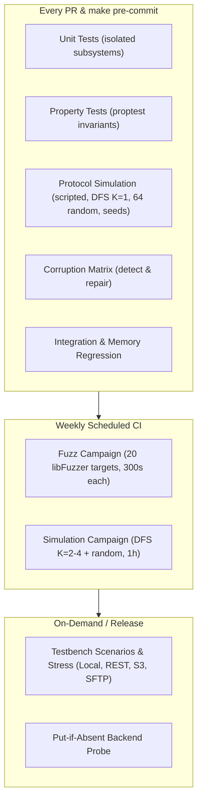
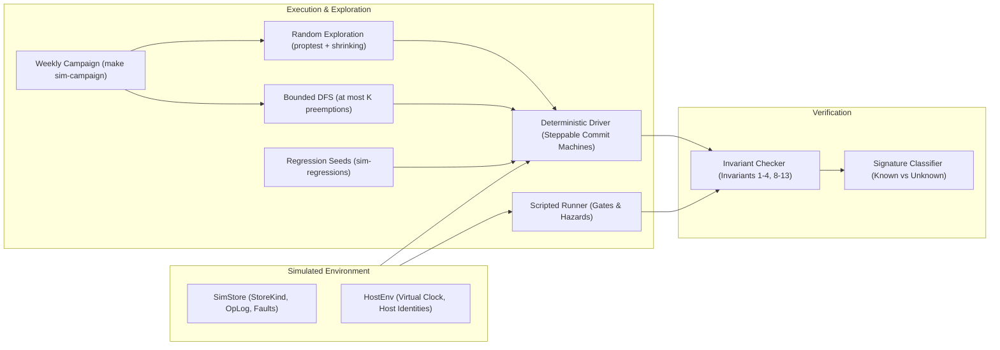

A single bug in serialization, encryption, or reference tracking can silently destroy data. vykar's testing strategy uses layered tiers so that each tier catches a different class of defect — from logic errors in individual functions through multi-client protocol races and multi-backend stress workflows.

| Tier | Primary defect class | How to run | Cadence |
|---|---|---|---|
| [Unit Tests](#unit-tests) | Logic errors in isolated subsystems | `make pre-commit` / `cargo test` | Every PR |
| [Property Tests](#property-tests) | Boundary, serde, crypto, and index edge cases | `make pre-commit` / `cargo test` | Every PR |
| [Protocol Simulation](#protocol-simulation) | Multi-client concurrency, crash, and fault bugs | `make pre-commit` (fast), `make sim-campaign` (long) | Every PR & weekly CI |
| [Corruption Matrix](#corruption-matrix-tests) | On-disk corruption detection and repair | `make pre-commit` / `cargo test` | Every PR |
| [Fuzz Tests](#fuzz-tests) | Crashes, hangs, and OOM on untrusted bytes | `make fuzz-check` / `make fuzz` | Weekly CI (nightly) |
| [Integration Tests](#integration-tests) | End-to-end command, CLI, and RSS regressions | `make pre-commit` / `cargo test` | Every PR |
| [Scenario & Stress Tests](#scenario--stress-tests) | Multi-backend drift and long-cycle accumulation | `scripts/testbench` (`uv run ...`) | On-demand / release |

## Unit Tests

Unit tests in `vykar-core` cover each subsystem in isolation. Fast feedback (seconds), deterministic, no I/O side effects beyond tempdirs.

| Category | Focus |
|----------|-------|
| Format & serialization | RepoObj envelope round-trips, pack header parsing, item serde, frozen format fixtures (`tests/fixtures/`) |
| Chunk index | Add/remove, the mapped base table, applied segments and edits |
| Sessions | Marker registration and refresh, stale reaping, exclusive sessions and their write check, the v2/v3 upgrade's legacy lock key |
| Prune & retention | Policy evaluation (keep-last, keep-daily/weekly/monthly/yearly) |
| Repair | Plan-only vs apply modes, post-repair cleanliness assertions |
| Compact | Pack analysis, repack candidate selection, crash-safety ordering |
| Snapshot lifecycle | Manifest operations, delete ordering, multi-source configs |

## Property Tests

8 `proptest` blocks catch edge cases that hand-written examples miss — off-by-one chunk boundaries, serde field-order regressions, AEAD context-binding failures, and segmented index consistency across folds and sweeps. Regressions are reproducible via proptest's seed persistence.

| Property | Cases | Invariant verified |
|---|:-:|---|
| Encryption round-trip | 1,000 | `decrypt(encrypt(P, ctx), ctx) == P` for both AES-256-GCM and ChaCha20-Poly1305; wrong-context decryption fails |
| Item serde round-trip | 1,000 | Arbitrary files, directories, and symlinks survive msgpack positional encode/decode |
| Legacy index blob round-trip | 1,000 | Legacy refcounts, pack offsets, and generation numbers survive encode/decode (the v2/v3 wire format) |
| Chunker completeness & determinism | 1,000 | No gaps or overlaps; same input always produces same boundaries; size bounds respected; stream and slice APIs agree |
| Compression round-trip | 1,000 | `decompress(compress(codec, data)) == data` for all codecs (None, LZ4, ZSTD); output within size bound |
| IndexDelta state machine | 500 | Additions applied once; a file's reuse stage restores the reused set exactly |
| Backup-restore round-trip | 16 | Arbitrary nested file trees (empty, small, large files; nested directories) restore byte-identical |
| Segmented index consistency | 16 | Random store/remove/relocate/sweep/fold/backup/age sequences match a cold reload from disk |

## Protocol Simulation

The protocol simulator (`vykar-core/src/sim`, compiled for tests and with the `sim` feature) runs multiple logical clients running real vykar commands over a shared, deterministic in-memory store (`SimStore`). Clients run on virtual time with independent host identities (`HostEnv`) and per-client cache directories, while `SimStore` logs every operation, maintains its own server clock for object `mtime`s, and injects faults. Every run uses an encrypted repository (AES-256-GCM with a fast KDF so object names stay fresh without slowing down searches).

### Store Models & Faults

`SimStore` models five backend behaviors (`StoreKind`) via vykar-storage's `Verifier` check and conditional-write semantics:

| `StoreKind` | Put-if-absent | Plain head overwrite | Real-world equivalent |
|---|---|---|---|
| `Plain` | Unsupported | Allowed | S3 without conditional writes, SFTP without hardlink; single-writer mode |
| `Conditional` | Honoured | Refused (409) | `vykar-server` (multi-writer mode) |
| `ConditionalOverwrite` | Honoured | Allowed (renews `mtime`) | Local, OpenSSH SFTP, AWS S3 (multi-writer mode) |
| `Ignoring` | Overwrites & returns yes | Allowed | Garage (init check detects & falls back to single-writer) |
| `RacyRelease` | Passes sequential check, racy on late landing | Allowed | IDrive e2 (known hazard `H-racy`) |

Injected fault actions (`FaultAction`):

| Fault | Behavior |
|---|---|
| `Fail` | Operation is not applied and returns `Err` |
| `FailApplied` | Write is applied to the store, then returns `Err` ("outcome unknown") |
| `Delay` | Returns `Err` now; effect is parked and applied at a later scheduler step |
| `Duplicate` | Applied now (`Ok`) and parked to land a second time later |
| `Crash` | Client's future operations fail without effect and its PID becomes dead |

### Checked Invariants

After every run, the checker evaluates the store and operation log against the protocol invariants and classifies any violation into a known damage `Signature` (any `Signature::Unknown`, or a closed signature on a multi-writer store, fails the test):

| # | Invariant | What it verifies | Scope |
|---|---|---|---|
| 1 | `CommittedSnapshotsRestore` | Every listed snapshot decodes and restores byte-for-byte against its recorded source tree | All stores |
| 2 | `AcknowledgedCommitsDurable` | Every backup returning `Ok` remains present unless deleted or pruned | All stores |
| 3 | `NoSilentRemoval` | Snapshots disappear only via a `delete` or `prune` that targeted them | All stores |
| 4 | `IndexIntegrity` | Head decodes, all live `index.d/` objects exist with expected sizes, and no absent packs are named | Latest head (`Plain`); latest − 16 retained heads (multi-writer) |
| 8 | `AllowedErrors` | Every failed run ends with an expected typed error (`Locked`, `ActiveSessions`, `StaleChunksDuringCommit`, injected storage error, etc.) | All stores |
| 9 | `NoPermanentWedge` | After markers age out, a fresh `backup` and `compact` both succeed | Scripted checks |
| 10 | `OrphanGrace` | No pack (except repack sources) is deleted younger than 12 h or while its writer's session marker is live | All stores |
| 11 | `MarkerGapCommit` | No backup publishes a head after a marker reap or gap with packs past the commit age limit | All stores |
| 12 | `HeadsImmutable` | No stored head is replaced by different bytes, and each retained head carries forward its predecessor's live objects (repair/upgrade/init exempt) | Multi-writer stores |
| 13 | `ExclusiveSessions` | Exclusive runs write only while holding the sole entered exclusive session; no other writer mutates protected keys while an exclusive hold is active | All stores |

### Test Modes & Schedule

The first four modes run on every `make pre-commit` and PR CI; the long campaign runs weekly (`.github/workflows/sim.yml`) or on demand via `make sim-campaign`.

| Mode | Module | What it explores |
|---|---|---|
| Scripted & gated scenarios | `sim::hazards`, `sim::interleavings`, `tests::single_writer`, `tests::multi_writer`, `tests::maintenance_sessions`, `tests::sim_exclusion` | Targeted pause points (`GateRule`) on protocol keys, clock steps, and known hazard reproductions |
| Random exploration | `tests::sim_explore` | Proptest-generated cases (clients, commands, faults, crashes, time jumps, choice sequences) with automatic shrinking; fixed seed by default |
| Bounded exhaustive DFS | `sim::explore`, `tests::sim_exhaustive` | Every schedule of small scenarios up to `K` preemptions (`K = 1` for driver scenarios; `K = 2–3` for gate-stepped exclusive, single-writer, and suspend-rule races) |
| Regression seeds | `crates/vykar-core/tests/sim-regressions/*.json`, `tests::sim_regressions` | Committed cases asserting exact signatures, non-drifted decisions, run outcomes, and multi-hour client clock-skew invariance |
| Long campaign | `tests::sim_campaign` | Wider DFS (`K = 2–4`, fault placements, 3 clients, stepped compacts) for 60% of the budget, then clock-seeded random proptest rounds for 40% across all cores |

- **Driver cases** fork a template containing a control snapshot `c0` aged > 12 h (so its segment is foldable and sweepable; `Template::young` keeps it young). Backups step through commit protection (`list-writers`, `mark-committing`, `list-exclusive`, suspend rule) and the `BackupCommit` state machine; `compact` runs whole or gate-stepped per protocol-key operation (`sessions/`, `index.h/`, `index.d/`, `snapshots/`, `packmaps/`, pack deletes, and first pack-shard listing) while its heartbeat runs in the background.
- **Known residual hazards** are explicitly tracked as expected signatures so protocol changes cannot silently regress them: `H3` / `H3-compact` (late head overwrite on `Plain`, closed on conditional stores), `H1-late-clone` (same-hostname late-booting clone reaping an exclusive session), `H-committing-reaped` (committing marker reaped by age during a compact sweep), `H-late-head-single` (single-writer head PUT stalled 46 min past `EXISTS` across a compact or mode switch; repairable via `check --repair`), and `H-racy` (racy conditional create on `RacyRelease`).

### Running & Debugging

| Command / Variable | Purpose |
|---|---|
| `make sim-campaign` | Run the long campaign (`SIM_SECONDS=3600`, `SIM_TRACE_DIR=target/sim-campaign`, `VYKAR_SIM_JOBS`) |
| `VYKAR_SIM_REPLAY=<trace>` | Replay a failing trace via `tests::sim_driver::replay_from_env` |
| `VYKAR_SIM_PROMOTE=<trace>` | Format a trace as a regression seed JSON via `tests::sim_regressions::promote_from_env` |
| `VYKAR_SIM_SEED` / `VYKAR_SIM_CASES` | Override the default seed or case count in `tests::sim_explore` |
| `VYKAR_SIM_MEASURE=1` | Print per-case latency and replay stats via `tests::sim_explore::measure` |

## Corruption Matrix Tests

9 corruption types tested against detection, repair, and resilience paths using `test-case` parametrization. Each corruption is applied to a known-good repository, then `check`, `repair`, and follow-up `backup` are run with assertions on the outcome.

| Corruption | `check` detects | `repair` fixes | Backup succeeds after |
|------------|:-:|:-:|:-:|
| BitFlipInPack | yes (Ok + errors) | yes | yes |
| BitFlipInBlob | yes (Ok + errors) | yes | yes |
| TruncatePack | yes (Ok + errors) | yes | yes |
| ZeroFillRegion | yes (Ok + errors) | yes | yes |
| DeletePack | yes (Ok + errors) | yes | yes |
| CorruptSnapshot | yes (Ok + errors) | yes | yes |
| DeleteIndex | yes (Ok + errors) | — | — |
| TruncateIndex | yes (Err) | not possible (Err) | — |
| CorruptConfig | yes (Err) | not possible (Err) | — |

*Legend: `yes (Ok + errors)` means the repository opens and `check` reports integrity errors; `yes (Err)` means opening or decoding fails outright; `—` means not applicable.*

## Fuzz Tests

21 coverage-guided fuzz targets via `cargo-fuzz` (libFuzzer). Each target feeds adversarial byte sequences into a parser, deserializer, or decrypt path, mutating from committed corpus seeds toward crashes, hangs, and OOM. Complements proptest by running for hours/days and optimizing for code-path coverage rather than round-trip invariants.

| Layer | Target | Function under test | Risk surface |
|---|---|---|---|
| Packs & compression | `fuzz_pack_scan` | `scan_pack_blobs_bytes` | Integer overflow in length fields, truncated frames |
| Packs & compression | `fuzz_pack_trailer` | `PackTrailer::decode_body`, `parse_footer`, `open_trailer_frame`, `read_trailer_from_pack_bytes` (deterministic AEAD) | Lying footer/frame lengths, entry counts, overlapping offsets, non-canonical bodies |
| Packs & compression | `fuzz_pack_map` | `PackMap::decode_body` | Lying pack/entry counts, unsorted or overlapping entries, oversized maps, non-canonical bodies |
| Packs & compression | `fuzz_decompress` | `decompress`, `decompress_metadata`, streaming zstd metadata reader | Decompression bombs, corrupt LZ4/Zstd frames, streaming vs buffered disagreement |
| Index & metadata | `fuzz_index_head` | `IndexHead::decode` | Head framing, round-trip |
| Index & metadata | `fuzz_index_base_v2` | `validate_base_body`, `BaseWriter` | Fixed-width base body: counts vs length, sort order, pack slots, unreferenced packs, re-encode identity |
| Index & metadata | `fuzz_index_segment_v2` | `SegmentBody::decode` | Keyed segment: header counts before allocation, sections, kinds, pack table, re-encode identity |
| Index & metadata | `fuzz_sweep_record` | `SweepRecord::decode`, `encode` | Lying lengths and counts in sweep records, re-encode identity |
| Index & metadata | `fuzz_index_object` | Store-level segment/base decode of `index.d/` objects (deterministic AEAD) | Name check, zstd streaming, decode bounds, damage classification |
| Index & metadata | `fuzz_msgpack_index_blob` | `from_slice::<IndexBlob>` | Massive chunk index allocation |
| Index & metadata | `fuzz_metadata_msgpack` | `decode_metadata_msgpack::<IndexBlob>` | Streaming msgpack decode disagreeing with buffered path |
| Index & metadata | `fuzz_file_cache_decode` | `FileCache::decode_from_plaintext` (+ skipping variant) | Manual msgpack marker parsing, allocation cap, legacy fallback |
| Snapshots & restore | `fuzz_msgpack_snapshot_meta` | `from_slice::<SnapshotMeta>` | Large collection size declarations |
| Snapshots & restore | `fuzz_listing_ext` | `decode_ext`, `check_ext`, the listing writer's index builder | Repository-controlled `ext`: lying counts and lengths, unknown versions and orders, invalid segment tables; `check` agreeing with decode; the writer's index always passing `check` |
| Snapshots & restore | `fuzz_item_stream` | `for_each_decoded_item` | Streaming framing via `Deserializer::position()`, EOF handling |
| Snapshots & restore | `fuzz_restore_paths` | `sanitize_item_into`, symlink target audit over an item stream | Path traversal on restore, raw non-UTF-8 names, against an independent model |
| Crypto, config & wire | `fuzz_unpack_object` | `unpack_object`, `unpack_object_expect_with_context` (+ in-place) | AEAD envelope parse, nonce extraction, context/AAD wiring, tag authentication |
| Crypto, config & wire | `fuzz_repo_config` | `RepoConfig::decode` (map & positional), `DecodedConfig::validate`, chunker gate & both chunkers | Unauthenticated `config`: unknown versions, pack-size limits, FastCDC params, resumable vs fastcdc disagreement |
| Crypto, config & wire | `fuzz_key_blob` | `inspect_key_blob` | Unauthenticated KDF parameters out of bounds (KDF never runs) |
| Crypto, config & wire | `fuzz_pending_journal` | `decode_pending_journal`, recovery seeding | `sessions/<id>.index` from other clients, versioned and legacy shapes |
| Crypto, config & wire | `fuzz_protocol_keys` | Storage-key validators, pack-key temp paths, `parse_byte_range`, `validate_pack_header` | Server keys escaping repository root, `Range` header parsing |

Corpus seeds are committed and deterministic. Weekly CI (`.github/workflows/fuzz.yml`) runs every target for 300 seconds on nightly. Locally: `make fuzz` (60s per target), `make fuzz-check` (replay corpus without new fuzzing), and `make fuzz-list`.

## Integration Tests

| Level | Location | What it verifies |
|---|---|---|
| In-process | `vykar-core/tests/` | Full `init → backup → list → restore → delete → prune → compact → check` cycles via the `commands` API: encryption modes, multi-source configs, lifecycle transitions, concurrent sessions, and crash-recovery journals |
| CLI-level | `vykar-cli/tests/` | Spawns the `vykar` binary and asserts exit codes, stdout/stderr, config parsing, multi-repo selection, and restored file contents |
| Memory regression | `vykar-core/tests/` | Backup and restore of a controlled corpus with RSS sampling; asserts peak RSS stays below fixed caps (512 MiB backup, 384 MiB restore) |

## Scenario & Stress Tests

The YAML-driven testbench (`scripts/testbench`) runs multi-phase workflows against all four real storage backends (**local**, **REST**, **S3/MinIO**, and **SFTP**) so storage-abstraction bugs cannot hide behind the local filesystem.

| Mode | Workflow & coverage |
|---|---|
| Scenarios | Configurable corpus (mixed file types, up to 2 GB) through `init → backup → verify (restore + diff) → check → churn → prune → compact → cleanup`. Churn applies configurable adds, deletes, and edits with growth caps to verify incremental backup and deduplication |
| Stress mode | Up to 1,000 iterations of `backup → list → restore → verify → delete → compact → prune` with periodic `check` (and optional `check --verify-data`). Catches state-accumulation bugs (leaking index entries, index bloat, stale caches) |

### Put-if-Absent Probe

`uv run probe` (in `scripts/testbench`) builds the `put_if_absent_probe` example and tests conditional-create semantics against loopback targets (local, `sftp-exec`, S3/MinIO, and SFTP with `--sftp-url`; non-loopback S3/SFTP requires `--allow-remote`), saving per-target JSON reports and a Markdown summary table under `<runtime_root>/probe-runs`.
