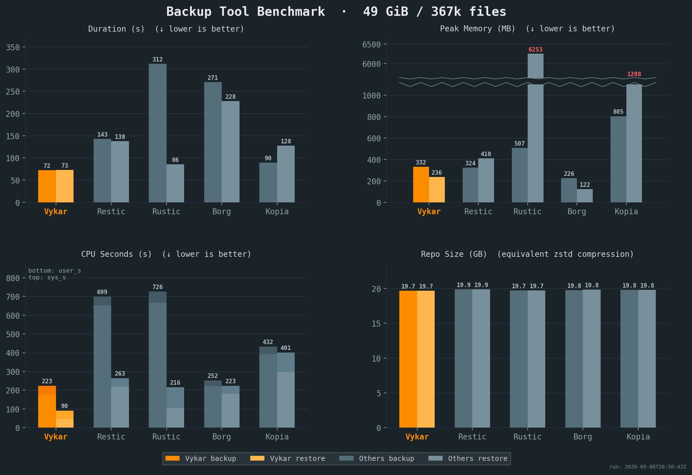

Vykar is a fast, encrypted, deduplicated backup tool written in Rust. It's centered around a simple YAML config format and includes a desktop GUI and WebDAV server to browse snapshots. More about [design goals](goals.md).

⚠️ **Do not use for production backups yet, but do test it along other backup tools.**

## Features

- **Fast** -- fastest backup and restore of the tools we benchmarked, at the lowest CPU cost
- **Encrypted by default** -- client-side AES-256-GCM or ChaCha20-Poly1305; the storage never sees your keys
- **Deduplicated and compressed** -- content-defined chunking with LZ4 or Zstandard keeps incremental backups small
- **One YAML file** -- repositories, sources, retention, excludes, and schedule, with hooks for monitoring and command dumps for databases
- **Storage backends** -- local filesystem, S3 (any compatible provider), SFTP, or the dedicated REST server
- **Verifiable** -- full or sampled integrity checks, repair, a redundant repository key, and restore that salvages around damage
- **Append-only storage** -- REST server with append-only enforcement, quotas, and server-side compaction, or S3 Object Lock
- **Find and restore** -- search files across snapshots, browse via built-in WebDAV and web UI, or use the desktop GUI
- **Runs unattended** -- built-in scheduler (interval or cron) with a status page, resource limits, and concurrent backups from multiple machines
- **Cross-platform** -- Linux, macOS, and Windows; single binary, Docker image, Ansible role


## Get Started

```bash
curl -fsSL https://vykar.borgbase.com/install.sh | sh
```

Then follow the **[Quick Start guide](quickstart.md)** to create a config and run your first backup in under 5 minutes. Other install methods (pre-built binaries, Docker, Ansible) are covered in [Install](install.md).

Once you're up and running:

- [Configure storage backends](backends.md) -- connect S3, SFTP, or the REST server
- [Set up hooks and command dumps](configuration.md#hooks) -- run scripts before/after backups, capture database dumps
- [Browse and restore snapshots](restore.md) -- list, search, and restore files
- [Schedule backups](daemon.md) -- run unattended with systemd, launchd, or Docker
- [Maintain your repository](maintenance.md) -- prune old snapshots, check integrity, compact packs
- [Explore backup recipes](recipes.md) -- common patterns for databases, containers, and filesystems


## Benchmarks

Vykar is the fastest tool for both backup and restore, with the lowest CPU cost, while maintaining competitive memory usage.

[](images/benchmark.summary.png)

<small>All benchmarks were run 5x on the same idle Intel i7-6700 CPU @ 3.40GHz machine with 2x Samsung PM981 NVMe drives, with results averaged across all runs. Compression settings were chosen to keep resulting repository sizes comparable. The sample corpus is a mix of small and large files with varying compressibility. See [detailed results](images/summary.json) or our [benchmark script](https://github.com/borgbase/vykar/tree/main/scripts) for full details.</small>


## How it compares

Vykar builds on ideas from Borg, Borgmatic, Restic, and Rustic. Where those tools rely on wrappers for configuration, scheduling, and hooks, Vykar ships them in one binary, alongside AEAD encryption with keyed content addressing and a server that enforces append-only access. See the [comparison with Borg, Restic, Rustic, and Kopia](comparison.md) for a feature-by-feature breakdown.
